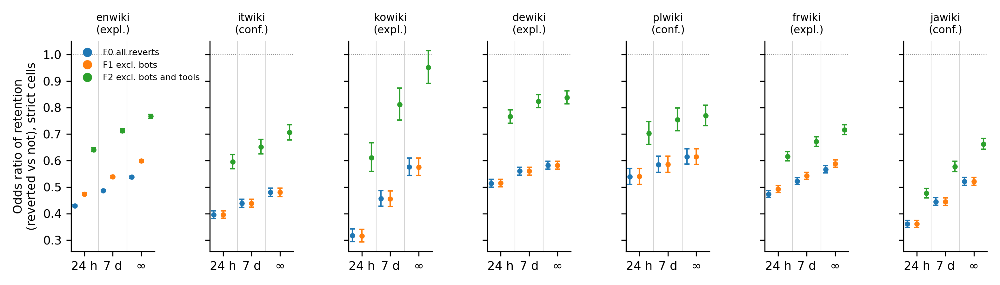
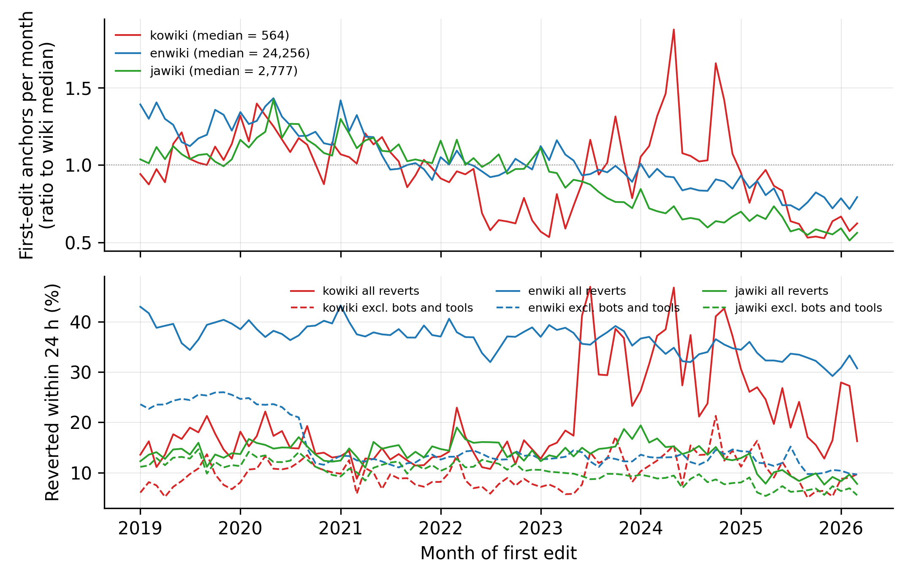

# Supplementary Material

Which reverts count? Reverter populations, attribution rules and observation windows behind a Wikipedia indicator of information quality work

Tables are generated by `03_pipeline/17_supplement_v11.py` from the aggregates in `04_output/` of the public repository. Editions marked * were held out for the registered tests. Dump rule: the history dumps' unbounded identity-revert rule. Radius rule: the same hashes with the 15-revision radius of the mwreverts library. Except for Table S7 and the registered rows of Table S8, all analyses are exploratory. Shares based on fewer than 50 edits are not shown; counts are.

## S1. Registration, sequence of events and deviations

The registered document (Zenodo, https://doi.org/10.5281/zenodo.23720117; commit 7fcff3d, 28 October 2026, 04:39 UTC) fixed the cohort, the three attribution rules, the reverter filters, the windows, four hypotheses with thresholds, and the code. The sequence was as follows.

1. English, Korean, French and German were analyzed without restriction. The thresholds of H1 to H4 were chosen from these four editions.
2. A batch driver downloaded and processed Japanese, Polish and Italian on 27 and 28 October 2026. The driver wrote its output files to disk and printed progress lines; the summary lines for H1 and H2 were among the lines printed to the terminal log. I did not open the output files or read those lines before the registered commit. This is recorded in the work log and by file and commit timestamps, and it cannot be verified by a reader.
3. The registration was committed and deposited. The results for the held-out editions were committed 11 minutes later, which reflects that they had already been computed.
4. Section 1 of the registered text says that the held-out editions "had not been downloaded". That sentence is wrong (deviation 4 below); the header of the same document states the actual sequence.

The registration is therefore a hold-out replication with thresholds fixed in advance on other editions. It protects against choosing thresholds after seeing the held-out results only to the extent that the reader accepts step 2.

Decisions. H1, H2 and H4 are tested with one-sided 95 percent bootstrap bounds (editors resampled), Holm-adjusted over the three tests within an edition. With three tests the Holm procedure compares the smallest p value with .05/3, the next with .05/2 and the largest with .05. All supported decisions in Table S7 have bootstrap p values below .0005 (no replicate on the wrong side of the threshold in 2,000), so the adjustment changes none; the one unsupported decision (H4, Polish) is unsupported without adjustment. H3 is a descriptive criterion without a test.

Deviations (full log: `04_logs/DEVIATION_LOG.md` in the repository).

| # | Registered | Done | Effect |
|---|---|---|---|
| 1 | Mixed model as an exploratory complement | Not reported; a per-edition logistic model was run and withdrawn as uninformative | None |
| 2 | Robustness list (12 h, 48 h, 30 d windows; five anchors; all registered accounts; historical-only bot flag; undo as a tool; 5-second latency; leave-one-edition-out; by year; Korean former anchor definition) | All run; reported in Table S8. Added: 180-day window, current-only bot flag, exclusion of unregistered reverters, cohort from 2021, Korean surge split | None |
| 3 | H3, second clause | Rejected in all three editions and reported as rejected; mechanism examined afterwards (exploratory) | Decision unchanged |
| 4 | Text: held-out editions "had not been downloaded" | They had been downloaded and processed; outputs unopened (see above) | Weakens the evidential status of the tests |
| 5 | 2,000 bootstrap replicates | Registered code used 2,000 for H1 and H2, 500 for H4; H4 recomputed with 2,000 | No decision changes |
| 6 | Negative control; simulation | Withdrawn: the control cannot fail and the simulation restates a closed form. Outputs remain in the repository | None |
| 7 | Interpretation of H2 as human substitution for automation | Withdrawn. Follow-up reverts redefined as reverts by a third party; radius rule, reverter classes, retention by class added (exploratory) | Decisions unchanged; interpretation changed |
| 8 | Tag analyses for first edits from August 2020 | Coverage analyses restricted to first edits from October 2020 (tag enabled on all wikis 15 September 2020); H3 reported with the registered window | First clause unaffected. Second clause: rejected in all three editions with the registered window; with the October window it would be met in Japanese (Table S10) |
| 9 | "Successor filters" F0, F1, F2 | Reverter classes; tool exclusion presented as hypothetical | None |
| 10 | Release of editor-level derived data with randomized identifiers | Not released: one first edit per editor with its timestamp and edition re-identifies the account from the public history whatever the identifier. Code regenerates the files | Reduces direct reusability; aggregates and code are public |
| 11 | Minimum cell size 50 | Applied in all tables of manuscript v0.9; an earlier public draft showed some smaller cells | None |
| 12 | Holm adjustment "across H1 to H4" | Applied over H1, H2 and H4; H3 has no test statistic. H1: all three R values are at or above the registered .75, read as registered ("most of the filter effect persists"). H4: registered as a point ratio of at least 1.5 with a lower bound above 1.0; reported so | None |
| 13 | Model used for coding assistance | The review coding by a language model and its checks are described in the manuscript; an internal pre-submission check of drafts by language-model reviewers led to several of the changes above and is recorded in the work log | None |

## Table S1. Survey of reporting practice: how 41 studies using a revert-based measure operationalize it

One row per study. The coding table with the passage supporting each code, URLs, evidence levels, the author's check of each study and the earlier model-to-model comparison is `04_output/practice_review.csv` and the files beside it. Search record: `04_output/practice_review_LIS_search.md`.

**Inclusion.** A study is tallied if a revert measure computed from revision histories is an outcome, an exposure, a label or a conflict indicator in its main analysis, or is itself the object of description. Studies in which reverting is one category in a coding of editing activity, or enters only as a control variable, are listed below and not tallied, because radius, window and reverter population are not choices their authors faced in the same form. This criterion was narrowed after a first version of the review had tallied those four studies; the narrowing lowers the counts of unstated choices.

**Flow of studies.** Stage 1 (citation networks of the methodological works and keyword searches; the number of records screened was not logged): 36 eligible studies, of which 34 were tallied and 2 are listed but not tallied because the full text could not be read. Stage 2a (OpenAlex, information science and neighboring journals): 911 records from six queries and 258 from a title search (1,169 in all); 79 assessed for eligibility; 54 candidates could at first be read only as abstracts or not at all. Stage 2b (12 November 2026, publisher full texts through institutional access and open-access copies): 45 of those 54 candidates were read in full (JASIST 9, Journal of Information Science 3, Information Processing & Management 3, Library & Information Science Research 1, Journal of Documentation 2, Online Information Review 5, New Media & Society 5, Social Science Computer Review 2, Information, Communication & Society 3, Journal of Computer-Mediated Communication 2, Computers in Human Behavior 1, First Monday 5, PLoS ONE 3, Royal Society Open Science 1), and the full text of 242 JASIST and ASIS&T proceedings articles returned by a search for Wikipedia and revert terms was screened by term counts, with every article mentioning Wikipedia at least eight times and reverting at least twice inspected. Retrieval and term-count screening in both stages were run through a language-model tool and a scripted browser session; eligibility was decided on the retrieved text. Stage 2 yielded 12 studies with a revert-based quantity: 7 are tallied, 4 are listed but not tallied under the inclusion criterion above, and 1 (an earlier conference report of the same sample as Stvilia et al., 2007) is listed but not tallied. The other candidates read contain no revert-based measure or use reverts only as background, as a described example, as one hand-coded category on policy pages without a reported quantity, or as a sample filter. Eleven texts could not be read: the two eligible studies of stage 1 named above, and nine candidates of stage 2 (four PLoS ONE articles and one Physical Review E article that could not be retrieved by the tools used, one New Media & Society article whose file could not be parsed, and three ACM proceedings papers). Total tallied: 41. The codes of one tallied study (Priedhorsky et al., 2007) were proposed from an extract made in the first pass, because no copy could be retrieved for the model's second pass (recorded in `notes`).

**Reading and coding.** A language model (Claude, Anthropic; model versions and dates in `04_logs/AI_ASSISTANCE_LOG.md`) extracted candidate passages and proposed codes, instructed to code a choice as stated only on finding an establishing passage and to record it. The author checked the codes of every tallied study against the source text and, where available, released code or author copies (column `author_check`); for four studies the check was assisted by a second language model (ChatGPT, OpenAI). The `notes` and `evidence_level` columns record where a code rests on an extracted passage and not on a re-read of the full text. No second human coder took part, and no reliability coefficient is claimed for the final codes. For the record of the process: before the coding rules were final, a separate model instance coded a random 13 studies blind and agreed with the first pass on 72 of 78 judgments (kappa 1.00 for the three reverter choices, .78 for detection, .61 for window, .59 for sensitivity analysis); that comparison is between two runs of the same model family on superseded codes and says nothing about the final table. The construct codes were assigned by the author and were not part of it.

**Tallies.** The article reports one tally (its Table 2): a choice counts as stated only if the article or its supplement states it for the main analysis. A rule stated only for a sub-analysis is not the study's rule. A detection principle named in the text counts as stated even if its implementation is deferred to a citation (Halfaker et al., 2013); detection given only by citation does not (Lam et al., 2011). The observation window is tallied in the article only for studies whose revert measure is an edit-level outcome, exposure or label, because for conflict measures computed over whole article histories and for descriptive studies it does not apply in the same form. For information, the table below also shows in how many studies an unstated choice can be recovered from a cited procedure, a named library default, the named data source, released code or the design of the measure (the wording "eventually reverted"; a measure built on mutual reverts between two editors; the removal of bot accounts or bot-authored edits from the sample, which addresses bots without mentioning reverts made by bots). These entries were derived from the notes of the author's check and confirmed by the author; they are not used in the article, and the whole-history design is marked only where the study states it.

| Choice                                                           |   Stated in the article |   Not stated, but recoverable |   Neither |
|:-----------------------------------------------------------------|------------------------:|------------------------------:|----------:|
| Detection rule                                                   |                      29 |                             3 |         9 |
| Search radius, in the 22 studies using an identity rule          |                       1 |                             4 |        17 |
| Reverts made by bots                                             |                       9 |                            10 |        22 |
| Reverts made with one-click tools                                |                       5 |                             0 |        36 |
| Self-reverts                                                     |                      16 |                             5 |        20 |
| Observation window, all studies                                  |                       5 |                             8 |        28 |
| Observation window, in the 21 studies with an edit-level measure |                       5 |                             6 |        10 |

Studies that state nothing on bots, tools or self-reverts: 18 (9 if recoverable choices are counted). Some sensitivity analysis over a revert choice: 8; over the reverter population: 0.

**By construct (constructs assigned by the author; four studies that evaluate detection methods or report descriptive rates are under other).**

|                  |   Studies |   No statement on bot, tool or self-reverts |   No window stated |
|:-----------------|----------:|--------------------------------------------:|-------------------:|
| quality judgment |        11 |                                           6 |                  8 |
| conflict         |        15 |                                           6 |                 15 |
| rejection        |         9 |                                           3 |                  7 |
| effort           |         2 |                                           0 |                  2 |
| other            |         4 |                                           3 |                  4 |
| all              |        41 |                                          18 |                 36 |

**Codes.**

| short_cite                   | venue                                                                  | editions                        | construct        | detection                                        | radius_or_rule                   | bot_reverts                  | tool_reverts        | self_reverts            | window                             | sensitivity_over_revert_choices             | source                                   |
|:-----------------------------|:-----------------------------------------------------------------------|:--------------------------------|:-----------------|:-------------------------------------------------|:---------------------------------|:-----------------------------|:--------------------|:------------------------|:-----------------------------------|:--------------------------------------------|:-----------------------------------------|
| Kittur et al., 2007          | CHI 2007                                                               | en only                         | conflict         | identity + summary matching                      | none stated                      | not stated                   | not stated          | excluded                | not stated                         | partial                                     | citation-network search                  |
| Priedhorsky et al., 2007     | GROUP '07                                                              | en only                         | quality judgment | identity + summary matching                      | 15 revisions                     | counted explicitly           | counted explicitly  | not stated              | not stated                         | partial                                     | citation-network search                  |
| Halfaker et al., 2009        | WikiSym '09                                                            | en only                         | rejection        | identity principle (implementation not reported) | none stated                      | not stated                   | not stated          | excluded                | not stated                         | yes: vandalism reverts removed              | citation-network search                  |
| Suh et al., 2009             | WikiSym '09                                                            | en only                         | rejection        | summary matching only                            | none stated                      | not stated                   | not stated          | not stated              | not stated                         | no                                          | citation-network search                  |
| Ekstrand & Riedl, 2009       | WikiSym '09                                                            | en only                         | other            | identity hash                                    | none stated                      | not stated                   | not stated          | not stated              | not stated                         | no                                          | citation-network search                  |
| West et al., 2010            | EUROSEC '10                                                            | en only                         | quality judgment | rollback or undo actions only                    | none stated                      | excluded                     | counted explicitly  | not stated              | not stated                         | no                                          | citation-network search                  |
| Halfaker et al., 2011a       | WikiSym '11                                                            | en only                         | rejection        | not stated                                       | none stated                      | not stated                   | not stated          | excluded                | not stated                         | no                                          | citation-network search                  |
| Halfaker et al., 2011b       | WikiSym '11                                                            | en only                         | rejection        | rollback or undo actions only                    | none stated                      | not stated                   | not stated          | not stated              | not stated                         | no                                          | citation-network search                  |
| Lam et al., 2011             | WikiSym '11                                                            | en only                         | rejection        | not stated                                       | none stated                      | not stated                   | not stated          | not stated              | time-bounded: 7 days               | no                                          | citation-network search                  |
| Sumi et al., 2011            | IEEE PASSAT/SocialCom 2011                                             | multilingual                    | conflict         | identity principle (implementation not reported) | none stated                      | not stated                   | not stated          | excluded                | not stated                         | partial                                     | citation-network search                  |
| Yasseri et al., 2012         | PLoS ONE                                                               | en only                         | conflict         | identity hash                                    | none stated                      | not stated                   | not stated          | excluded                | not stated                         | no                                          | citation-network search                  |
| Flöck et al., 2012           | HT '12                                                                 | en only                         | other            | diff-based                                       | 20 revisions (also 50, 100)      | not stated                   | not stated          | not stated              | not stated                         | yes: scan range 20/50/100; diff vs identity | citation-network search                  |
| Halfaker et al., 2013        | American Behavioral Scientist                                          | en only                         | rejection        | identity principle (implementation not reported) | none stated                      | modelled separately or focal | modelled separately | excluded (definitional) | not stated                         | no                                          | citation-network search                  |
| Geiger & Halfaker, 2013      | WikiSym '13                                                            | en only                         | effort           | not stated                                       | none stated                      | modelled separately or focal | modelled separately | not stated              | not stated                         | no                                          | citation-network search                  |
| Yasseri et al., 2014         | Global Wikipedia (edited book)                                         | multilingual                    | conflict         | identity hash                                    | none stated                      | not stated                   | not stated          | excluded (definitional) | not stated                         | no                                          | citation-network search                  |
| Tsvetkova et al., 2016       | Scientific Reports                                                     | multilingual                    | conflict         | identity hash                                    | none stated                      | excluded                     | not stated          | excluded                | not stated                         | no                                          | citation-network search                  |
| Tsvetkova et al., 2017       | PLoS ONE                                                               | multilingual                    | conflict         | identity hash                                    | none stated                      | modelled separately or focal | not stated          | excluded                | not stated                         | no                                          | citation-network search                  |
| Geiger & Halfaker, 2017      | PACM HCI (CSCW)                                                        | multilingual                    | conflict         | identity hash                                    | mwreverts default (not reported) | modelled separately or focal | not stated          | not stated              | not stated                         | partial                                     | citation-network search                  |
| TeBlunthuis et al., 2018     | CHI 2018                                                               | Wikia                           | rejection        | not stated                                       | none stated                      | modelled separately or focal | not stated          | not stated              | not stated                         | no                                          | citation-network search                  |
| DeDeo, 2013                  | PLoS ONE                                                               | en only                         | conflict         | identity hash                                    | none stated                      | not stated                   | not stated          | excluded                | not stated                         | partial                                     | citation-network search                  |
| Zhang et al., 2019           | ICWSM 2019                                                             | en only                         | rejection        | not stated                                       | none stated                      | not stated                   | not stated          | excluded (definitional) | not stated                         | no                                          | citation-network search                  |
| Tran et al., 2020            | IEEE S&P 2020                                                          | en only                         | quality judgment | identity hash                                    | mwreverts default (not reported) | not stated                   | not stated          | excluded                | not stated                         | partial                                     | citation-network search                  |
| Hill & Shaw, 2021            | Communication Research                                                 | Wikia                           | quality judgment | identity hash                                    | mwreverts default (not reported) | not stated                   | not stated          | excluded (definitional) | not stated                         | no                                          | citation-network search                  |
| Chhabra et al., 2020         | OpenSym 2020                                                           | en only                         | conflict         | identity hash                                    | none stated                      | not stated                   | not stated          | not stated              | not stated                         | no                                          | citation-network search                  |
| TeBlunthuis et al., 2021     | PACM HCI (CSCW)                                                        | multilingual                    | rejection        | identity hash                                    | none stated                      | not stated                   | not stated          | excluded                | time-bounded: 48 hours             | no                                          | citation-network search                  |
| Ruprechter et al., 2021      | Scientific Reports                                                     | multilingual                    | other            | dump precomputed field                           | none stated                      | counted explicitly           | not stated          | not stated              | not stated                         | no                                          | citation-network search                  |
| Wikimedia Foundation, 2021   | Meta-Wiki report                                                       | single non-English edition (pt) | quality judgment | not stated                                       | none stated                      | not stated                   | not stated          | not stated              | time-bounded: 48 hours             | no                                          | citation-network search                  |
| Tran et al., 2022            | PACM HCI (CSCW)                                                        | multilingual                    | quality judgment | identity principle (implementation not reported) | none stated                      | not stated                   | not stated          | not stated              | not stated                         | no                                          | citation-network search                  |
| Wang & Zhu, 2022             | FAccT '22                                                              | multilingual                    | effort           | identity principle (implementation not reported) | none stated                      | not stated                   | not stated          | excluded (definitional) | not stated                         | no                                          | citation-network search                  |
| Champion & Hill, 2023        | PACM HCI (CSCW)                                                        | en only                         | quality judgment | identity principle (implementation not reported) | none stated                      | not stated                   | not stated          | not stated              | revision-bounded: 10 contributions | no                                          | citation-network search                  |
| Warncke-Wang et al., 2023    | PACM HCI (CSCW)                                                        | multilingual                    | quality judgment | not stated                                       | none stated                      | not stated                   | not stated          | not stated              | time-bounded: 48 hours             | no                                          | citation-network search                  |
| Trokhymovych et al., 2023    | KDD '23                                                                | multilingual                    | quality judgment | not stated                                       | none stated                      | not stated                   | not stated          | not stated              | not stated                         | no                                          | citation-network search                  |
| Franzmeyer et al., 2024      | Findings of ACL 2024                                                   | en only                         | quality judgment | not stated                                       | none stated                      | not stated                   | not stated          | excluded (definitional) | not stated                         | no                                          | citation-network search                  |
| Formisano et al., 2026       | Humanities and Social Sciences Communications                          | en only                         | other            | dump precomputed field                           | none stated                      | not stated                   | not stated          | not stated              | not stated                         | no                                          | citation-network search                  |
| Stvilia et al., 2007         | Journal of the American Society for Information Science and Technology | en only                         | quality judgment | not stated                                       | none stated                      | not stated                   | not stated          | not stated              | not stated                         | no                                          | LIS and neighbouring journal search      |
| Iñiguez et al., 2014         | EPJ Data Science                                                       | multilingual                    | conflict         | identity hash                                    | none stated                      | not stated                   | not stated          | not stated              | not stated                         | no                                          | LIS and neighbouring journal search      |
| Rudas et al., 2017           | PLoS ONE                                                               | multilingual                    | conflict         | not stated                                       | none stated                      | not stated                   | not stated          | not stated              | not stated                         | no                                          | LIS and neighbouring journal search      |
| Yasseri & Kertész, 2013      | Journal of Statistical Physics                                         | multilingual                    | conflict         | identity hash                                    | none stated                      | not stated                   | not stated          | not stated              | not stated                         | no                                          | LIS and neighbouring journal search      |
| Sepehri Rad & Barbosa, 2012  | WikiSym '12                                                            | not stated                      | conflict         | not stated                                       | none stated                      | not stated                   | not stated          | not stated              | not stated                         | no                                          | LIS and neighbouring journal search      |
| Morris-O'Connor et al., 2023 | Journal of Documentation                                               | en only                         | conflict         | identity hash                                    | none stated                      | not stated                   | not stated          | not stated              | not stated                         | no                                          | LIS full-text screening (library access) |
| Ariel, 2026                  | Journal of Documentation                                               | single non-English edition (he) | conflict         | change tags and summary matching                 | none stated                      | not stated                   | counted explicitly  | not stated              | not stated                         | no                                          | LIS full-text screening (library access) |

**Choices recoverable from outside the article's own statement.**

| short_cite                   | detection                                    | radius                                                    | bot                                                                                            | self                                                | window                                  |
|:-----------------------------|:---------------------------------------------|:----------------------------------------------------------|:-----------------------------------------------------------------------------------------------|:----------------------------------------------------|:----------------------------------------|
| Halfaker et al., 2009        |                                              |                                                           | bot accounts or bot-authored edits removed from the sample; reverts made by bots not addressed |                                                     | "eventually reverted" read as unbounded |
| Suh et al., 2009             |                                              |                                                           | bot accounts or bot-authored edits removed from the sample; reverts made by bots not addressed |                                                     |                                         |
| Lam et al., 2011             | cited procedure (Priedhorsky et al., 2007)   |                                                           |                                                                                                |                                                     |                                         |
| Geiger & Halfaker, 2013      |                                              |                                                           |                                                                                                |                                                     | "eventually reverted" read as unbounded |
| Geiger & Halfaker, 2017      |                                              | library default (mwreverts, 15); released code sets 15    |                                                                                                | released code drops self-reverts                    |                                         |
| TeBlunthuis et al., 2018     | cited study followed (Halfaker et al., 2013) |                                                           |                                                                                                |                                                     |                                         |
| Zhang et al., 2019           |                                              |                                                           | bot accounts or bot-authored edits removed from the sample; reverts made by bots not addressed |                                                     | "eventually reverted" read as unbounded |
| Tran et al., 2020            |                                              | library default (mwreverts, 15)                           |                                                                                                |                                                     |                                         |
| Hill & Shaw, 2021            |                                              | library default (mwreverts, 15)                           |                                                                                                |                                                     |                                         |
| TeBlunthuis et al., 2021     |                                              |                                                           | bot accounts or bot-authored edits removed from the sample; reverts made by bots not addressed |                                                     |                                         |
| Ruprechter et al., 2021      |                                              |                                                           |                                                                                                |                                                     | dump field (unbounded to the dump date) |
| Wikimedia Foundation, 2021   |                                              |                                                           | bot accounts or bot-authored edits removed from the sample; reverts made by bots not addressed |                                                     |                                         |
| Tran et al., 2022            |                                              |                                                           |                                                                                                |                                                     | "eventually reverted" read as unbounded |
| Wang & Zhu, 2022             |                                              |                                                           | bot accounts or bot-authored edits removed from the sample; reverts made by bots not addressed |                                                     |                                         |
| Champion & Hill, 2023        |                                              |                                                           | bot accounts or bot-authored edits removed from the sample; reverts made by bots not addressed |                                                     |                                         |
| Trokhymovych et al., 2023    | dump field visible in a data-sample figure   |                                                           | bot accounts or bot-authored edits removed from the sample; reverts made by bots not addressed |                                                     | dump field (unbounded to the dump date) |
| Formisano et al., 2026       |                                              |                                                           |                                                                                                |                                                     | dump field (unbounded to the dump date) |
| Iñiguez et al., 2014         |                                              | all pairs of revisions over the whole history (unbounded) |                                                                                                | measure built on mutual reverts between two editors | whole article history                   |
| Rudas et al., 2017           |                                              |                                                           | bot accounts or bot-authored edits removed from the sample; reverts made by bots not addressed |                                                     |                                         |
| Yasseri & Kertész, 2013      |                                              |                                                           |                                                                                                | measure built on mutual reverts between two editors |                                         |
| Sepehri Rad & Barbosa, 2012  |                                              |                                                           |                                                                                                | measure built on mutual reverts between two editors |                                         |
| Morris-O'Connor et al., 2023 |                                              |                                                           | bot accounts or bot-authored edits removed from the sample; reverts made by bots not addressed | measure built on mutual reverts between two editors |                                         |

**Listed, not tallied.**

| short_cite           | venue                                                             | reason                                            |
|:---------------------|:------------------------------------------------------------------|:--------------------------------------------------|
| Kiesel et al., 2017  | ICWSM 2017                                                        | full text could not be read                       |
| Boté-Vericad, 2026   | Zenodo report                                                     | full text could not be read                       |
| Stvilia et al., 2005 | ICIQ 2005 (International Conference on Information Quality)       | same sample and measures as Stvilia et al. (2007) |
| Purdy, 2020          | First Monday                                                      | revert is one hand-coded activity category        |
| Lerner & Lomi, 2018  | PLoS ONE                                                          | revert count enters only as a control variable    |
| Arazy et al., 2019   | Journal of the Association for Information Science and Technology | revert is one annotated activity category         |
| Gao et al., 2026     | Journal of the Association for Information Science and Technology | revert is one classifier-assigned action type     |

**Reporting items 1 to 4 (Table 5 of the article) applied to the reviewed studies.** Item 1 (construct) could be assigned by the author for all studies but is seldom named by the study itself; item 2 (attribution rule) is stated in 29 of 41; item 3 (window) in 5; item 4 (bots, tools and self-reverts, all three) in 1, at least one of the three in 23.

**References for Table S1**

Ariel, Y. (2026). Crisis documentation on Hebrew Wikipedia: Revision dynamics and epistemic stabilization in wartime articles. Journal of Documentation. Advance online publication. https://doi.org/10.1108/JD-04-2026-0232

Champion, K., & Hill, B. M. (2023). Taboo and collaborative knowledge production: Evidence from Wikipedia. Proceedings of the ACM on Human-Computer Interaction, 7(CSCW2), Article 299, 1-25. https://doi.org/10.1145/3610090

Chhabra, A., Kaur, R., & Iyengar, S. R. S. (2020). Dynamics of edit war sequences in Wikipedia. In Proceedings of the 16th International Symposium on Open Collaboration (OpenSym 2020) (pp. 1-10). ACM. https://doi.org/10.1145/3412569.3412585

DeDeo, S. (2013). Collective phenomena and non-finite state computation in a human social system. PLoS ONE, 8(10), Article e75818. https://doi.org/10.1371/journal.pone.0075818

Ekstrand, M. D., & Riedl, J. T. (2009). rv you're dumb: Identifying discarded work in wiki article history. In Proceedings of the 5th International Symposium on Wikis and Open Collaboration (WikiSym '09) (pp. 1-10). ACM. https://doi.org/10.1145/1641309.1641317

Flock, F., Vrandecic, D., & Simperl, E. (2012). Revisiting reverts: Accurate revert detection in Wikipedia. In Proceedings of the 23rd ACM Conference on Hypertext and Social Media (HT '12) (pp. 3-12). ACM. https://doi.org/10.1145/2309996.2310000

Formisano, G., Hine, E., Juneja, P., Laitila, J., Novelli, C., Chiu, E., Dejanikus, E., Levin, M., Schroder, T., West, A., & Floridi, L. (2026). Editorial governance under pressure: Wikipedia's revert dynamics during the 2024 US election. Humanities and Social Sciences Communications, 13, Article 1459. https://doi.org/10.1057/s41599-026-06810-2

Franzmeyer, T., Shtedritski, A., Albanie, S., Torr, P., Henriques, J. F., & Foerster, J. N. (2024). HelloFresh: LLM evaluations on streams of real-world human editorial actions across X Community Notes and Wikipedia edits. In Findings of the Association for Computational Linguistics: ACL 2024 (pp. 12702-12716). Association for Computational Linguistics. https://doi.org/10.18653/v1/2024.findings-acl.754

Geiger, R. S., & Halfaker, A. (2013). When the levee breaks: Without bots, what happens to Wikipedia's quality control processes? In Proceedings of the 9th International Symposium on Open Collaboration (WikiSym '13) (pp. 1-6). ACM. https://doi.org/10.1145/2491055.2491061

Geiger, R. S., & Halfaker, A. (2017). Operationalizing conflict and cooperation between automated software agents in Wikipedia: A replication and expansion of "Even good bots fight". Proceedings of the ACM on Human-Computer Interaction, 1(CSCW), Article 49, 1-33. https://doi.org/10.1145/3134684

Halfaker, A., Geiger, R. S., Morgan, J. T., & Riedl, J. (2013). The rise and decline of an open collaboration system: How Wikipedia's reaction to popularity is causing its decline. American Behavioral Scientist, 57(5), 664-688. https://doi.org/10.1177/0002764212469365

Halfaker, A., Kittur, A., & Riedl, J. (2011). Don't bite the newbies: How reverts affect the quantity and quality of Wikipedia work. In Proceedings of the 7th International Symposium on Wikis and Open Collaboration (WikiSym '11) (pp. 163-172). ACM. https://doi.org/10.1145/2038558.2038585

Halfaker, A., Kittur, A., Kraut, R., & Riedl, J. (2009). A jury of your peers: Quality, experience and ownership in Wikipedia. In Proceedings of the 5th International Symposium on Wikis and Open Collaboration (WikiSym '09) (pp. 1-10). ACM. https://doi.org/10.1145/1641309.1641332

Halfaker, A., Song, B., Stuart, D. A., Kittur, A., & Riedl, J. (2011). NICE: Social translucence through UI intervention. In Proceedings of the 7th International Symposium on Wikis and Open Collaboration (WikiSym '11) (pp. 101-104). ACM. https://doi.org/10.1145/2038558.2038575

Hill, B. M., & Shaw, A. (2021). The hidden costs of requiring accounts: Quasi-experimental evidence from peer production. Communication Research, 48(6), 771-795. https://doi.org/10.1177/0093650220910345

Iñiguez, G., Török, J., Yasseri, T., Kaski, K., & Kertész, J. (2014). Modeling social dynamics in a collaborative environment. EPJ Data Science, 3(1), Article 7. https://doi.org/10.1140/epjds/s13688-014-0007-z

Kittur, A., Suh, B., Pendleton, B. A., & Chi, E. H. (2007). He says, she says: Conflict and coordination in Wikipedia. In Proceedings of the SIGCHI Conference on Human Factors in Computing Systems (CHI '07) (pp. 453-462). ACM. https://doi.org/10.1145/1240624.1240698

Lam, S. K., Uduwage, A., Dong, Z., Sen, S., Musicant, D. R., Terveen, L., & Riedl, J. (2011). WP:Clubhouse? An exploration of Wikipedia's gender imbalance. In Proceedings of the 7th International Symposium on Wikis and Open Collaboration (WikiSym '11) (pp. 1-10). ACM. https://doi.org/10.1145/2038558.2038560

Morris-O'Connor, D. A., Strotmann, A., & Zhao, D. (2023). The colonization of Wikipedia: Evidence from characteristic editing behaviors of warring camps. Journal of Documentation, 79(3), 784–810. https://doi.org/10.1108/JD-04-2022-0090

Priedhorsky, R., Chen, J., Lam, S. K., Panciera, K., Terveen, L., & Riedl, J. (2007). Creating, destroying, and restoring value in Wikipedia. In Proceedings of the 2007 International ACM Conference on Supporting Group Work (GROUP '07) (pp. 259-268). ACM. https://doi.org/10.1145/1316624.1316663

Rudas, C., Surányi, O., Yasseri, T., & Török, J. (2017). Understanding and coping with extremism in an online collaborative environment: A data-driven modeling. PLoS ONE, 12(3), e0173561. https://doi.org/10.1371/journal.pone.0173561

Ruprechter, T., Horta Ribeiro, M., Santos, T., Lemmerich, F., Strohmaier, M., West, R., & Helic, D. (2021). Volunteer contributions to Wikipedia increased during COVID-19 mobility restrictions. Scientific Reports, 11, Article 21505. https://doi.org/10.1038/s41598-021-00789-3

Sepehri Rad, H., & Barbosa, D. (2012). Identifying controversial articles in Wikipedia: A comparative study. In Proceedings of the Eighth Annual International Symposium on Wikis and Open Collaboration (WikiSym '12) (pp. 1-10). ACM. https://doi.org/10.1145/2462932.2462942

Stvilia, B., Gasser, L., Twidale, M. B., & Smith, L. C. (2007). A framework for information quality assessment. Journal of the American Society for Information Science and Technology, 58(12), 1720-1733. https://doi.org/10.1002/asi.20652

Suh, B., Convertino, G., Chi, E. H., & Pirolli, P. (2009). The singularity is not near: Slowing growth of Wikipedia. In Proceedings of the 5th International Symposium on Wikis and Open Collaboration (WikiSym '09) (pp. 1-10). ACM. https://doi.org/10.1145/1641309.1641322

Sumi, R., Yasseri, T., Rung, A., Kornai, A., & Kertesz, J. (2011). Edit wars in Wikipedia. In 2011 IEEE Third International Conference on Privacy, Security, Risk and Trust and 2011 IEEE Third International Conference on Social Computing (pp. 724-727). IEEE. https://doi.org/10.1109/PASSAT/SocialCom.2011.47

TeBlunthuis, N., Hill, B. M., & Halfaker, A. (2021). Effects of algorithmic flagging on fairness: Quasi-experimental evidence from Wikipedia. Proceedings of the ACM on Human-Computer Interaction, 5(CSCW1), Article 56, 1-27. https://doi.org/10.1145/3449130

TeBlunthuis, N., Shaw, A., & Hill, B. M. (2018). Revisiting "The rise and decline" in a population of peer production projects. In Proceedings of the 2018 CHI Conference on Human Factors in Computing Systems (CHI '18) (Paper 355, pp. 1-7). ACM. https://doi.org/10.1145/3173574.3173929

Tran, C., Champion, K., Forte, A., Hill, B. M., & Greenstadt, R. (2020). Are anonymity-seekers just like everybody else? An analysis of contributions to Wikipedia from Tor. In 2020 IEEE Symposium on Security and Privacy (SP) (pp. 186-202). IEEE. https://doi.org/10.1109/SP40000.2020.00053

Tran, C., Champion, K., Hill, B. M., & Greenstadt, R. (2022). The risks, benefits, and consequences of prepublication moderation: Evidence from 17 Wikipedia language editions. Proceedings of the ACM on Human-Computer Interaction, 6(CSCW2), Article 333, 1-25. https://doi.org/10.1145/3555225

Trokhymovych, M., Aslam, M., Chou, A.-J., Baeza-Yates, R., & Saez-Trumper, D. (2023). Fair multilingual vandalism detection system for Wikipedia. In Proceedings of the 29th ACM SIGKDD Conference on Knowledge Discovery and Data Mining (KDD '23) (pp. 4981-4990). ACM. https://doi.org/10.1145/3580305.3599823

Tsvetkova, M., Garcia-Gavilanes, R., & Yasseri, T. (2016). Dynamics of disagreement: Large-scale temporal network analysis reveals negative interactions in online collaboration. Scientific Reports, 6, Article 36333. https://doi.org/10.1038/srep36333

Tsvetkova, M., Garcia-Gavilanes, R., Floridi, L., & Yasseri, T. (2017). Even good bots fight: The case of Wikipedia. PLoS ONE, 12(2), Article e0171774. https://doi.org/10.1371/journal.pone.0171774

Wang, L., & Zhu, H. (2022). How are ML-based online content moderation systems actually used? Studying community size, local activity, and disparate treatment. In 2022 ACM Conference on Fairness, Accountability, and Transparency (FAccT '22) (pp. 824-838). ACM. https://doi.org/10.1145/3531146.3533147

Warncke-Wang, M., Ho, R., Miller, M., & Johnson, I. (2023). Increasing participation in peer production communities with the Newcomer Homepage. Proceedings of the ACM on Human-Computer Interaction, 7(CSCW2), Article 280, 1-26. https://doi.org/10.1145/3610071

West, A. G., Kannan, S., & Lee, I. (2010). Detecting Wikipedia vandalism via spatio-temporal analysis of revision metadata? In Proceedings of the Third European Workshop on System Security (EUROSEC '10) (pp. 22-28). ACM. https://doi.org/10.1145/1752046.1752050

Wikimedia Foundation Anti-Harassment Tools Team. (2021). IP editing: Privacy enhancement and abuse mitigation/Impact report for login required experiment on Portuguese Wikipedia. Meta-Wiki. https://meta.wikimedia.org/wiki/IP_Editing:_Privacy_Enhancement_and_Abuse_Mitigation/Impact_report_for_Login_Required_Experiment_on_Portuguese_Wikipedia

Yasseri, T., & Kertész, J. (2013). Value production in a collaborative environment: Sociophysical studies of Wikipedia. Journal of Statistical Physics, 151(3-4), 414-439. https://doi.org/10.1007/s10955-013-0728-6

Yasseri, T., Spoerri, A., Graham, M., & Kertesz, J. (2014). The most controversial topics in Wikipedia: A multilingual and geographical analysis. In P. Fichman & N. Hara (Eds.), Global Wikipedia: International and cross-cultural issues in online collaboration. Rowman & Littlefield.

Yasseri, T., Sumi, R., Rung, A., Kornai, A., & Kertesz, J. (2012). Dynamics of conflicts in Wikipedia. PLoS ONE, 7(6), Article e38869. https://doi.org/10.1371/journal.pone.0038869

Zhang, A. F., Wang, R., Blohm, E., Budak, C., Robert, L. P., Jr., & Romero, D. M. (2019). Participation of new editors after times of shock on Wikipedia. Proceedings of the International AAAI Conference on Web and Social Media, 13(1), 560-571. https://doi.org/10.1609/icwsm.v13i01.3253

## Table S2. Composition of first reverts of newcomer first edits (dump rule, full cohorts)

**First edits 2019 onward, window 24 h.** Shares of first reverts; intervals are 95 percent percentile intervals from 2,000 bootstrap resamples of reverting accounts (each revert by an unregistered editor counted as its own account).

| Edition   |   First edits |   p reverted | Bot                  | One-click tool       | Other registered, manual   | Unregistered         | Self                 |
|:----------|--------------:|-------------:|:---------------------|:---------------------|:---------------------------|:---------------------|:---------------------|
| English   |     2,189,284 |        0.37  | 0.122 [0.001, 0.300] | 0.448 [0.346, 0.534] | 0.364 [0.286, 0.432]       | 0.023 [0.018, 0.027] | 0.044 [0.034, 0.053] |
| Italian*  |       135,400 |        0.342 | 0.000 [0.000, 0.001] | 0.525 [0.455, 0.583] | 0.407 [0.354, 0.468]       | 0.024 [0.019, 0.032] | 0.044 [0.035, 0.058] |
| Korean    |        47,633 |        0.216 | 0.003 [0.000, 0.008] | 0.516 [0.349, 0.618] | 0.289 [0.232, 0.370]       | 0.096 [0.068, 0.147] | 0.096 [0.068, 0.146] |
| German    |       236,903 |        0.256 | 0.001 [0.000, 0.003] | 0.410 [0.351, 0.466] | 0.545 [0.492, 0.599]       | 0.017 [0.014, 0.020] | 0.027 [0.023, 0.033] |
| Polish*   |        67,755 |        0.222 | 0.001 [0.000, 0.004] | 0.315 [0.263, 0.374] | 0.616 [0.556, 0.668]       | 0.030 [0.023, 0.041] | 0.038 [0.029, 0.050] |
| French    |       346,938 |        0.243 | 0.042 [0.000, 0.125] | 0.255 [0.189, 0.324] | 0.643 [0.564, 0.719]       | 0.012 [0.010, 0.015] | 0.047 [0.039, 0.058] |
| Japanese* |       223,045 |        0.14  | 0.001 [0.000, 0.002] | 0.247 [0.146, 0.339] | 0.558 [0.491, 0.631]       | 0.080 [0.066, 0.098] | 0.114 [0.094, 0.140] |

**First edits 2019 onward, window unbounded.** Shares of first reverts; intervals are 95 percent percentile intervals from 2,000 bootstrap resamples of reverting accounts (each revert by an unregistered editor counted as its own account).

| Edition   |   First edits |   p reverted | Bot                  | One-click tool       | Other registered, manual   | Unregistered         | Self                 |
|:----------|--------------:|-------------:|:---------------------|:---------------------|:---------------------------|:---------------------|:---------------------|
| English   |     2,189,284 |        0.412 | 0.111 [0.001, 0.274] | 0.432 [0.341, 0.508] | 0.383 [0.308, 0.448]       | 0.034 [0.027, 0.040] | 0.040 [0.032, 0.048] |
| Italian*  |       135,400 |        0.369 | 0.001 [0.000, 0.002] | 0.503 [0.428, 0.561] | 0.421 [0.369, 0.482]       | 0.034 [0.027, 0.044] | 0.041 [0.033, 0.053] |
| Korean    |        47,633 |        0.279 | 0.006 [0.000, 0.015] | 0.438 [0.286, 0.544] | 0.336 [0.282, 0.405]       | 0.142 [0.103, 0.206] | 0.078 [0.055, 0.114] |
| German    |       236,903 |        0.294 | 0.003 [0.000, 0.007] | 0.369 [0.314, 0.427] | 0.586 [0.533, 0.637]       | 0.017 [0.014, 0.021] | 0.025 [0.021, 0.030] |
| Polish*   |        67,755 |        0.303 | 0.002 [0.000, 0.005] | 0.248 [0.197, 0.306] | 0.690 [0.627, 0.745]       | 0.031 [0.024, 0.041] | 0.029 [0.022, 0.038] |
| French    |       346,938 |        0.27  | 0.039 [0.001, 0.116] | 0.241 [0.177, 0.305] | 0.654 [0.583, 0.725]       | 0.023 [0.019, 0.027] | 0.044 [0.036, 0.053] |
| Japanese* |       223,045 |        0.172 | 0.003 [0.000, 0.007] | 0.209 [0.124, 0.295] | 0.581 [0.518, 0.643]       | 0.109 [0.091, 0.130] | 0.097 [0.081, 0.115] |

**First edits 2021 onward, window 24 h.** Shares of first reverts; intervals are 95 percent percentile intervals from 2,000 bootstrap resamples of reverting accounts (each revert by an unregistered editor counted as its own account).

| Edition   |   First edits |   p reverted | Bot                  | One-click tool       | Other registered, manual   | Unregistered         | Self                 |
|:----------|--------------:|-------------:|:---------------------|:---------------------|:---------------------------|:---------------------|:---------------------|
| English   |     1,453,656 |        0.361 | 0.125 [0.001, 0.304] | 0.524 [0.407, 0.620] | 0.285 [0.223, 0.346]       | 0.022 [0.017, 0.027] | 0.044 [0.034, 0.054] |
| Italian*  |        88,005 |        0.334 | 0.000 [0.000, 0.000] | 0.546 [0.467, 0.611] | 0.390 [0.331, 0.457]       | 0.020 [0.015, 0.028] | 0.044 [0.033, 0.060] |
| Korean    |        32,751 |        0.239 | 0.001 [0.000, 0.003] | 0.554 [0.389, 0.648] | 0.262 [0.206, 0.345]       | 0.094 [0.065, 0.148] | 0.090 [0.062, 0.140] |
| German    |       159,216 |        0.248 | 0.001 [0.000, 0.003] | 0.394 [0.332, 0.456] | 0.560 [0.500, 0.617]       | 0.018 [0.015, 0.022] | 0.028 [0.023, 0.034] |
| Polish*   |        45,382 |        0.227 | 0.002 [0.000, 0.005] | 0.303 [0.244, 0.368] | 0.624 [0.562, 0.679]       | 0.035 [0.025, 0.048] | 0.037 [0.027, 0.049] |
| French    |       229,556 |        0.232 | 0.020 [0.000, 0.062] | 0.261 [0.194, 0.325] | 0.656 [0.595, 0.721]       | 0.011 [0.009, 0.013] | 0.051 [0.042, 0.062] |
| Japanese* |       148,508 |        0.138 | 0.001 [0.000, 0.003] | 0.300 [0.171, 0.411] | 0.519 [0.441, 0.612]       | 0.069 [0.054, 0.089] | 0.110 [0.086, 0.141] |

**First edits 2021 onward, window unbounded.** Shares of first reverts; intervals are 95 percent percentile intervals from 2,000 bootstrap resamples of reverting accounts (each revert by an unregistered editor counted as its own account).

| Edition   |   First edits |   p reverted | Bot                  | One-click tool       | Other registered, manual   | Unregistered         | Self                 |
|:----------|--------------:|-------------:|:---------------------|:---------------------|:---------------------------|:---------------------|:---------------------|
| English   |     1,453,656 |        0.402 | 0.114 [0.001, 0.280] | 0.508 [0.401, 0.594] | 0.305 [0.243, 0.364]       | 0.033 [0.026, 0.039] | 0.040 [0.032, 0.049] |
| Italian*  |        88,005 |        0.361 | 0.001 [0.000, 0.001] | 0.522 [0.445, 0.583] | 0.406 [0.351, 0.471]       | 0.030 [0.023, 0.040] | 0.041 [0.032, 0.056] |
| Korean    |        32,751 |        0.303 | 0.004 [0.000, 0.009] | 0.477 [0.307, 0.581] | 0.310 [0.256, 0.386]       | 0.135 [0.094, 0.207] | 0.074 [0.052, 0.115] |
| German    |       159,216 |        0.287 | 0.003 [0.000, 0.007] | 0.353 [0.297, 0.415] | 0.600 [0.542, 0.653]       | 0.018 [0.015, 0.022] | 0.025 [0.021, 0.030] |
| Polish*   |        45,382 |        0.316 | 0.002 [0.000, 0.005] | 0.234 [0.174, 0.299] | 0.704 [0.636, 0.767]       | 0.033 [0.024, 0.045] | 0.027 [0.020, 0.037] |
| French    |       229,556 |        0.26  | 0.019 [0.001, 0.059] | 0.246 [0.184, 0.307] | 0.667 [0.607, 0.728]       | 0.020 [0.017, 0.025] | 0.047 [0.040, 0.057] |
| Japanese* |       148,508 |        0.17  | 0.004 [0.000, 0.010] | 0.254 [0.145, 0.361] | 0.553 [0.477, 0.634]       | 0.096 [0.077, 0.119] | 0.093 [0.074, 0.115] |

**Concentration of reverting, first edits 2019 onward, 24 hours.**

| Edition   |   Bot: accounts |   Bot: share of the most active account |   One-click tool: accounts |   One-click tool: share of the most active account |   Other registered, manual: accounts |   Other registered, manual: share of the most active account |
|:----------|----------------:|----------------------------------------:|---------------------------:|---------------------------------------------------:|-------------------------------------:|-------------------------------------------------------------:|
| English   |              29 |                                   0.931 |                      6,596 |                                              0.061 |                               22,356 |                                                        0.017 |
| Italian*  |               6 |                                   0.417 |                        201 |                                              0.064 |                                1,100 |                                                        0.068 |
| Korean    |               5 |                                   0.484 |                         93 |                                              0.187 |                                  521 |                                                        0.09  |
| German    |               6 |                                   0.395 |                      1,286 |                                              0.09  |                                2,615 |                                                        0.053 |
| Polish*   |               2 |                                   0.789 |                        341 |                                              0.109 |                                  726 |                                                        0.101 |
| French    |              10 |                                   0.981 |                        316 |                                              0.125 |                                2,756 |                                                        0.039 |
| Japanese* |               5 |                                   0.714 |                        103 |                                              0.234 |                                2,285 |                                                        0.045 |

**First edits that create a page (page-history samples).** Such edits cannot be identity-reverted; removal is by deletion, which is outside the indicator. English restricts article creation to autoconfirmed accounts.

| Edition   |   Share of first edits that create a page |   p reverted within 24 h, all |   p reverted within 24 h, edits to existing pages |   First reverts made by the revision that follows the measured edit |
|:----------|------------------------------------------:|------------------------------:|--------------------------------------------------:|--------------------------------------------------------------------:|
| English   |                                     0     |                         0.367 |                                             0.367 |                                                               0.731 |
| Italian*  |                                     0.155 |                         0.341 |                                             0.403 |                                                               0.72  |
| Korean    |                                     0.145 |                         0.216 |                                             0.252 |                                                               0.643 |
| German    |                                     0.16  |                         0.256 |                                             0.304 |                                                               0.788 |
| Polish*   |                                     0.201 |                         0.221 |                                             0.277 |                                                               0.719 |
| French    |                                     0.121 |                         0.243 |                                             0.277 |                                                               0.721 |
| Japanese* |                                     0.093 |                         0.14  |                                             0.155 |                                                               0.672 |

## Table S3. Change in the revert rate when a class of first reverts is recoded as not reverted, and what the tool class can see

Percentage points; by identity, the class's share of first reverts times the rate.

**First edits 2019 onward, 24-hour window.**

| Edition   |   Bots |   One-click tools |   Self-reverts |   Unregistered reverters |   Undo-button reverts (if counted as a tool) |   Undo share of manual reverts by other registered editors |
|:----------|-------:|------------------:|---------------:|-------------------------:|---------------------------------------------:|-----------------------------------------------------------:|
| English   |   4.53 |             16.56 |           1.62 |                     0.84 |                                        11.24 |                                                      0.784 |
| Italian*  |   0.01 |             17.93 |           1.49 |                     0.83 |                                        10.17 |                                                      0.699 |
| Korean    |   0.07 |             11.13 |           2.07 |                     2.07 |                                         5.87 |                                                      0.71  |
| German    |   0.04 |             10.5  |           0.69 |                     0.43 |                                         7.31 |                                                      0.489 |
| Polish*   |   0.03 |              6.99 |           0.83 |                     0.67 |                                         7.54 |                                                      0.502 |
| French    |   1.02 |              6.2  |           1.15 |                     0.3  |                                        11.69 |                                                      0.722 |
| Japanese* |   0.01 |              3.45 |           1.6  |                     1.11 |                                         5.69 |                                                      0.618 |

**First edits 2021 onward, 24-hour window.**

| Edition   |   Bots |   One-click tools |   Self-reverts |   Unregistered reverters |   Undo-button reverts (if counted as a tool) |   Undo share of manual reverts by other registered editors |
|:----------|-------:|------------------:|---------------:|-------------------------:|---------------------------------------------:|-----------------------------------------------------------:|
| English   |   4.51 |             18.9  |           1.58 |                     0.79 |                                         8.49 |                                                      0.755 |
| Italian*  |   0    |             18.21 |           1.46 |                     0.67 |                                         9.76 |                                                      0.725 |
| Korean    |   0.03 |             13.25 |           2.15 |                     2.24 |                                         5.97 |                                                      0.71  |
| German    |   0.03 |              9.76 |           0.68 |                     0.45 |                                         7.19 |                                                      0.48  |
| Polish*   |   0.04 |              6.87 |           0.83 |                     0.79 |                                         8.37 |                                                      0.532 |
| French    |   0.48 |              6.07 |           1.19 |                     0.26 |                                        11.81 |                                                      0.749 |
| Japanese* |   0.02 |              4.15 |           1.52 |                     0.96 |                                         5.46 |                                                      0.645 |

**Wider tool tags.** Share of first reverts within 24 hours carrying a tag of RedWarn, Ultraviolet, AntiVandal script, STiki, LiveRC or MassRollback but outside the tool class used in the article (rollback, Huggle, Twinkle). Adding them would raise the tool share by the amount shown.

| Edition   | First edits   |   First reverts within 24 h |   Tool class as used |   Wider tags, outside the tool class |
|:----------|:--------------|----------------------------:|---------------------:|-------------------------------------:|
| English   | 2019+         |                      809720 |                0.448 |                                0.039 |
| English   | 2021+         |                      524398 |                0.524 |                                0.049 |
| Italian*  | 2019+         |                       46260 |                0.525 |                                0.000 |
| Italian*  | 2021+         |                       29357 |                0.546 |                                0.000 |
| Korean    | 2019+         |                       10279 |                0.516 |                                0.000 |
| Korean    | 2021+         |                        7838 |                0.554 |                                0.000 |
| German    | 2019+         |                       60665 |                0.410 |                                0.000 |
| German    | 2021+         |                       39495 |                0.394 |                                0.000 |
| Polish*   | 2019+         |                       15033 |                0.315 |                                0.000 |
| Polish*   | 2021+         |                       10281 |                0.303 |                                0.000 |
| French    | 2019+         |                       84351 |                0.255 |                                0.085 |
| French    | 2021+         |                       53369 |                0.261 |                                0.080 |
| Japanese* | 2019+         |                       31127 |                0.247 |                                0.000 |
| Japanese* | 2021+         |                       20515 |                0.300 |                                0.000 |

**Tool-related change tags on reverting revisions in the article namespace, whole period, by edition** (tags matching rollback, Huggle, Twinkle, RedWarn, Ultraviolet, STiki, AntiVandal, SWViewer, LiveRC and similar names; tags not listed for an edition do not occur there).

| Edition   | Tag               |   Reverting revisions |
|:----------|:------------------|----------------------:|
| Korean    | mw-rollback       |                218443 |
| Korean    | app-rollback      |                    23 |
| Japanese* | mw-rollback       |                160250 |
| Japanese* | MassRollback      |                 19619 |
| Japanese* | app-rollback      |                    11 |
| Polish*   | mw-rollback       |                290595 |
| Polish*   | app-rollback      |                   109 |
| Italian*  | mw-rollback       |               1082706 |
| Italian*  | app-rollback      |                   240 |
| German    | mw-rollback       |               1139847 |
| German    | app-rollback      |                   400 |
| French    | mw-rollback       |                587008 |
| French    | LiveRC            |                285273 |
| French    | huggle            |                 28943 |
| French    | app-rollback      |                    68 |
| English   | mw-rollback       |               6999688 |
| English   | twinkle           |               3271154 |
| English   | huggle            |               1210355 |
| English   | RedWarn           |                433575 |
| English   | Ultraviolet       |                157322 |
| English   | AntiVandal script |                156948 |
| English   | STiki             |                 97797 |
| English   | app-rollback      |                  1240 |

## Table S4. Follow-up manual reverts by a third party, and the window ratio R, under two attribution rules (page-history samples)

Share of first edits first reverted by the class shown that were later reverted manually (no bot flag, no tool tag) by a registered account that is neither the author nor the account that made the first revert. The window is counted from the first revert. Unregistered follow-up reverters are not counted, because they cannot be compared with the first reverter; tables that count them are marked.

**Dump rule, 24 h.**

| first_class              |   English |   Italian* |   Korean |   German |   Polish* |   French |   Japanese* |
|:-------------------------|----------:|-----------:|---------:|---------:|----------:|---------:|------------:|
| Bot or one-click tool    |     0.077 |      0.079 |    0.069 |    0.057 |     0.060 |    0.090 |       0.097 |
| Manual, not the author   |     0.066 |      0.084 |    0.064 |    0.041 |     0.037 |    0.070 |       0.092 |
| Bot                      |     0.126 |            |    0.078 |    0.063 |           |    0.217 |             |
| One-click tool           |     0.064 |      0.079 |    0.069 |    0.057 |     0.060 |    0.070 |       0.098 |
| Other registered, manual |     0.066 |      0.082 |    0.068 |    0.041 |     0.035 |    0.070 |       0.091 |
| Unregistered             |     0.057 |      0.117 |    0.056 |    0.070 |     0.077 |    0.061 |       0.094 |
| Self                     |     0.079 |      0.084 |    0.155 |    0.099 |     0.100 |    0.073 |       0.076 |

**Dump rule, 7 d.**

| first_class              |   English |   Italian* |   Korean |   German |   Polish* |   French |   Japanese* |
|:-------------------------|----------:|-----------:|---------:|---------:|----------:|---------:|------------:|
| Bot or one-click tool    |     0.117 |      0.133 |    0.135 |    0.084 |     0.098 |    0.138 |       0.128 |
| Manual, not the author   |     0.110 |      0.133 |    0.115 |    0.064 |     0.065 |    0.111 |       0.126 |
| Bot                      |     0.173 |            |    0.169 |    0.063 |           |    0.271 |             |
| One-click tool           |     0.103 |      0.133 |    0.135 |    0.084 |     0.099 |    0.116 |       0.129 |
| Other registered, manual |     0.111 |      0.131 |    0.119 |    0.063 |     0.062 |    0.111 |       0.125 |
| Unregistered             |     0.096 |      0.156 |    0.103 |    0.085 |     0.119 |    0.097 |       0.136 |
| Self                     |     0.117 |      0.143 |    0.206 |    0.118 |     0.125 |    0.098 |       0.092 |

**Dump rule, unbounded.**

| first_class              |   English |   Italian* |   Korean |   German |   Polish* |   French |   Japanese* |
|:-------------------------|----------:|-----------:|---------:|---------:|----------:|---------:|------------:|
| Bot or one-click tool    |     0.182 |      0.229 |    0.272 |    0.160 |     0.220 |    0.241 |       0.203 |
| Manual, not the author   |     0.174 |      0.211 |    0.212 |    0.125 |     0.154 |    0.196 |       0.187 |
| Bot                      |     0.243 |            |    0.273 |    0.159 |           |    0.363 |             |
| One-click tool           |     0.166 |      0.230 |    0.272 |    0.160 |     0.221 |    0.222 |       0.204 |
| Other registered, manual |     0.176 |      0.209 |    0.218 |    0.124 |     0.152 |    0.197 |       0.185 |
| Unregistered             |     0.151 |      0.236 |    0.200 |    0.170 |     0.200 |    0.174 |       0.195 |
| Self                     |     0.165 |      0.218 |    0.286 |    0.202 |     0.204 |    0.175 |       0.132 |

**Dump rule, unbounded: follow-up by any third party, registered or not, after the first edit's content had been reinstated** (share of first edits first reverted by the class).

| first_class            |   English |   Italian* |   Korean |   German |   Polish* |   French |   Japanese* |
|:-----------------------|----------:|-----------:|---------:|---------:|----------:|---------:|------------:|
| Bot or one-click tool  |     0.014 |      0.021 |    0.122 |    0.017 |     0.028 |    0.010 |       0.042 |
| Manual, not the author |     0.016 |      0.021 |    0.070 |    0.016 |     0.014 |    0.013 |       0.042 |

**Dump rule, unbounded: follow-up by any third party, registered or not, immediately, restoring a still earlier state** (share of first edits first reverted by the class).

| first_class            |   English |   Italian* |   Korean |   German |   Polish* |   French |   Japanese* |
|:-----------------------|----------:|-----------:|---------:|---------:|----------:|---------:|------------:|
| Bot or one-click tool  |     0.011 |      0.015 |    0.024 |    0.010 |     0.016 |    0.008 |       0.007 |
| Manual, not the author |     0.011 |      0.015 |    0.024 |    0.004 |     0.007 |    0.008 |       0.014 |

**Dump rule, unbounded: follow-up by any third party, registered or not, after other intervening edits** (share of first edits first reverted by the class).

| first_class            |   English |   Italian* |   Korean |   German |   Polish* |   French |   Japanese* |
|:-----------------------|----------:|-----------:|---------:|---------:|----------:|---------:|------------:|
| Bot or one-click tool  |     0.176 |      0.217 |    0.208 |    0.145 |     0.191 |    0.234 |       0.177 |
| Manual, not the author |     0.175 |      0.204 |    0.240 |    0.114 |     0.146 |    0.188 |       0.178 |

**Radius rule, 24 h.**

| first_class              |   English |   Italian* |   Korean |   German |   Polish* |   French |   Japanese* |
|:-------------------------|----------:|-----------:|---------:|---------:|----------:|---------:|------------:|
| Bot or one-click tool    |     0.010 |      0.013 |    0.017 |    0.009 |     0.013 |    0.013 |       0.029 |
| Manual, not the author   |     0.006 |      0.011 |    0.012 |    0.003 |     0.003 |    0.005 |       0.012 |
| Bot                      |     0.017 |            |    0.026 |    0.032 |           |    0.044 |             |
| One-click tool           |     0.008 |      0.013 |    0.016 |    0.009 |     0.013 |    0.008 |       0.029 |
| Other registered, manual |     0.006 |      0.010 |    0.010 |    0.003 |     0.002 |    0.005 |       0.013 |
| Unregistered             |     0.011 |      0.030 |    0.015 |    0.004 |     0.025 |    0.006 |       0.009 |
| Self                     |     0.019 |      0.029 |    0.064 |    0.052 |     0.058 |    0.024 |       0.032 |

**Radius rule, 7 d.**

| first_class              |   English |   Italian* |   Korean |   German |   Polish* |   French |   Japanese* |
|:-------------------------|----------:|-----------:|---------:|---------:|----------:|---------:|------------:|
| Bot or one-click tool    |     0.013 |      0.016 |    0.023 |    0.011 |     0.017 |    0.016 |       0.031 |
| Manual, not the author   |     0.009 |      0.013 |    0.016 |    0.003 |     0.004 |    0.006 |       0.017 |
| Bot                      |     0.020 |            |    0.039 |    0.032 |           |    0.048 |             |
| One-click tool           |     0.011 |      0.016 |    0.023 |    0.010 |     0.017 |    0.010 |       0.032 |
| Other registered, manual |     0.008 |      0.011 |    0.013 |    0.003 |     0.003 |    0.006 |       0.017 |
| Unregistered             |     0.014 |      0.031 |    0.022 |    0.004 |     0.032 |    0.006 |       0.015 |
| Self                     |     0.026 |      0.035 |    0.072 |    0.057 |     0.060 |    0.029 |       0.035 |

**Radius rule, unbounded.**

| first_class              |   English |   Italian* |   Korean |   German |   Polish* |   French |   Japanese* |
|:-------------------------|----------:|-----------:|---------:|---------:|----------:|---------:|------------:|
| Bot or one-click tool    |     0.017 |      0.019 |    0.032 |    0.012 |     0.023 |    0.019 |       0.035 |
| Manual, not the author   |     0.011 |      0.016 |    0.022 |    0.004 |     0.006 |    0.008 |       0.021 |
| Bot                      |     0.026 |            |    0.053 |    0.048 |           |    0.052 |             |
| One-click tool           |     0.014 |      0.019 |    0.032 |    0.012 |     0.023 |    0.014 |       0.035 |
| Other registered, manual |     0.011 |      0.014 |    0.019 |    0.004 |     0.005 |    0.008 |       0.022 |
| Unregistered             |     0.014 |      0.036 |    0.029 |    0.004 |     0.034 |    0.008 |       0.019 |
| Self                     |     0.031 |      0.039 |    0.077 |    0.064 |     0.066 |    0.031 |       0.038 |

**Radius rule, unbounded: follow-up by any third party, registered or not, after the first edit's content had been reinstated** (share of first edits first reverted by the class).

| first_class            |   English |   Italian* |   Korean |   German |   Polish* |   French |   Japanese* |
|:-----------------------|----------:|-----------:|---------:|---------:|----------:|---------:|------------:|
| Bot or one-click tool  |     0.001 |      0.001 |    0.009 |    0.001 |     0.002 |    0.000 |       0.004 |
| Manual, not the author |     0.001 |      0.002 |    0.007 |    0.000 |     0.001 |    0.000 |       0.002 |

**Radius rule, unbounded: follow-up by any third party, registered or not, immediately, restoring a still earlier state** (share of first edits first reverted by the class).

| first_class            |   English |   Italian* |   Korean |   German |   Polish* |   French |   Japanese* |
|:-----------------------|----------:|-----------:|---------:|---------:|----------:|---------:|------------:|
| Bot or one-click tool  |     0.010 |      0.014 |    0.020 |    0.010 |     0.016 |    0.008 |       0.007 |
| Manual, not the author |     0.011 |      0.014 |    0.018 |    0.004 |     0.007 |    0.008 |       0.013 |

**Radius rule, unbounded: follow-up by any third party, registered or not, after other intervening edits** (share of first edits first reverted by the class).

| first_class            |   English |   Italian* |   Korean |   German |   Polish* |   French |   Japanese* |
|:-----------------------|----------:|-----------:|---------:|---------:|----------:|---------:|------------:|
| Bot or one-click tool  |     0.011 |      0.012 |    0.023 |    0.005 |     0.010 |    0.013 |       0.029 |
| Manual, not the author |     0.006 |      0.011 |    0.016 |    0.002 |     0.004 |    0.005 |       0.015 |

**Dump rule, 24 hours, by the number of revisions on the page before the measured edit** (fixed before the first revert).

| key                                      |   English |   Italian* |   Korean |   German |   Polish* |   French |   Japanese* |
|:-----------------------------------------|----------:|-----------:|---------:|---------:|----------:|---------:|------------:|
| 1. under 50, Bot or one-click tool       |     0.056 |      0.045 |    0.046 |    0.045 |     0.049 |    0.057 |       0.069 |
| 1. under 50, Other registered, manual    |     0.039 |      0.053 |    0.047 |    0.036 |     0.023 |    0.039 |       0.061 |
| 2. 50 to 499, Bot or one-click tool      |     0.078 |      0.071 |    0.066 |    0.061 |     0.059 |    0.082 |       0.097 |
| 2. 50 to 499, Other registered, manual   |     0.075 |      0.074 |    0.068 |    0.037 |     0.035 |    0.065 |       0.091 |
| 3. 500 or more, Bot or one-click tool    |     0.103 |      0.101 |    0.113 |    0.061 |     0.074 |    0.115 |       0.126 |
| 3. 500 or more, Other registered, manual |     0.092 |      0.101 |    0.092 |    0.056 |     0.061 |    0.092 |       0.120 |

**Radius rule, 24 hours, by the number of revisions on the page before the measured edit** (fixed before the first revert).

| key                                      |   English |   Italian* |   Korean |   German |   Polish* |   French |   Japanese* |
|:-----------------------------------------|----------:|-----------:|---------:|---------:|----------:|---------:|------------:|
| 1. under 50, Bot or one-click tool       |     0.007 |      0.007 |    0.008 |    0.008 |     0.010 |    0.009 |       0.014 |
| 1. under 50, Other registered, manual    |     0.002 |      0.007 |    0.004 |    0.003 |     0.000 |    0.002 |       0.006 |
| 2. 50 to 499, Bot or one-click tool      |     0.010 |      0.011 |    0.013 |    0.009 |     0.012 |    0.013 |       0.035 |
| 2. 50 to 499, Other registered, manual   |     0.007 |      0.007 |    0.012 |    0.003 |     0.002 |    0.005 |       0.016 |
| 3. 500 or more, Bot or one-click tool    |     0.016 |      0.017 |    0.038 |    0.009 |     0.018 |    0.014 |       0.031 |
| 3. 500 or more, Other registered, manual |     0.009 |      0.014 |    0.014 |    0.003 |     0.005 |    0.007 |       0.013 |

**Dump rule, 24 hours counted from the measured edit** (the registered clock; follow-up by any third party, registered or not).

| first_class              |   English |   Italian* |   Korean |   German |   Polish* |   French |   Japanese* |
|:-------------------------|----------:|-----------:|---------:|---------:|----------:|---------:|------------:|
| Bot or one-click tool    |     0.086 |      0.088 |    0.090 |    0.063 |     0.069 |    0.096 |       0.106 |
| Manual, not the author   |     0.087 |      0.103 |    0.140 |    0.053 |     0.056 |    0.078 |       0.142 |
| Bot                      |     0.135 |            |          |          |           |    0.227 |             |
| One-click tool           |     0.073 |      0.088 |    0.089 |    0.063 |     0.069 |    0.074 |       0.107 |
| Other registered, manual |     0.080 |      0.095 |    0.113 |    0.050 |     0.052 |    0.076 |       0.126 |
| Unregistered             |     0.200 |      0.237 |    0.222 |    0.131 |     0.156 |    0.175 |       0.259 |
| Self                     |     0.092 |      0.104 |    0.197 |    0.117 |     0.115 |    0.082 |       0.084 |

**Window ratio R** (replace effect of excluding bots and tools at the longer window divided by the effect within 24 hours; 2,000 bootstrap resamples of editors). With N(W) the number of first edits first reverted by a bot or tool within W and S(W) the share of them with a later non-bot, non-tool revert within W, the replace effect is N(W)(1 − S(W))/n, so R = N(∞)(1 − S(∞)) / [N(24 h)(1 − S(24 h))]. R falls below 1 when follow-up accumulates faster than first reverts by bots and tools, and rises above 1 when it does not.

| key                           | English              | Italian*             | Korean               | German               | Polish*              | French               | Japanese*            |
|:------------------------------|:---------------------|:---------------------|:---------------------|:---------------------|:---------------------|:---------------------|:---------------------|
| Dump rule, 180 d / 24 h       | 0.926 [0.919, 0.934] | 0.857 [0.848, 0.865] | 0.809 [0.793, 0.825] | 0.931 [0.921, 0.941] | 0.905 [0.890, 0.921] | 0.875 [0.861, 0.889] | 0.926 [0.906, 0.945] |
| Dump rule, unbounded / 24 h   | 0.922 [0.915, 0.930] | 0.843 [0.834, 0.852] | 0.775 [0.758, 0.792] | 0.917 [0.907, 0.928] | 0.877 [0.860, 0.892] | 0.858 [0.844, 0.871] | 0.919 [0.898, 0.939] |
| Radius rule, 180 d / 24 h     | 1.043 [1.038, 1.047] | 1.024 [1.019, 1.028] | 1.074 [1.064, 1.085] | 1.036 [1.030, 1.042] | 1.067 [1.057, 1.077] | 1.039 [1.032, 1.046] | 1.046 [1.034, 1.058] |
| Radius rule, unbounded / 24 h | 1.045 [1.041, 1.050] | 1.024 [1.020, 1.028] | 1.074 [1.064, 1.085] | 1.036 [1.031, 1.042] | 1.067 [1.057, 1.077] | 1.039 [1.032, 1.046] | 1.048 [1.037, 1.060] |

## Table S5. Retention (an edit on days 2 to 60) by who made the first revert within 24 hours

Cells: share retained; odds ratio against newcomers not reverted within 24 hours with 95 percent interval; number of newcomers.

**All newcomers.**

| first_revert_class       | English                                  | Italian*                                | Korean                                  | German                                  | Polish*                                 | French                                  | Japanese*                               |
|:-------------------------|:-----------------------------------------|:----------------------------------------|:----------------------------------------|:----------------------------------------|:----------------------------------------|:----------------------------------------|:----------------------------------------|
| Any revert               | 0.097; OR 0.43 [0.43, 0.43]; n = 809,720 | 0.090; OR 0.40 [0.38, 0.41]; n = 46,260 | 0.079; OR 0.32 [0.29, 0.34]; n = 10,279 | 0.107; OR 0.51 [0.50, 0.53]; n = 60,665 | 0.113; OR 0.54 [0.51, 0.57]; n = 15,033 | 0.089; OR 0.47 [0.46, 0.49]; n = 84,351 | 0.116; OR 0.36 [0.35, 0.37]; n = 31,127 |
| Bot                      | 0.069; OR 0.30 [0.29, 0.31]; n = 99,135  |                                         |                                         | 0.081; OR 0.40 [0.19, 0.85]; n = 86     |                                         | 0.041; OR 0.21 [0.18, 0.25]; n = 3,552  |                                         |
| One-click tool           | 0.086; OR 0.38 [0.37, 0.38]; n = 362,541 | 0.072; OR 0.31 [0.29, 0.33]; n = 24,278 | 0.035; OR 0.13 [0.12, 0.16]; n = 5,301  | 0.062; OR 0.29 [0.27, 0.30]; n = 24,876 | 0.067; OR 0.30 [0.27, 0.34]; n = 4,733  | 0.052; OR 0.27 [0.25, 0.28]; n = 21,513 | 0.037; OR 0.10 [0.09, 0.12]; n = 7,690  |
| Other registered, manual | 0.114; OR 0.52 [0.51, 0.52]; n = 294,376 | 0.108; OR 0.48 [0.46, 0.51]; n = 18,823 | 0.118; OR 0.50 [0.44, 0.56]; n = 2,971  | 0.142; OR 0.71 [0.68, 0.73]; n = 33,055 | 0.135; OR 0.66 [0.62, 0.70]; n = 9,263  | 0.104; OR 0.57 [0.55, 0.58]; n = 54,268 | 0.129; OR 0.41 [0.39, 0.43]; n = 17,362 |
| Unregistered             | 0.106; OR 0.48 [0.45, 0.50]; n = 18,309  | 0.121; OR 0.55 [0.46, 0.66]; n = 1,130  | 0.122; OR 0.52 [0.43, 0.63]; n = 988    | 0.084; OR 0.40 [0.32, 0.50]; n = 1,007  | 0.132; OR 0.65 [0.50, 0.85]; n = 454    | 0.082; OR 0.44 [0.35, 0.55]; n = 1,044  | 0.152; OR 0.49 [0.44, 0.55]; n = 2,485  |
| Self                     | 0.139; OR 0.65 [0.63, 0.67]; n = 35,359  | 0.128; OR 0.59 [0.51, 0.67]; n = 2,017  | 0.153; OR 0.67 [0.56, 0.79]; n = 988    | 0.113; OR 0.55 [0.47, 0.64]; n = 1,641  | 0.124; OR 0.61 [0.47, 0.78]; n = 564    | 0.119; OR 0.66 [0.60, 0.73]; n = 3,974  | 0.199; OR 0.68 [0.63, 0.74]; n = 3,562  |

Share retained among newcomers not reverted within 24 hours: English 0.199; Italian* 0.201; Korean 0.213; German 0.189; Polish* 0.191; French 0.171; Japanese* 0.266.

**Newcomers not blocked within 60 days of the first edit.**

| first_revert_class       | English                                  | Italian*                                | Korean                                 | German                                  | Polish*                                 | French                                  | Japanese*                               |
|:-------------------------|:-----------------------------------------|:----------------------------------------|:---------------------------------------|:----------------------------------------|:----------------------------------------|:----------------------------------------|:----------------------------------------|
| Any revert               | 0.096; OR 0.43 [0.43, 0.43]; n = 785,031 | 0.088; OR 0.40 [0.38, 0.41]; n = 41,280 | 0.080; OR 0.32 [0.30, 0.35]; n = 9,508 | 0.110; OR 0.53 [0.51, 0.54]; n = 57,461 | 0.112; OR 0.54 [0.51, 0.57]; n = 14,302 | 0.090; OR 0.48 [0.47, 0.50]; n = 78,726 | 0.112; OR 0.35 [0.34, 0.36]; n = 28,635 |
| Bot                      | 0.069; OR 0.30 [0.29, 0.31]; n = 95,666  |                                         |                                        | 0.081; OR 0.40 [0.19, 0.85]; n = 86     |                                         | 0.050; OR 0.26 [0.22, 0.31]; n = 2,662  |                                         |
| One-click tool           | 0.085; OR 0.38 [0.37, 0.38]; n = 352,569 | 0.069; OR 0.30 [0.29, 0.32]; n = 21,337 | 0.035; OR 0.14 [0.12, 0.16]; n = 4,806 | 0.066; OR 0.30 [0.29, 0.32]; n = 22,418 | 0.067; OR 0.31 [0.27, 0.34]; n = 4,280  | 0.053; OR 0.27 [0.26, 0.29]; n = 19,442 | 0.031; OR 0.09 [0.08, 0.10]; n = 7,052  |
| Other registered, manual | 0.113; OR 0.51 [0.51, 0.52]; n = 284,043 | 0.107; OR 0.49 [0.46, 0.51]; n = 17,054 | 0.119; OR 0.50 [0.45, 0.56]; n = 2,797 | 0.140; OR 0.70 [0.68, 0.72]; n = 32,379 | 0.132; OR 0.65 [0.61, 0.69]; n = 9,028  | 0.104; OR 0.57 [0.55, 0.59]; n = 51,753 | 0.125; OR 0.40 [0.38, 0.42]; n = 15,857 |
| Unregistered             | 0.104; OR 0.47 [0.45, 0.49]; n = 17,863  | 0.126; OR 0.59 [0.49, 0.71]; n = 979    | 0.124; OR 0.53 [0.44, 0.65]; n = 916   | 0.087; OR 0.41 [0.33, 0.52]; n = 961    | 0.137; OR 0.68 [0.52, 0.90]; n = 438    | 0.081; OR 0.44 [0.35, 0.55]; n = 983    | 0.144; OR 0.47 [0.42, 0.53]; n = 2,275  |
| Self                     | 0.137; OR 0.64 [0.62, 0.66]; n = 34,890  | 0.126; OR 0.59 [0.52, 0.68]; n = 1,898  | 0.148; OR 0.65 [0.54, 0.77]; n = 960   | 0.114; OR 0.55 [0.48, 0.65]; n = 1,617  | 0.128; OR 0.63 [0.49, 0.81]; n = 538    | 0.119; OR 0.66 [0.60, 0.73]; n = 3,886  | 0.199; OR 0.69 [0.63, 0.75]; n = 3,423  |

Share retained among newcomers not reverted within 24 hours: English 0.198; Italian* 0.196; Korean 0.212; German 0.189; Polish* 0.190; French 0.169; Japanese* 0.265.

**Share of newcomers blocked within 60 days of the first edit, by class of first revert within 24 hours.**

| first_revert_class       |   English |   Italian* |   Korean |   German |   Polish* |   French |   Japanese* |
|:-------------------------|----------:|-----------:|---------:|---------:|----------:|---------:|------------:|
| All newcomers            |     0.015 |      0.054 |    0.024 |    0.019 |     0.021 |    0.021 |       0.019 |
| Not reverted             |     0.006 |      0.027 |    0.010 |    0.007 |     0.013 |    0.007 |       0.009 |
| Bot                      |     0.035 |            |          |    0.000 |           |    0.251 |             |
| One-click tool           |     0.028 |      0.121 |    0.093 |    0.099 |     0.096 |    0.096 |       0.083 |
| Other registered, manual |     0.035 |      0.094 |    0.059 |    0.020 |     0.025 |    0.046 |       0.087 |
| Unregistered             |     0.024 |      0.134 |    0.073 |    0.046 |     0.035 |    0.058 |       0.085 |
| Self                     |     0.013 |      0.059 |    0.028 |    0.015 |     0.046 |    0.022 |       0.039 |

## Table S6. Tag coverage: radius-rule reverts whose reverted first edit carries no `mw-reverted` tag, first edits from October 2020 (page-history samples)

Patrolling regime: English, Korean, Japanese none; German, Polish FlaggedRevs; Italian, French recent-changes patrolling. Cells: untagged share with 95 percent Wilson interval; number of reverts.

**By class of reverter.**

| reverter_class           | English                          | Italian*                         | Korean                          | German                           | Polish*                          | French                           | Japanese*                       |
|:-------------------------|:---------------------------------|:---------------------------------|:--------------------------------|:---------------------------------|:---------------------------------|:---------------------------------|:--------------------------------|
| All reverters            | 0.003 [0.002, 0.004]; n = 16,611 | 0.096 [0.091, 0.101]; n = 14,935 | 0.004 [0.003, 0.005]; n = 9,485 | 0.024 [0.022, 0.027]; n = 12,246 | 0.039 [0.036, 0.043]; n = 13,282 | 0.070 [0.065, 0.075]; n = 10,914 | 0.010 [0.008, 0.013]; n = 7,039 |
| Bot                      | 0.000 [0.000, 0.003]; n = 2,012  |                                  | 0.000 [0.000, 0.071]; n = 50    |                                  |                                  | 0.004 [0.001, 0.024]; n = 231    |                                 |
| One-click tool           | 0.002 [0.001, 0.003]; n = 8,433  | 0.006 [0.005, 0.008]; n = 7,952  | 0.002 [0.001, 0.004]; n = 4,809 | 0.022 [0.018, 0.027]; n = 4,413  | 0.052 [0.045, 0.061]; n = 3,112  | 0.003 [0.002, 0.006]; n = 2,682  | 0.015 [0.010, 0.022]; n = 1,813 |
| Other registered, manual | 0.003 [0.002, 0.005]; n = 4,942  | 0.106 [0.099, 0.114]; n = 5,964  | 0.004 [0.002, 0.007]; n = 2,793 | 0.016 [0.013, 0.019]; n = 7,305  | 0.020 [0.017, 0.023]; n = 9,363  | 0.031 [0.027, 0.035]; n = 7,274  | 0.006 [0.004, 0.009]; n = 3,884 |
| Unregistered             | 0.002 [0.000, 0.010]; n = 551    | 0.786 [0.745, 0.822]; n = 434    | 0.002 [0.000, 0.007]; n = 1,107 | 0.235 [0.179, 0.301]; n = 183    | 0.286 [0.245, 0.332]; n = 412    | 0.715 [0.653, 0.770]; n = 228    | 0.000 [0.000, 0.006]; n = 624   |
| Self                     | 0.022 [0.014, 0.036]; n = 673    | 0.708 [0.670, 0.744]; n = 579    | 0.022 [0.014, 0.035]; n = 726   | 0.127 [0.094, 0.170]; n = 299    | 0.135 [0.103, 0.174]; n = 364    | 0.733 [0.693, 0.770]; n = 499    | 0.027 [0.018, 0.042]; n = 697   |

**Registered reverters (tool, other manual and self), by the user groups the reverting account held at the time of the revert** (`event_user_groups_historical`). Autopatrol-carrying groups: autopatrolled, autoreviewer, sysop, bot, rollbacker, patroller, editor, reviewer and other administrative groups. Implicit groups such as autoconfirmed are not recorded in this field.

| groups                    | English                         | Italian*                         | Korean                          | German                           | Polish*                          | French                          | Japanese*                       |
|:--------------------------|:--------------------------------|:---------------------------------|:--------------------------------|:---------------------------------|:---------------------------------|:--------------------------------|:--------------------------------|
| autopatrol-carrying group | 0.002 [0.001, 0.003]; n = 9,259 | 0.008 [0.006, 0.009]; n = 13,080 | 0.003 [0.002, 0.005]; n = 6,180 | 0.016 [0.014, 0.019]; n = 11,519 | 0.022 [0.020, 0.025]; n = 11,815 | 0.003 [0.002, 0.005]; n = 4,997 | 0.020 [0.015, 0.027]; n = 2,199 |
| other group only          | 0.002 [0.001, 0.004]; n = 3,186 |                                  | 0.000 [0.000, 0.004]; n = 892   | 0.071 [0.035, 0.139]; n = 99     | 0.045 [0.025, 0.079]; n = 244    | 0.006 [0.002, 0.018]; n = 487   | 0.002 [0.001, 0.004]; n = 2,634 |
| no group                  | 0.012 [0.008, 0.018]; n = 1,603 | 0.698 [0.674, 0.722]; n = 1,408  | 0.013 [0.008, 0.021]; n = 1,256 | 0.143 [0.112, 0.181]; n = 399    | 0.163 [0.139, 0.190]; n = 780    | 0.117 [0.108, 0.126]; n = 4,971 | 0.013 [0.009, 0.020]; n = 1,561 |

**Registered manual reverters other than the author with no explicit group, by the account's edit count at the time of the revert.** On the French edition the autopatrolled status is granted automatically with experience and is not recorded as an explicit group.

| reverter_edit_count   | English                       | Italian*                      | Korean                        | German   | Polish*                       | French                          | Japanese*                     |
|:----------------------|:------------------------------|:------------------------------|:------------------------------|:---------|:------------------------------|:--------------------------------|:------------------------------|
| under 50              | 0.010 [0.003, 0.036]; n = 199 | 0.718 [0.610, 0.806]; n = 78  | 0.000 [0.000, 0.014]; n = 262 |          | 0.377 [0.272, 0.495]; n = 69  | 0.701 [0.608, 0.779]; n = 107   | 0.000 [0.000, 0.015]; n = 249 |
| 50 to 499             | 0.003 [0.001, 0.017]; n = 330 | 0.690 [0.606, 0.763]; n = 129 | 0.000 [0.000, 0.020]; n = 187 |          | 0.289 [0.205, 0.390]; n = 90  | 0.597 [0.524, 0.665]; n = 181   | 0.003 [0.001, 0.016]; n = 353 |
| 500 to 4,999          |                               | 0.826 [0.780, 0.865]; n = 305 |                               |          | 0.111 [0.060, 0.198]; n = 81  | 0.034 [0.024, 0.049]; n = 789   | 0.005 [0.001, 0.027]; n = 205 |
| 5,000 or more         |                               | 0.755 [0.696, 0.806]; n = 233 |                               |          | 0.133 [0.084, 0.206]; n = 120 | 0.001 [0.000, 0.003]; n = 3,274 |                               |

**All reverters, by year of the first edit.**

|   year |   English |   Italian* |   Korean |   German |   Polish* |   French |   Japanese* |
|-------:|----------:|-----------:|---------:|---------:|----------:|---------:|------------:|
|   2020 |     0.003 |      0.090 |    0.000 |    0.016 |     0.021 |    0.071 |       0.008 |
|   2021 |     0.003 |      0.092 |    0.006 |    0.023 |     0.023 |    0.073 |       0.009 |
|   2022 |     0.003 |      0.088 |    0.005 |    0.026 |     0.039 |    0.078 |       0.016 |
|   2023 |     0.002 |      0.088 |    0.002 |    0.019 |     0.041 |    0.062 |       0.010 |
|   2024 |     0.004 |      0.093 |    0.004 |    0.038 |     0.054 |    0.070 |       0.005 |
|   2025 |     0.002 |      0.121 |    0.005 |    0.020 |     0.048 |    0.060 |       0.006 |
|   2026 |     0.002 |      0.141 |    0.003 |    0.015 |     0.067 |    0.089 |       0.015 |

**Worked example: one cross-edition comparison computed with the tag and with the radius rule** (first edits from October 2020; share of first edits counted as reverted; gap to English in percentage points; odds ratio of retention for reverted against non-reverted newcomers).

| Edition   |      n |   Reverted, tag |   Reverted, radius rule |   Gap to English, tag |   Gap to English, radius rule | Change in gap [95% interval, editors resampled]   | [95% interval, reverting accounts resampled]   |   OR retention, tag |   OR retention, radius rule |
|:----------|-------:|----------------:|------------------------:|----------------------:|------------------------------:|:--------------------------------------------------|:-----------------------------------------------|--------------------:|----------------------------:|
| English   | 42,042 |           0.401 |                   0.395 |                   0   |                           0   |                                                   |                                                |                0.54 |                        0.53 |
| Italian*  | 41,609 |           0.327 |                   0.359 |                   7.4 |                           3.6 | 3.8 [3.6, 4.0]                                    | [3.4, 4.2]                                     |                0.46 |                        0.45 |
| Korean    | 34,456 |           0.28  |                   0.275 |                  12.1 |                          12   | 0.1 [0.0, 0.3]                                    | [-0.0, 0.3]                                    |                0.48 |                        0.48 |
| German    | 42,644 |           0.282 |                   0.287 |                  11.9 |                          10.8 | 1.1 [1.0, 1.3]                                    | [1.0, 1.3]                                     |                0.58 |                        0.58 |
| Polish*   | 42,613 |           0.303 |                   0.312 |                   9.9 |                           8.3 | 1.5 [1.4, 1.7]                                    | [1.3, 1.8]                                     |                0.61 |                        0.61 |
| French    | 42,312 |           0.243 |                   0.258 |                  15.8 |                          13.7 | 2.1 [1.9, 2.2]                                    | [1.9, 2.3]                                     |                0.61 |                        0.6  |
| Japanese* | 42,442 |           0.171 |                   0.166 |                  23   |                          22.9 | 0.1 [-0.1, 0.2]                                   | [-0.1, 0.2]                                    |                0.46 |                        0.46 |

**Tag by radius rule, cell by cell** (first edits from October 2020). The two rules are not nested: MediaWiki records an edit made through the undo function as a revert whether or not the result is identical to an earlier revision, so the tag also marks edits that no hash-based rule finds. Dump flag: the dumps' own identity-revert field, computed by Wikimedia on the complete page history. The last column bounds the effect of loading the English history from 2018: edits that the dumps' flag marks reverted and the recomputation on the loaded history does not.

| Edition   |      n |   Both |   Tag only |   Radius rule only |   Neither |   Tag only, % of first edits |   Radius rule only, % of first edits |   Tag only: reverted under the dump flag |   Tag only: not reverted under the dump flag |   Dump flag yes, recomputation no |
|:----------|-------:|-------:|-----------:|-------------------:|----------:|-----------------------------:|-------------------------------------:|-----------------------------------------:|---------------------------------------------:|----------------------------------:|
| English   | 42,042 | 16,566 |        301 |                 45 |    25,130 |                         0.72 |                                 0.11 |                                        9 |                                          292 |                                28 |
| Italian*  | 41,609 | 13,502 |        108 |              1,433 |    26,566 |                         0.26 |                                 3.44 |                                        3 |                                          105 |                                 0 |
| Korean    | 34,456 |  9,448 |        199 |                 37 |    24,772 |                         0.58 |                                 0.11 |                                       17 |                                          182 |                                 1 |
| German    | 42,644 | 11,950 |         66 |                296 |    30,332 |                         0.15 |                                 0.69 |                                        1 |                                           65 |                                 0 |
| Polish*   | 42,613 | 12,760 |        134 |                522 |    29,197 |                         0.31 |                                 1.22 |                                        0 |                                          134 |                                 0 |
| French    | 42,312 | 10,149 |        150 |                765 |    31,248 |                         0.35 |                                 1.81 |                                        3 |                                          147 |                                 0 |
| Japanese* | 42,442 |  6,968 |        307 |                 71 |    35,096 |                         0.72 |                                 0.17 |                                        3 |                                          304 |                                 0 |

**Decomposition of the change in the gap to English between the two rules, by period of the first edit** (percentage points). Change = radius-only share in the edition, minus its tag-only share, plus the English tag-only share, minus the English radius-only share.

| Edition   | Period             |   Gap, tag |   Gap, radius rule |   Change |   Radius only, edition |   Tag only, edition (minus) |   Tag only, English |   Radius only, English (minus) |
|:----------|:-------------------|-----------:|-------------------:|---------:|-----------------------:|----------------------------:|--------------------:|-------------------------------:|
| Italian*  | from 2020-10       |       7.41 |               3.62 |     3.79 |                   3.44 |                       -0.26 |                0.72 |                          -0.11 |
| Korean    | from 2020-10       |      12.12 |              11.98 |     0.14 |                   0.11 |                       -0.58 |                0.72 |                          -0.11 |
| German    | from 2020-10       |      11.94 |              10.79 |     1.15 |                   0.69 |                       -0.15 |                0.72 |                          -0.11 |
| Polish*   | from 2020-10       |       9.86 |               8.34 |     1.52 |                   1.22 |                       -0.31 |                0.72 |                          -0.11 |
| French    | from 2020-10       |      15.78 |              13.72 |     2.06 |                   1.81 |                       -0.35 |                0.72 |                          -0.11 |
| Japanese* | from 2020-10       |      22.98 |              22.93 |     0.05 |                   0.17 |                       -0.72 |                0.72 |                          -0.11 |
| Italian*  | 2020-10 to 2024-12 |       6.86 |               3.12 |     3.74 |                   3.36 |                       -0.26 |                0.76 |                          -0.12 |
| Korean    | 2020-10 to 2024-12 |      12.96 |              12.81 |     0.15 |                   0.10 |                       -0.59 |                0.76 |                          -0.12 |
| German    | 2020-10 to 2024-12 |      11.98 |              10.74 |     1.24 |                   0.75 |                       -0.16 |                0.76 |                          -0.12 |
| Polish*   | 2020-10 to 2024-12 |       8.86 |               7.34 |     1.52 |                   1.22 |                       -0.34 |                0.76 |                          -0.12 |
| French    | 2020-10 to 2024-12 |      16.05 |              13.87 |     2.18 |                   1.88 |                       -0.34 |                0.76 |                          -0.12 |
| Japanese* | 2020-10 to 2024-12 |      23.03 |              22.96 |     0.08 |                   0.18 |                       -0.75 |                0.76 |                          -0.12 |
| Italian*  | from 2025-01       |       9.57 |               5.58 |     3.99 |                   3.77 |                       -0.25 |                0.53 |                          -0.06 |
| Korean    | from 2025-01       |       8.56 |               8.46 |     0.10 |                   0.13 |                       -0.50 |                0.53 |                          -0.06 |
| German    | from 2025-01       |      11.42 |              10.63 |     0.78 |                   0.47 |                       -0.15 |                0.53 |                          -0.06 |
| Polish*   | from 2025-01       |      13.36 |              11.86 |     1.49 |                   1.25 |                       -0.22 |                0.53 |                          -0.06 |
| French    | from 2025-01       |      14.72 |              13.16 |     1.56 |                   1.49 |                       -0.40 |                0.53 |                          -0.06 |
| Japanese* | from 2025-01       |      23.49 |              23.54 |    -0.04 |                   0.09 |                       -0.60 |                0.53 |                          -0.06 |

**Untagged share of radius-rule reverts by class of first reverter and period, editions with patrolling or FlaggedRevs.** Classes with fewer than 50 reverts are blank.

| reverter     | French, 2020-10 to 2024-12     | French, from 2025-01           | German, 2020-10 to 2024-12     | German, from 2025-01           | Italian*, 2020-10 to 2024-12   | Italian*, from 2025-01         | Polish*, 2020-10 to 2024-12    | Polish*, from 2025-01          |
|:-------------|:-------------------------------|:-------------------------------|:-------------------------------|:-------------------------------|:-------------------------------|:-------------------------------|:-------------------------------|:-------------------------------|
| all          | 0.071 (share of reverts 1.000) | 0.066 (share of reverts 1.000) | 0.025 (share of reverts 1.000) | 0.018 (share of reverts 1.000) | 0.090 (share of reverts 1.000) | 0.125 (share of reverts 1.000) | 0.037 (share of reverts 1.000) | 0.052 (share of reverts 1.000) |
| tool         | 0.003 (share of reverts 0.257) | 0.000 (share of reverts 0.187) | 0.024 (share of reverts 0.363) | 0.010 (share of reverts 0.348) | 0.007 (share of reverts 0.538) | 0.003 (share of reverts 0.502) | 0.051 (share of reverts 0.238) | 0.060 (share of reverts 0.214) |
| other manual | 0.032 (share of reverts 0.654) | 0.027 (share of reverts 0.730) | 0.016 (share of reverts 0.593) | 0.015 (share of reverts 0.614) | 0.097 (share of reverts 0.394) | 0.149 (share of reverts 0.425) | 0.018 (share of reverts 0.705) | 0.029 (share of reverts 0.704) |
| unregistered | 0.753 (share of reverts 0.022) |                                | 0.233 (share of reverts 0.015) |                                | 0.759 (share of reverts 0.028) | 0.888 (share of reverts 0.036) | 0.291 (share of reverts 0.029) | 0.270 (share of reverts 0.042) |
| self         | 0.744 (share of reverts 0.044) | 0.691 (share of reverts 0.055) | 0.131 (share of reverts 0.026) |                                | 0.699 (share of reverts 0.039) | 0.761 (share of reverts 0.036) | 0.119 (share of reverts 0.025) | 0.190 (share of reverts 0.038) |

Notes. The tag sits on the reverted edit and is set by any approved revert within its depth, including a later one by another account, while rows are classified by the first reverter under the radius rule; the class-specific untagged shares are therefore lower bounds on the omission per revert. Holders of global rights (global rollbackers, global sysops, stewards) have no local group in `event_user_groups_historical` and fall under "no group". Manual patrol actions are recorded in the public logging table, which was not used; a join of reverting revisions to patrol log entries would test the mechanism directly.

**Untagged share with intervals that resample reverting accounts** (2,000 resamples; unregistered reverters and self-reverts are their own clusters). Autopatrol-carrying group as defined above; the list is a union over editions, not a per-edition configuration.

| Edition   | Reverter                                |   Reverts |   Accounts |   Share of the most active account | Untagged [Wilson]; [reverting accounts resampled]   |
|:----------|:----------------------------------------|----------:|-----------:|-----------------------------------:|:----------------------------------------------------|
| English   | all                                     |     16611 |       4849 |                              0.114 | 0.003 [0.002, 0.004]; [0.002, 0.004]                |
| English   | bot                                     |      2012 |          9 |                              0.939 | 0.000 [0.000, 0.003]; [0.000, 0.001]                |
| English   | tool                                    |      8433 |       1891 |                              0.046 | 0.002 [0.001, 0.003]; [0.001, 0.002]                |
| English   | other manual                            |      4942 |       2350 |                              0.019 | 0.003 [0.002, 0.005]; [0.001, 0.005]                |
| English   | unregistered                            |       551 |        551 |                              0.002 | 0.002 [0.000, 0.010]; [0.000, 0.005]                |
| English   | self                                    |       673 |        673 |                              0.001 | 0.022 [0.014, 0.036]; [0.012, 0.034]                |
| English   | tool, autopatrol-carrying group         |      6862 |       1298 |                              0.057 | 0.001 [0.001, 0.002]; [0.001, 0.002]                |
| English   | tool, no such group                     |      1571 |        698 |                              0.049 | 0.003 [0.001, 0.007]; [0.001, 0.005]                |
| English   | other manual, autopatrol-carrying group |      2397 |        919 |                              0.024 | 0.004 [0.002, 0.007]; [0.001, 0.008]                |
| English   | other manual, no such group             |      2545 |       1498 |                              0.038 | 0.002 [0.001, 0.005]; [0.001, 0.004]                |
| Italian*  | all                                     |     14935 |       1772 |                              0.072 | 0.096 [0.091, 0.101]; [0.077, 0.123]                |
| Italian*  | tool                                    |      7952 |        166 |                              0.082 | 0.006 [0.005, 0.008]; [0.004, 0.008]                |
| Italian*  | other manual                            |      5964 |        727 |                              0.071 | 0.106 [0.099, 0.114]; [0.084, 0.138]                |
| Italian*  | unregistered                            |       434 |        434 |                              0.002 | 0.786 [0.745, 0.822]; [0.749, 0.823]                |
| Italian*  | self                                    |       579 |        579 |                              0.002 | 0.708 [0.670, 0.744]; [0.672, 0.746]                |
| Italian*  | tool, autopatrol-carrying group         |      7868 |        155 |                              0.083 | 0.006 [0.005, 0.008]; [0.004, 0.008]                |
| Italian*  | tool, no such group                     |        84 |         11 |                              0.774 | 0.000 [0.000, 0.044]; [0.000, 0.000]                |
| Italian*  | other manual, autopatrol-carrying group |      5212 |        429 |                              0.081 | 0.010 [0.008, 0.013]; [0.006, 0.015]                |
| Italian*  | other manual, no such group             |       752 |        345 |                              0.051 | 0.771 [0.740, 0.800]; [0.718, 0.819]                |
| Korean    | all                                     |      9485 |       2407 |                              0.138 | 0.004 [0.003, 0.005]; [0.003, 0.005]                |
| Korean    | bot                                     |        50 |          5 |                              0.440 | 0.000 [0.000, 0.071]; [0.000, 0.000]                |
| Korean    | tool                                    |      4809 |         75 |                              0.226 | 0.002 [0.001, 0.004]; [0.001, 0.003]                |
| Korean    | other manual                            |      2793 |        556 |                              0.106 | 0.004 [0.002, 0.007]; [0.001, 0.006]                |
| Korean    | unregistered                            |      1107 |       1107 |                              0.001 | 0.002 [0.000, 0.007]; [0.000, 0.005]                |
| Korean    | self                                    |       726 |        726 |                              0.001 | 0.022 [0.014, 0.035]; [0.012, 0.033]                |
| Korean    | tool, autopatrol-carrying group         |      4748 |         63 |                              0.229 | 0.002 [0.001, 0.004]; [0.001, 0.003]                |
| Korean    | tool, no such group                     |        61 |         12 |                              0.328 | 0.000 [0.000, 0.059]; [0.000, 0.000]                |
| Korean    | other manual, autopatrol-carrying group |      1432 |         80 |                              0.207 | 0.007 [0.004, 0.013]; [0.003, 0.012]                |
| Korean    | other manual, no such group             |      1361 |        501 |                              0.052 | 0.000 [0.000, 0.003]; [0.000, 0.000]                |
| German    | all                                     |     12246 |       2110 |                              0.044 | 0.024 [0.022, 0.027]; [0.021, 0.028]                |
| German    | tool                                    |      4413 |        644 |                              0.089 | 0.022 [0.018, 0.027]; [0.018, 0.027]                |
| German    | other manual                            |      7305 |       1435 |                              0.059 | 0.016 [0.013, 0.019]; [0.013, 0.019]                |
| German    | unregistered                            |       183 |        183 |                              0.005 | 0.235 [0.179, 0.301]; [0.175, 0.295]                |
| German    | self                                    |       299 |        299 |                              0.003 | 0.127 [0.094, 0.170]; [0.090, 0.167]                |
| German    | tool, autopatrol-carrying group         |      4409 |        640 |                              0.089 | 0.022 [0.018, 0.027]; [0.017, 0.027]                |
| German    | other manual, autopatrol-carrying group |      7110 |       1352 |                              0.060 | 0.013 [0.010, 0.016]; [0.010, 0.016]                |
| German    | other manual, no such group             |       195 |        113 |                              0.077 | 0.128 [0.088, 0.182]; [0.082, 0.187]                |
| Polish*   | all                                     |     13282 |       1592 |                              0.098 | 0.039 [0.036, 0.043]; [0.031, 0.050]                |
| Polish*   | tool                                    |      3112 |        303 |                              0.130 | 0.052 [0.045, 0.061]; [0.041, 0.064]                |
| Polish*   | other manual                            |      9363 |        747 |                              0.132 | 0.020 [0.017, 0.023]; [0.014, 0.028]                |
| Polish*   | unregistered                            |       412 |        412 |                              0.002 | 0.286 [0.245, 0.332]; [0.245, 0.330]                |
| Polish*   | self                                    |       364 |        364 |                              0.003 | 0.135 [0.103, 0.174]; [0.102, 0.170]                |
| Polish*   | tool, autopatrol-carrying group         |      3052 |        295 |                              0.133 | 0.053 [0.046, 0.062]; [0.041, 0.065]                |
| Polish*   | tool, no such group                     |        60 |          9 |                              0.817 | 0.017 [0.003, 0.089]; [0.000, 0.188]                |
| Polish*   | other manual, autopatrol-carrying group |      8763 |        609 |                              0.141 | 0.011 [0.009, 0.014]; [0.007, 0.017]                |
| Polish*   | other manual, no such group             |       600 |        163 |                              0.327 | 0.147 [0.121, 0.177]; [0.103, 0.254]                |
| French    | all                                     |     10914 |       1990 |                              0.043 | 0.070 [0.065, 0.075]; [0.058, 0.084]                |
| French    | bot                                     |       231 |          4 |                              0.913 | 0.004 [0.001, 0.024]; [0.000, 0.005]                |
| French    | tool                                    |      2682 |        203 |                              0.128 | 0.003 [0.002, 0.006]; [0.001, 0.006]                |
| French    | other manual                            |      7274 |       1210 |                              0.038 | 0.031 [0.027, 0.035]; [0.025, 0.039]                |
| French    | unregistered                            |       228 |        228 |                              0.004 | 0.715 [0.653, 0.770]; [0.658, 0.772]                |
| French    | self                                    |       499 |        499 |                              0.002 | 0.733 [0.693, 0.770]; [0.695, 0.774]                |
| French    | tool, autopatrol-carrying group         |      2556 |        171 |                              0.134 | 0.002 [0.001, 0.005]; [0.000, 0.004]                |
| French    | tool, no such group                     |       126 |         34 |                              0.198 | 0.024 [0.008, 0.068]; [0.000, 0.085]                |
| French    | other manual, autopatrol-carrying group |      2441 |        185 |                              0.114 | 0.005 [0.003, 0.008]; [0.002, 0.007]                |
| French    | other manual, no such group             |      4833 |       1071 |                              0.046 | 0.045 [0.039, 0.051]; [0.035, 0.055]                |
| Japanese* | all                                     |      7039 |       2441 |                              0.073 | 0.010 [0.008, 0.013]; [0.007, 0.014]                |
| Japanese* | tool                                    |      1813 |         70 |                              0.237 | 0.015 [0.010, 0.022]; [0.007, 0.023]                |
| Japanese* | other manual                            |      3884 |       1099 |                              0.062 | 0.006 [0.004, 0.009]; [0.003, 0.011]                |
| Japanese* | unregistered                            |       624 |        624 |                              0.002 | 0.000 [0.000, 0.006]; [0.000, 0.000]                |
| Japanese* | self                                    |       697 |        697 |                              0.001 | 0.027 [0.018, 0.042]; [0.016, 0.040]                |
| Japanese* | tool, autopatrol-carrying group         |      1773 |         62 |                              0.228 | 0.015 [0.010, 0.022]; [0.008, 0.023]                |
| Japanese* | other manual, autopatrol-carrying group |       426 |         53 |                              0.192 | 0.040 [0.025, 0.063]; [0.012, 0.093]                |
| Japanese* | other manual, no such group             |      3458 |       1062 |                              0.069 | 0.002 [0.001, 0.004]; [0.001, 0.004]                |

## Table S7. Registered tests in the held-out editions, as produced by the registered code

Note on H4. The registered rule has two clauses: a ratio of the largest to the smallest odds ratio of at least 1.5, and a 95 percent lower bound above 1.0. The second clause cannot fail, because a ratio of largest to smallest is at least 1 in every resample. The nine cells also combine the effect of the filter with that of the window; the three 24-hour cells alone are reported in the article.

Bootstrap replicates in the registered code: 2,000 for H1 and H2, 500 for H4 (H4 intervals recomputed with 2,000 replicates are given below).

|                         |   Japanese* |   Polish* |   Italian* |
|:------------------------|------------:|----------:|-----------:|
| n                       |   60000.000 | 59997.000 |  59999.000 |
| delta24_pp              |       2.972 |     6.217 |     15.900 |
| deltainf_pp             |       2.730 |     5.450 |     13.409 |
| D_pp                    |       0.242 |     0.767 |      2.492 |
| D_ci90_lo               |       0.188 |     0.680 |      2.362 |
| D_ci95_lo               |       0.180 |     0.660 |      2.338 |
| D_ci95_hi               |       0.307 |     0.872 |      2.650 |
| R                       |       0.919 |     0.877 |      0.843 |
| R_ci_lo                 |       0.898 |     0.861 |      0.834 |
| R_ci_hi                 |       0.939 |     0.892 |      0.852 |
| h2_n                    |   60000.000 | 59997.000 |  59999.000 |
| h2_delta_strict_pp      |       3.477 |     6.995 |     17.955 |
| h2_delta_replace_pp     |       2.972 |     6.217 |     15.900 |
| h2_S                    |       0.145 |     0.111 |      0.114 |
| h2_S_ci95_hi_onesided   |       0.157 |     0.119 |      0.119 |
| h2_S_ci_lo              |       0.131 |     0.102 |      0.109 |
| h2_S_ci_hi              |       0.160 |     0.120 |      0.121 |
| h3_n                    |   44211.000 | 44041.000 |  43006.000 |
| h3_agree_d2_d3r15       |       0.986 |     0.979 |      0.954 |
| h3_agree_d1_d2          |       0.981 |     0.977 |      0.951 |
| h3_n_d1only             |     538.000 |   876.000 |   1997.000 |
| h3_d1only_beyond_radius |       0.424 |     0.094 |      0.073 |
| h4_or_ratio             |       1.836 |     1.425 |      1.783 |
| h4_or_ratio_ci_lo       |       1.791 |     1.375 |      1.720 |
| h4_or_ratio_ci_hi       |       1.878 |     1.494 |      1.841 |
| h4_boot                 |     500.000 |   500.000 |    500.000 |

**H4 recomputed with 2,000 paired bootstrap replicates, nine registered cells** (ratio of the largest to the smallest odds ratio of retention across cells).

| Edition   |   max/min odds ratio | 95% interval   |   one-sided 95% lower bound |
|:----------|---------------------:|:---------------|----------------------------:|
| English   |                1.785 | [1.768, 1.801] |                       1.771 |
| Italian*  |                1.783 | [1.722, 1.846] |                       1.732 |
| Korean    |                3.008 | [2.801, 3.221] |                       2.84  |
| German    |                1.629 | [1.592, 1.665] |                       1.599 |
| Polish*   |                1.425 | [1.368, 1.492] |                       1.379 |
| French    |                1.512 | [1.485, 1.538] |                       1.489 |
| Japanese* |                1.836 | [1.791, 1.887] |                       1.798 |

**H4 recomputed with 2,000 paired bootstrap replicates, three 24-hour cells** (ratio of the largest to the smallest odds ratio of retention across cells).

| Edition   |   max/min odds ratio | 95% interval   |   one-sided 95% lower bound |
|:----------|---------------------:|:---------------|----------------------------:|
| English   |                1.492 | [1.479, 1.504] |                       1.48  |
| Italian*  |                1.503 | [1.454, 1.552] |                       1.462 |
| Korean    |                1.933 | [1.835, 2.028] |                       1.851 |
| German    |                1.488 | [1.461, 1.516] |                       1.466 |
| Polish*   |                1.302 | [1.265, 1.344] |                       1.272 |
| French    |                1.3   | [1.283, 1.317] |                       1.285 |
| Japanese* |                1.321 | [1.304, 1.339] |                       1.307 |

## Table S8. Registered robustness analyses (bots and one-click tools excluded together, as registered)

**Replace effect in percentage points by window (dump rule, page-history samples).**

| W         |   English |   Italian* |   Korean |   German |   Polish* |   French |   Japanese* |
|:----------|----------:|-----------:|---------:|---------:|----------:|---------:|------------:|
| 12 h      |     18.65 |      15.70 |     9.70 |     9.52 |      6.12 |     6.30 |        3.00 |
| 24 h      |     18.83 |      15.90 |     9.83 |     9.59 |      6.22 |     6.36 |        2.97 |
| 48 h      |     18.79 |      15.79 |     9.76 |     9.56 |      6.24 |     6.34 |        2.94 |
| 7 d       |     18.46 |      15.17 |     9.43 |     9.48 |      6.11 |     6.17 |        2.94 |
| 30 d      |     17.87 |      14.33 |     8.84 |     9.31 |      5.89 |     5.89 |        2.87 |
| 180 d     |     17.44 |      13.62 |     7.95 |     8.92 |      5.63 |     5.56 |        2.75 |
| unbounded |     17.37 |      13.41 |     7.62 |     8.79 |      5.45 |     5.45 |        2.73 |

**Strict effect in percentage points by filter variant, 24 hours (full cohorts).**

| variant                                   |   English |   Italian* |   Korean |   German |   Polish* |   French |   Japanese* |
|:------------------------------------------|----------:|-----------:|---------:|---------:|----------:|---------:|------------:|
| F1 bots (current or historical)           |      4.53 |       0.01 |     0.07 |     0.04 |      0.03 |     1.02 |        0.01 |
| F1c bots (current only)                   |      4.53 |       0.01 |     0.03 |     0.04 |      0.02 |     1.02 |        0.01 |
| F1fast bots + <=5 s registered            |      4.57 |       0.02 |     0.08 |     0.07 |      0.03 |     1.03 |        0.01 |
| F1h bots (historical only)                |      4.53 |       0.01 |     0.07 |     0.04 |      0.03 |     1.02 |        0.01 |
| F2 bots + tools (rollback/huggle/twinkle) |     21.09 |      17.94 |    11.19 |    10.54 |      7.01 |     7.22 |        3.46 |
| F2fast bots + tools + <=5 s               |     21.10 |      17.94 |    11.20 |    10.54 |      7.01 |     7.23 |        3.46 |
| F2s bots + tools + undo                   |     32.33 |      28.11 |    17.06 |    17.85 |     14.56 |    18.91 |        9.15 |
| F3 bots + tools + anonymous reverters     |     21.92 |      18.77 |    13.27 |    10.96 |      7.68 |     7.53 |        4.57 |

**Bot-or-tool share of first reverts within 24 hours by cohort variant.**

| cohort                                                  |   English |   Italian* |   Korean |   German |   Polish* |   French |   Japanese* |
|:--------------------------------------------------------|----------:|-----------:|---------:|---------:|----------:|---------:|------------:|
| all registered first edits 2019+                        |     0.565 |      0.523 |    0.511 |    0.398 |     0.317 |    0.292 |       0.259 |
| self-created first edits 2019+ (primary)                |     0.570 |      0.525 |    0.519 |    0.411 |     0.316 |    0.297 |       0.248 |
| self-created, anchors 2021+ (all tags available)        |     0.649 |      0.546 |    0.555 |    0.395 |     0.305 |    0.282 |       0.301 |
| self-created, secondary anchors (edits 2-5 within 91 d) |     0.564 |      0.517 |    0.512 |    0.409 |     0.335 |    0.315 |       0.280 |

**Korean, with and without the surge of June 2023 to December 2024.**

| Cohort                       |   First edits |   p reverted, 24 h |   Bot-or-tool share, 24 h |   p reverted, unbounded |   R, dump rule |
|:-----------------------------|--------------:|-------------------:|--------------------------:|------------------------:|---------------:|
| all                          |         47633 |              0.216 |                     0.519 |                   0.279 |          0.775 |
| excl. 2023-06..2024-12 surge |         35065 |              0.165 |                     0.437 |                   0.226 |          0.865 |
| surge only                   |         12568 |              0.357 |                     0.624 |                   0.427 |          0.692 |

Leave-one-edition-out and by-year results are in `04_output/robust_dose_response_loo.csv` and `04_output/<edition>_grid_by_year.csv`.

## Table S9. Change tags on reverting revisions by edition and year (all namespaces)

**mw-rollback**

|           |    2018 |   2019 |   2020 |   2021 |   2022 |   2023 |   2024 |   2025 |   2026 |
|:----------|--------:|-------:|-------:|-------:|-------:|-------:|-------:|-------:|-------:|
| English   | 1122426 | 895626 | 932095 | 883106 | 750250 | 774662 | 589221 | 606866 | 445436 |
| Italian*  |  119804 | 124817 | 147566 | 159560 | 156810 | 127405 | 103429 |  90733 |  44813 |
| Korean    |   20961 |  14881 |  28911 |  22528 |  31437 |  27802 |  29237 |  28939 |  11935 |
| German    |  193873 | 189579 | 154538 | 142501 | 117173 | 120366 |  97322 |  69006 |  44425 |
| Polish*   |   33863 |  33984 |  42665 |  37281 |  36801 |  33087 |  34604 |  22962 |  12179 |
| French    |   82033 |  86959 |  68743 |  76641 |  67687 |  60521 |  59402 |  47767 |  33146 |
| Japanese* |    9121 |  11759 |  18030 |  27752 |  24273 |  26174 |  19051 |  14461 |   8951 |

**huggle**

|           |   2018 |   2019 |   2020 |   2021 |   2022 |   2023 |   2024 |   2025 |   2026 |
|:----------|-------:|-------:|-------:|-------:|-------:|-------:|-------:|-------:|-------:|
| English   | 345176 | 262033 | 162423 |   1631 |   2409 | 151939 | 132999 | 104257 |  47488 |
| Italian*  |      0 |      0 |      0 |      0 |      0 |      0 |      0 |      0 |      0 |
| Korean    |      0 |      0 |      0 |      0 |      0 |      0 |      0 |      0 |      0 |
| German    |      0 |      0 |      0 |      0 |      0 |      0 |      0 |      0 |      0 |
| Polish*   |      0 |      0 |      0 |      0 |      0 |      0 |      0 |      0 |      0 |
| French    |   5016 |   4433 |    836 |   1111 |   1774 |   4027 |   1868 |   1510 |    280 |
| Japanese* |      0 |      0 |      0 |      0 |      0 |      0 |      0 |      0 |      0 |

**twinkle**

|           |   2018 |   2019 |   2020 |   2021 |   2022 |   2023 |   2024 |   2025 |   2026 |
|:----------|-------:|-------:|-------:|-------:|-------:|-------:|-------:|-------:|-------:|
| English   |      0 |      0 | 207362 | 602187 | 543831 | 514898 | 541969 | 538128 | 322779 |
| Italian*  |      0 |      0 |      0 |      0 |      0 |      0 |      0 |      0 |      0 |
| Korean    |      0 |      0 |      0 |      0 |      0 |      0 |      0 |      0 |      0 |
| German    |      0 |      0 |      0 |      0 |      0 |      0 |      0 |      0 |      0 |
| Polish*   |      0 |      0 |      0 |      0 |      0 |      0 |      0 |      0 |      0 |
| French    |      0 |      0 |      0 |      0 |      0 |      0 |      0 |      0 |      0 |
| Japanese* |      0 |      0 |      0 |      0 |      0 |      0 |      0 |      0 |      0 |

**mw-undo**

|           |    2018 |    2019 |    2020 |    2021 |    2022 |    2023 |    2024 |    2025 |   2026 |
|:----------|--------:|--------:|--------:|--------:|--------:|--------:|--------:|--------:|-------:|
| English   | 1494822 | 1529089 | 1540633 | 1552495 | 1435631 | 1340784 | 1362885 | 1285981 | 803483 |
| Italian*  |   95578 |  117098 |  116429 |  114948 |   97846 |   89979 |   84370 |   73064 |  45823 |
| Korean    |   30946 |   29764 |   57931 |   45761 |   26982 |   21147 |   28007 |   21249 |  11311 |
| German    |  109547 |   96185 |   98655 |   97514 |   81234 |   79920 |   75943 |   69172 |  44466 |
| Polish*   |   24450 |   26055 |   33152 |   46991 |   49128 |   31284 |   32403 |   22045 |  13004 |
| French    |  161866 |  154328 |  168055 |  151144 |  134478 |  137671 |  119977 |  118490 |  84144 |
| Japanese* |   74816 |   95772 |   95019 |   93695 |   94968 |   67232 |   50025 |   44876 |  31462 |

## Table S10. Sensitivity of intervals to clustering in reverting accounts, and H3 under two windows (page-history samples)

Editor-resampled intervals here and in Table S4 come from separate bootstrap runs and can differ in the third decimal.

Cells: estimate; 95 percent percentile interval resampling editors; 95 percent percentile interval resampling the accounts that made the first revert (non-reverted edits and edits first reverted by an unregistered editor are their own clusters; 1,000 replicates). No registered decision changes: under account resampling the one-sided 95 percent lower bound of D is above 0 and the upper bound of S below .25 in the three held-out editions.

| quantity                                               | English                                                | Italian*                                               | Korean                                                 | German                                                 | Polish*                                                | French                                                 | Japanese*                                              |
|:-------------------------------------------------------|:-------------------------------------------------------|:-------------------------------------------------------|:-------------------------------------------------------|:-------------------------------------------------------|:-------------------------------------------------------|:-------------------------------------------------------|:-------------------------------------------------------|
| H1 difference D, dump rule (points)                    | 1.463; editors [1.312, 1.610]; accounts [0.753, 2.405] | 2.492; editors [2.343, 2.638]; accounts [1.875, 3.086] | 2.213; editors [2.030, 2.400]; accounts [0.954, 3.587] | 0.793; editors [0.695, 0.890]; accounts [0.476, 1.122] | 0.767; editors [0.657, 0.873]; accounts [0.431, 1.115] | 0.905; editors [0.815, 1.015]; accounts [0.543, 1.341] | 0.242; editors [0.177, 0.305]; accounts [0.051, 0.469] |
| R, dump rule                                           | 0.922; editors [0.915, 0.930]; accounts [0.901, 0.949] | 0.843; editors [0.835, 0.852]; accounts [0.828, 0.859] | 0.775; editors [0.758, 0.791]; accounts [0.720, 0.838] | 0.917; editors [0.907, 0.927]; accounts [0.901, 0.939] | 0.877; editors [0.861, 0.894]; accounts [0.854, 0.911] | 0.858; editors [0.842, 0.872]; accounts [0.837, 0.885] | 0.919; editors [0.899, 0.939]; accounts [0.886, 0.974] |
| R, radius rule                                         | 1.045; editors [1.040, 1.050]; accounts [1.028, 1.067] | 1.024; editors [1.020, 1.029]; accounts [1.016, 1.034] | 1.074; editors [1.063, 1.085]; accounts [1.050, 1.111] | 1.036; editors [1.031, 1.042]; accounts [1.022, 1.055] | 1.067; editors [1.057, 1.077]; accounts [1.044, 1.099] | 1.039; editors [1.031, 1.046]; accounts [1.023, 1.062] | 1.048; editors [1.037, 1.060]; accounts [1.023, 1.098] |
| H2 share S (registered definition)                     | 0.100; editors [0.095, 0.105]; accounts [0.083, 0.116] | 0.114; editors [0.109, 0.120]; accounts [0.103, 0.124] | 0.122; editors [0.113, 0.130]; accounts [0.104, 0.141] | 0.089; editors [0.082, 0.096]; accounts [0.080, 0.098] | 0.111; editors [0.102, 0.121]; accounts [0.101, 0.124] | 0.120; editors [0.110, 0.129]; accounts [0.090, 0.154] | 0.145; editors [0.129, 0.160]; accounts [0.128, 0.173] |
| Odds ratio of retention, tool-reverted vs not reverted | 0.370; editors [0.343, 0.398]; accounts [0.342, 0.399] | 0.306; editors [0.283, 0.331]; accounts [0.261, 0.353] | 0.134; editors [0.115, 0.155]; accounts [0.095, 0.201] | 0.283; editors [0.252, 0.314]; accounts [0.244, 0.331] | 0.301; editors [0.265, 0.336]; accounts [0.265, 0.345] | 0.284; editors [0.244, 0.328]; accounts [0.241, 0.327] | 0.088; editors [0.067, 0.109]; accounts [0.061, 0.114] |
| Untagged share of radius-rule reverts                  | 0.003; editors [0.002, 0.004]; accounts [0.002, 0.004] | 0.096; editors [0.091, 0.101]; accounts [0.076, 0.123] | 0.004; editors [0.003, 0.005]; accounts [0.003, 0.005] | 0.024; editors [0.021, 0.027]; accounts [0.021, 0.028] | 0.039; editors [0.036, 0.043]; accounts [0.031, 0.049] | 0.070; editors [0.065, 0.074]; accounts [0.059, 0.084] | 0.010; editors [0.008, 0.012]; accounts [0.007, 0.014] |

**H3, second clause: of first edits reverted under the dump rule but not tagged, the share whose first revert lies beyond the 15-revision radius.**

| window                              |   English |   Italian* |   Korean |   German |   Polish* |   French |   Japanese* |
|:------------------------------------|----------:|-----------:|---------:|---------:|----------:|---------:|------------:|
| from 2020-10-01                     |     0.841 |      0.088 |    0.954 |    0.137 |     0.131 |    0.114 |       0.749 |
| registered window (from 2020-08-01) |     0.340 |      0.073 |    0.770 |    0.075 |     0.094 |    0.096 |       0.424 |

## Table S11. The proposed reporting items (Table 5 of the article) completed for this study

| Item | This study |
|---|---|
| 1. Construct | The audit is not tied to one construct; it reports what the indicator contains under each of four (Table 1). The cohort of newcomer first edits and the retention outcome correspond to the contributor's experience of rejection. |
| 2. Attribution rule | Three, compared: the `revision_is_identity_reverted` field of the history dumps (unbounded); the same hashes with a 15-revision radius; the `mw-reverted` tag. |
| 3. Window | 24 hours, 7 days, 180 days and unbounded, all reported; 12 hours, 48 hours and 30 days in Table S8. No window is treated as validated for the non-English editions. |
| 4. Bots, tools, author | Each counted and reported as a separate class; exclusions shown as variants (Table 3, Table S3). |
| 5. Shares and accounts | Table 3 and Table S2, with the number of accounts making tool reverts and the share of the most active. |
| 6. Outcomes by class | Retention by class of first reverter (Figure 3, Table S5). |
| 7. Both rules | Follow-up and window results under the unbounded and the radius rule (Table 4, Table S4). |
| 8. Tag | Patrolling regime and autopatrol rules per edition (Endnote 2); tag used for first edits from October 2020; coverage against the radius rule (Table S6). |

## Figure S1. Odds ratio of retention in the nine registered cells, by edition

Reverted versus non-reverted first edits under three reverter filters (all reverts; without bots; without bots and one-click tools, strict recoding) and three windows. The movement across cells is compositional (see the article).

## Figure S2. Monthly newcomer first edits and 24-hour revert rates in Korean, English and Japanese, 2019 to March 2026

Upper panel: first edits per month relative to the edition's median. Lower panel: share reverted within 24 hours, all reverts (solid) and without bots and one-click tools (dashed). The drop of the dashed English line in September 2020 marks the start of Twinkle tagging.
