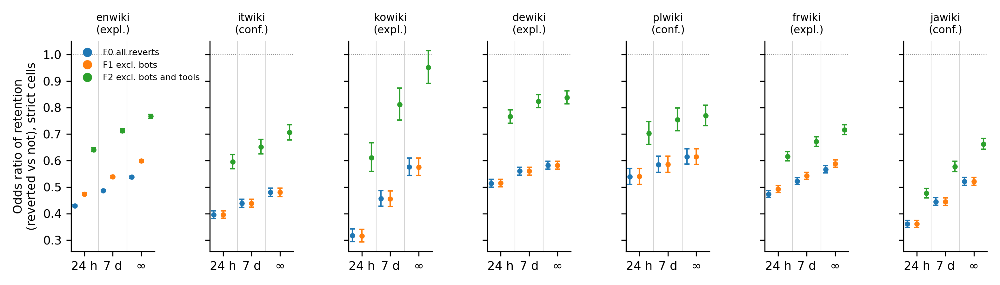
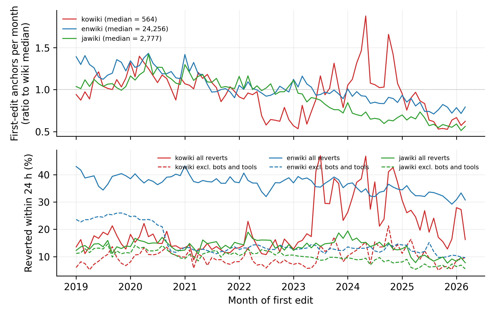

# Supplementary Material

Which reverts count? Successor filtering and observation windows in Wikipedia revert-based metrics

All tables are generated by `03_pipeline/12_supplement.py` from the released aggregates in `04_output/`. Editions are ordered by the bot-and-tool share of first reverts. Confirmatory editions: jawiki, plwiki, itwiki.

## Table S1. Filter effect by observation window (replace variant, F2), R(W) and substitution S(W)

Δ in percentage points from the 60,000-anchor samples (all anchors in kowiki); R(W) = Δ(W)/Δ(24 h); S(W) = 1 − Δ(replace, W)/Δ(strict, W) on the same sample.

**Δ(F2 replace, W), pp**

|           |   enwiki |   itwiki |   kowiki |   dewiki |   plwiki |   frwiki |   jawiki |
|:----------|---------:|---------:|---------:|---------:|---------:|---------:|---------:|
| 12 h      |    18.65 |    15.70 |     9.70 |     9.52 |     6.12 |     6.30 |     3.00 |
| 24 h      |    18.83 |    15.90 |     9.83 |     9.59 |     6.22 |     6.36 |     2.97 |
| 48 h      |    18.79 |    15.79 |     9.76 |     9.56 |     6.24 |     6.34 |     2.94 |
| 7 d       |    18.46 |    15.17 |     9.43 |     9.48 |     6.11 |     6.17 |     2.94 |
| 30 d      |    17.87 |    14.33 |     8.84 |     9.31 |     5.89 |     5.89 |     2.87 |
| 180 d     |    17.44 |    13.62 |     7.95 |     8.92 |     5.63 |     5.56 |     2.75 |
| unbounded |    17.37 |    13.41 |     7.62 |     8.79 |     5.45 |     5.45 |     2.73 |

**R(W)**

|           |   enwiki |   itwiki |   kowiki |   dewiki |   plwiki |   frwiki |   jawiki |
|:----------|---------:|---------:|---------:|---------:|---------:|---------:|---------:|
| 12 h      |    0.990 |    0.987 |    0.987 |    0.993 |    0.984 |    0.991 |    1.008 |
| 24 h      |    1.000 |    1.000 |    1.000 |    1.000 |    1.000 |    1.000 |    1.000 |
| 48 h      |    0.998 |    0.993 |    0.993 |    0.997 |    1.004 |    0.997 |    0.990 |
| 7 d       |    0.980 |    0.954 |    0.959 |    0.989 |    0.983 |    0.970 |    0.988 |
| 30 d      |    0.949 |    0.901 |    0.899 |    0.971 |    0.947 |    0.926 |    0.965 |
| 180 d     |    0.926 |    0.857 |    0.809 |    0.931 |    0.905 |    0.875 |    0.926 |
| unbounded |    0.922 |    0.843 |    0.775 |    0.917 |    0.877 |    0.858 |    0.919 |

**S(W)**

|           |   enwiki |   itwiki |   kowiki |   dewiki |   plwiki |   frwiki |   jawiki |
|:----------|---------:|---------:|---------:|---------:|---------:|---------:|---------:|
| 12 h      |    0.087 |    0.102 |    0.100 |    0.079 |    0.098 |    0.109 |    0.131 |
| 24 h      |    0.100 |    0.114 |    0.122 |    0.089 |    0.111 |    0.120 |    0.145 |
| 48 h      |    0.116 |    0.130 |    0.150 |    0.099 |    0.122 |    0.133 |    0.161 |
| 7 d       |    0.147 |    0.174 |    0.210 |    0.117 |    0.154 |    0.168 |    0.180 |
| 30 d      |    0.186 |    0.227 |    0.278 |    0.145 |    0.205 |    0.216 |    0.211 |
| 180 d     |    0.212 |    0.267 |    0.356 |    0.186 |    0.256 |    0.264 |    0.251 |
| unbounded |    0.218 |    0.279 |    0.385 |    0.198 |    0.280 |    0.279 |    0.258 |

## Table S2. Strict filter effect by definition of the excluded class (24-hour window, all primary anchors)

Δ = p(F0) − p(F) in percentage points, 95 percent analytic interval in Table S2 data file. F1h/F1c: bot flag from the historical / current column only; F1fast and F2fast additionally treat registered non-bot reverts within 5 seconds as bots; F2s adds `mw-undo` to the tool tags; F3 additionally excludes anonymous reverters.

| variant                                   |   enwiki |   itwiki |   kowiki |   dewiki |   plwiki |   frwiki |   jawiki |
|:------------------------------------------|---------:|---------:|---------:|---------:|---------:|---------:|---------:|
| F1 bots (current or historical)           |     4.53 |     0.01 |     0.07 |     0.04 |     0.03 |     1.02 |     0.01 |
| F1c bots (current only)                   |     4.53 |     0.01 |     0.03 |     0.04 |     0.02 |     1.02 |     0.01 |
| F1fast bots + <=5 s registered            |     4.57 |     0.02 |     0.08 |     0.07 |     0.03 |     1.03 |     0.01 |
| F1h bots (historical only)                |     4.53 |     0.01 |     0.07 |     0.04 |     0.03 |     1.02 |     0.01 |
| F2 bots + tools (rollback/huggle/twinkle) |    21.09 |    17.94 |    11.19 |    10.54 |     7.01 |     7.22 |     3.46 |
| F2fast bots + tools + <=5 s               |    21.10 |    17.94 |    11.20 |    10.54 |     7.01 |     7.23 |     3.46 |
| F2s bots + tools + undo                   |    32.33 |    28.11 |    17.06 |    17.85 |    14.56 |    18.91 |     9.15 |
| F3 bots + tools + anonymous reverters     |    21.92 |    18.77 |    13.27 |    10.96 |     7.68 |     7.53 |     4.57 |

Unbounded window:

| variant                                   |   enwiki |   itwiki |   kowiki |   dewiki |   plwiki |   frwiki |   jawiki |
|:------------------------------------------|---------:|---------:|---------:|---------:|---------:|---------:|---------:|
| F1 bots (current or historical)           |     4.58 |     0.03 |     0.16 |     0.08 |     0.06 |     1.06 |     0.06 |
| F1c bots (current only)                   |     4.58 |     0.03 |     0.08 |     0.08 |     0.04 |     1.06 |     0.06 |
| F1fast bots + <=5 s registered            |     4.63 |     0.05 |     0.18 |     0.12 |     0.06 |     1.06 |     0.06 |
| F1h bots (historical only)                |     4.58 |     0.03 |     0.16 |     0.08 |     0.06 |     1.06 |     0.06 |
| F2 bots + tools (rollback/huggle/twinkle) |    22.38 |    18.58 |    12.38 |    10.94 |     7.57 |     7.55 |     3.65 |
| F2fast bots + tools + <=5 s               |    22.39 |    18.58 |    12.39 |    10.94 |     7.57 |     7.55 |     3.65 |
| F2s bots + tools + undo                   |    34.97 |    29.41 |    19.83 |    19.50 |    18.95 |    20.34 |    10.52 |
| F3 bots + tools + anonymous reverters     |    23.77 |    19.83 |    16.36 |    11.45 |     8.51 |     8.16 |     5.53 |

## Table S3. Cohort variants: relative strict filter effect Δ(F2, 24 h)/p(F0, 24 h) and cohort size

| cohort                                                  |   enwiki |   itwiki |   kowiki |   dewiki |   plwiki |   frwiki |   jawiki |
|:--------------------------------------------------------|---------:|---------:|---------:|---------:|---------:|---------:|---------:|
| all registered first edits 2019+                        |    0.565 |    0.523 |    0.511 |    0.398 |    0.317 |    0.292 |    0.259 |
| self-created first edits 2019+ (primary)                |    0.570 |    0.525 |    0.519 |    0.411 |    0.316 |    0.297 |    0.248 |
| self-created, anchors 2021+ (all tags available)        |    0.649 |    0.546 |    0.555 |    0.395 |    0.305 |    0.282 |    0.301 |
| self-created, secondary anchors (edits 2-5 within 91 d) |    0.564 |    0.517 |    0.512 |    0.409 |    0.335 |    0.315 |    0.280 |

Anchors per cohort:

| cohort                                                  |   enwiki |   itwiki |   kowiki |   dewiki |   plwiki |   frwiki |   jawiki |
|:--------------------------------------------------------|---------:|---------:|---------:|---------:|---------:|---------:|---------:|
| all registered first edits 2019+                        |  2488692 |   168749 |    59618 |   289854 |    85443 |   413873 |   247119 |
| self-created first edits 2019+ (primary)                |  2189284 |   135400 |    47633 |   236903 |    67755 |   346938 |   223045 |
| self-created, anchors 2021+ (all tags available)        |  1453656 |    88005 |    32751 |   159216 |    45382 |   229556 |   148508 |
| self-created, secondary anchors (edits 2-5 within 91 d) |  2947210 |   181835 |    84573 |   282617 |    87029 |   434787 |   403249 |

## Table S4. Normal approximations to the registered one-sided tests, with Holm adjustment within edition

The registered tests are bootstrap bounds (reported in the main text); the normal approximation uses the analytic standard error of the paired difference (H1), the delta method (H2) and the log odds-ratio variance (H4). H3 is a descriptive agreement criterion and is not a test.

| wiki   | test                                           |   estimate |    se | p_one_sided   | p_holm   |
|:-------|:-----------------------------------------------|-----------:|------:|:--------------|:---------|
| enwiki | H1 D=Δ(24h)−Δ(∞) > 0                           |      1.463 | 0.078 | < .001        | < .001   |
| enwiki | H2 S < 0.25                                    |      0.100 | 0.003 | < .001        | < .001   |
| enwiki | H4 OR_max/OR_min >= 1.5 (log ratio vs log 1.5) |      1.785 | 0.007 | < .001        | < .001   |
| itwiki | H1 D=Δ(24h)−Δ(∞) > 0                           |      2.492 | 0.077 | < .001        | < .001   |
| itwiki | H2 S < 0.25                                    |      0.114 | 0.003 | < .001        | < .001   |
| itwiki | H4 OR_max/OR_min >= 1.5 (log ratio vs log 1.5) |      1.783 | 0.028 | < .001        | < .001   |
| kowiki | H1 D=Δ(24h)−Δ(∞) > 0                           |      2.213 | 0.091 | < .001        | < .001   |
| kowiki | H2 S < 0.25                                    |      0.122 | 0.004 | < .001        | < .001   |
| kowiki | H4 OR_max/OR_min >= 1.5 (log ratio vs log 1.5) |      3.008 | 0.051 | < .001        | < .001   |
| dewiki | H1 D=Δ(24h)−Δ(∞) > 0                           |      0.793 | 0.052 | < .001        | < .001   |
| dewiki | H2 S < 0.25                                    |      0.089 | 0.004 | < .001        | < .001   |
| dewiki | H4 OR_max/OR_min >= 1.5 (log ratio vs log 1.5) |      1.629 | 0.021 | < .001        | < .001   |
| plwiki | H1 D=Δ(24h)−Δ(∞) > 0                           |      0.767 | 0.054 | < .001        | < .001   |
| plwiki | H2 S < 0.25                                    |      0.111 | 0.005 | < .001        | < .001   |
| plwiki | H4 OR_max/OR_min >= 1.5 (log ratio vs log 1.5) |      1.425 | 0.038 | 0.912         | 0.912    |
| frwiki | H1 D=Δ(24h)−Δ(∞) > 0                           |      0.905 | 0.050 | < .001        | < .001   |
| frwiki | H2 S < 0.25                                    |      0.120 | 0.005 | < .001        | < .001   |
| frwiki | H4 OR_max/OR_min >= 1.5 (log ratio vs log 1.5) |      1.512 | 0.018 | 0.333         | 0.333    |
| jawiki | H1 D=Δ(24h)−Δ(∞) > 0                           |      0.242 | 0.032 | < .001        | < .001   |
| jawiki | H2 S < 0.25                                    |      0.145 | 0.008 | < .001        | < .001   |
| jawiki | H4 OR_max/OR_min >= 1.5 (log ratio vs log 1.5) |      1.836 | 0.024 | < .001        | < .001   |

## Table S5. Logistic regression of reverted status on filter and window (replace sample, long format), editor-clustered standard errors

Reference cell F0 at 24 h. Rows: anchors × 3 filters × 3 windows (about 540,000 per edition; 428,661 in kowiki); clusters = editors. Coefficients on the log-odds scale; cluster-robust (CR1) standard errors in parentheses.

| term       | enwiki         | itwiki         | kowiki         | dewiki         | plwiki         | frwiki         | jawiki         |
|:-----------|:---------------|:---------------|:---------------|:---------------|:---------------|:---------------|:---------------|
| const      | -0.544 (0.008) | -0.66 (0.009)  | -1.29 (0.011)  | -1.069 (0.009) | -1.259 (0.01)  | -1.136 (0.01)  | -1.813 (0.012) |
| F1r        | -0.132 (0.003) | -0.0 (0.0)     | -0.003 (0.001) | -0.003 (0.0)   | -0.002 (0.0)   | -0.034 (0.002) | -0.001 (0.0)   |
| F2r        | -0.98 (0.009)  | -0.845 (0.008) | -0.726 (0.01)  | -0.591 (0.008) | -0.407 (0.006) | -0.384 (0.006) | -0.272 (0.006) |
| W7d        | 0.091 (0.003)  | 0.067 (0.002)  | 0.151 (0.004)  | 0.091 (0.003)  | 0.106 (0.003)  | 0.071 (0.003)  | 0.112 (0.004)  |
| Winf       | 0.172 (0.003)  | 0.121 (0.003)  | 0.341 (0.006)  | 0.196 (0.004)  | 0.419 (0.006)  | 0.138 (0.003)  | 0.244 (0.005)  |
| F1r_x_W7d  | 0.016 (0.001)  | 0.0 (0.0)      | -0.0 (0.001)   | -0.0 (0.0)     | -0.0 (0.0)     | 0.004 (0.001)  | -0.0 (0.0)     |
| F1r_x_Winf | 0.034 (0.002)  | -0.0 (0.0)     | -0.002 (0.001) | -0.002 (0.0)   | -0.001 (0.0)   | 0.009 (0.001)  | -0.002 (0.001) |
| F2r_x_W7d  | 0.072 (0.003)  | 0.078 (0.003)  | 0.116 (0.005)  | 0.042 (0.002)  | 0.036 (0.002)  | 0.029 (0.002)  | 0.027 (0.002)  |
| F2r_x_Winf | 0.168 (0.005)  | 0.2 (0.005)    | 0.307 (0.008)  | 0.119 (0.004)  | 0.132 (0.004)  | 0.086 (0.003)  | 0.067 (0.003)  |

## Table S6. kowiki: anchor definition (first edit, registered) versus first main-namespace edit (pilot definition), strict F2

| anchor                  | W    |     n |   p_F0 |   p_F2 |   delta_pp |   ci_lo |   ci_hi |   rel_delta |
|:------------------------|:-----|------:|-------:|-------:|-----------:|--------:|--------:|------------:|
| first edit (registered) | W24h | 47633 |  0.216 |  0.104 |     11.194 |  10.911 |  11.477 |       0.519 |
| first edit (registered) | W7d  | 47633 |  0.243 |  0.123 |     11.937 |  11.646 |  12.228 |       0.492 |
| first edit (registered) | Winf | 47633 |  0.279 |  0.155 |     12.382 |  12.086 |  12.678 |       0.444 |
| first ns0 edit (pilot)  | W24h | 52819 |  0.218 |  0.105 |     11.267 |  10.997 |  11.536 |       0.517 |
| first ns0 edit (pilot)  | W7d  | 52819 |  0.244 |  0.124 |     11.984 |  11.707 |  12.261 |       0.491 |
| first ns0 edit (pilot)  | Winf | 52819 |  0.279 |  0.155 |     12.412 |  12.131 |  12.693 |       0.444 |

**Table S6b.** kowiki with and without the June 2023 to December 2024 period of elevated newcomer inflow.

| cohort                       |     n |   p_F0_W24h |   strict_delta_W24h |   rel_W24h |   replace_delta_W24h |   p_F0_Winf |   strict_delta_Winf |   rel_Winf |   replace_delta_Winf |     R |
|:-----------------------------|------:|------------:|--------------------:|-----------:|---------------------:|------------:|--------------------:|-----------:|---------------------:|------:|
| all                          | 47633 |       0.216 |              11.194 |      0.519 |                9.830 |       0.279 |              12.382 |      0.444 |                7.617 | 0.775 |
| excl. 2023-06..2024-12 surge | 35065 |       0.165 |               7.227 |      0.437 |                6.394 |       0.226 |               8.199 |      0.363 |                5.533 | 0.865 |
| surge only                   | 12568 |       0.357 |              22.263 |      0.624 |               19.416 |       0.427 |              24.053 |      0.563 |               13.432 | 0.692 |

## Table S7. Simulation: R = Δ(∞)/Δ(24 h) as a function of the human re-revert probability after an excluded fast revert and the median human delay

Grid over revert base rate (.10, .25, .40), excluded-actor share (0 to .8) and excluded-actor speed (5 to 60 s); R is averaged over those parameters (min and max shown) because they do not affect it. Observed R in the seven editions: .78 to .92.

|   p(human re-revert) | median human delay   |   mean |   min |   max |
|---------------------:|:---------------------|-------:|------:|------:|
|                0.000 | 10 min               |  1.000 | 1.000 | 1.000 |
|                0.000 | 1 h                  |  1.000 | 1.000 | 1.000 |
|                0.000 | 1 d                  |  1.000 | 1.000 | 1.000 |
|                0.000 | 7 d                  |  1.000 | 1.000 | 1.000 |
|                0.100 | 10 min               |  1.000 | 1.000 | 1.000 |
|                0.100 | 1 h                  |  1.000 | 0.999 | 1.000 |
|                0.100 | 1 d                  |  0.948 | 0.947 | 0.951 |
|                0.100 | 7 d                  |  0.905 | 0.901 | 0.908 |
|                0.200 | 10 min               |  1.000 | 1.000 | 1.000 |
|                0.200 | 1 h                  |  0.999 | 0.999 | 0.999 |
|                0.200 | 1 d                  |  0.889 | 0.884 | 0.893 |
|                0.200 | 7 d                  |  0.808 | 0.804 | 0.813 |
|                0.500 | 10 min               |  1.000 | 1.000 | 1.000 |
|                0.500 | 1 h                  |  0.996 | 0.995 | 0.997 |
|                0.500 | 1 d                  |  0.667 | 0.663 | 0.672 |
|                0.500 | 7 d                  |  0.513 | 0.507 | 0.518 |

## Table S8. Change-tag availability on reverting revisions, by edition and year (all namespaces, all users)

Counts of reverting revisions carrying each tag. `twinkle` is tagged only in enwiki from September 2020; `huggle` tagging in enwiki is nearly absent in 2021 and 2022.

**mw-rollback**

| wiki   |    2018 |   2019 |   2020 |   2021 |   2022 |   2023 |   2024 |   2025 |   2026 |
|:-------|--------:|-------:|-------:|-------:|-------:|-------:|-------:|-------:|-------:|
| enwiki | 1122426 | 895626 | 932095 | 883106 | 750250 | 774662 | 589221 | 606866 | 445436 |
| itwiki |  119804 | 124817 | 147566 | 159560 | 156810 | 127405 | 103429 |  90733 |  44813 |
| kowiki |   20961 |  14881 |  28911 |  22528 |  31437 |  27802 |  29237 |  28939 |  11935 |
| dewiki |  193873 | 189579 | 154538 | 142501 | 117173 | 120366 |  97322 |  69006 |  44425 |
| plwiki |   33863 |  33984 |  42665 |  37281 |  36801 |  33087 |  34604 |  22962 |  12179 |
| frwiki |   82033 |  86959 |  68743 |  76641 |  67687 |  60521 |  59402 |  47767 |  33146 |
| jawiki |    9121 |  11759 |  18030 |  27752 |  24273 |  26174 |  19051 |  14461 |   8951 |

**huggle**

| wiki   |   2018 |   2019 |   2020 |   2021 |   2022 |   2023 |   2024 |   2025 |   2026 |
|:-------|-------:|-------:|-------:|-------:|-------:|-------:|-------:|-------:|-------:|
| enwiki | 345176 | 262033 | 162423 |   1631 |   2409 | 151939 | 132999 | 104257 |  47488 |
| itwiki |      0 |      0 |      0 |      0 |      0 |      0 |      0 |      0 |      0 |
| kowiki |      0 |      0 |      0 |      0 |      0 |      0 |      0 |      0 |      0 |
| dewiki |      0 |      0 |      0 |      0 |      0 |      0 |      0 |      0 |      0 |
| plwiki |      0 |      0 |      0 |      0 |      0 |      0 |      0 |      0 |      0 |
| frwiki |   5016 |   4433 |    836 |   1111 |   1774 |   4027 |   1868 |   1510 |    280 |
| jawiki |      0 |      0 |      0 |      0 |      0 |      0 |      0 |      0 |      0 |

**twinkle**

| wiki   |   2018 |   2019 |   2020 |   2021 |   2022 |   2023 |   2024 |   2025 |   2026 |
|:-------|-------:|-------:|-------:|-------:|-------:|-------:|-------:|-------:|-------:|
| enwiki |      0 |      0 | 207362 | 602187 | 543831 | 514898 | 541969 | 538128 | 322779 |
| itwiki |      0 |      0 |      0 |      0 |      0 |      0 |      0 |      0 |      0 |
| kowiki |      0 |      0 |      0 |      0 |      0 |      0 |      0 |      0 |      0 |
| dewiki |      0 |      0 |      0 |      0 |      0 |      0 |      0 |      0 |      0 |
| plwiki |      0 |      0 |      0 |      0 |      0 |      0 |      0 |      0 |      0 |
| frwiki |      0 |      0 |      0 |      0 |      0 |      0 |      0 |      0 |      0 |
| jawiki |      0 |      0 |      0 |      0 |      0 |      0 |      0 |      0 |      0 |

**mw-undo**

| wiki   |    2018 |    2019 |    2020 |    2021 |    2022 |    2023 |    2024 |    2025 |   2026 |
|:-------|--------:|--------:|--------:|--------:|--------:|--------:|--------:|--------:|-------:|
| enwiki | 1494822 | 1529089 | 1540633 | 1552495 | 1435631 | 1340784 | 1362885 | 1285981 | 803483 |
| itwiki |   95578 |  117098 |  116429 |  114948 |   97846 |   89979 |   84370 |   73064 |  45823 |
| kowiki |   30946 |   29764 |   57931 |   45761 |   26982 |   21147 |   28007 |   21249 |  11311 |
| dewiki |  109547 |   96185 |   98655 |   97514 |   81234 |   79920 |   75943 |   69172 |  44466 |
| plwiki |   24450 |   26055 |   33152 |   46991 |   49128 |   31284 |   32403 |   22045 |  13004 |
| frwiki |  161866 |  154328 |  168055 |  151144 |  134478 |  137671 |  119977 |  118490 |  84144 |
| jawiki |   74816 |   95772 |   95019 |   93695 |   94968 |   67232 |   50025 |   44876 |  31462 |

**mw-reverted**

| wiki   |   2018 |   2019 |   2020 |   2021 |   2022 |   2023 |   2024 |   2025 |   2026 |
|:-------|-------:|-------:|-------:|-------:|-------:|-------:|-------:|-------:|-------:|
| enwiki |   3780 |   5448 | 187989 | 592840 | 502091 | 472535 | 464239 | 453555 | 284397 |
| itwiki |     60 |    194 |   9389 |  30391 |  30547 |  25426 |  21420 |  19383 |  11200 |
| kowiki |    133 |    350 |  17909 |  42624 |  29790 |  23156 |  36357 |  33781 |  18214 |
| dewiki |    258 |    339 |  19656 |  65817 |  77713 |  56409 |  52028 |  50042 |  32436 |
| plwiki |   1070 |    936 |   6384 |  19635 |  17635 |  14595 |  20480 |   9618 |   5891 |
| frwiki |    323 |    501 |  10836 |  33358 |  26666 |  25423 |  24698 |  23414 |  16344 |
| jawiki |    101 |    236 |  13033 |  41124 |  42374 |  25019 |  21034 |  17799 |  11163 |

## Figure S1. Retention odds ratio in the nine strict cells, by edition

Odds ratio of retention (an edit on days 2 to 60) for reverted versus non-reverted anchors, with 95 percent intervals, for the three filters (F0 all reverts, F1 excluding bots, F2 excluding bots and tools) in the 24-hour, 7-day and unbounded windows.

## Figure S2. Monthly first-edit anchors and 24-hour revert rates, kowiki, enwiki and jawiki, 2019 to March 2026

Upper panel: anchors per month relative to each edition's median. Lower panel: share of anchors reverted within 24 hours under F0 (solid) and F2 strict (dashed). The kowiki inflow and revert-rate rise from mid-2023 to the end of 2024 is discussed in the Results; the drop in enwiki's F2 line in September 2020 marks the start of Twinkle tagging.
