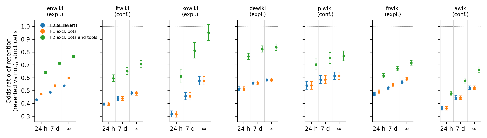
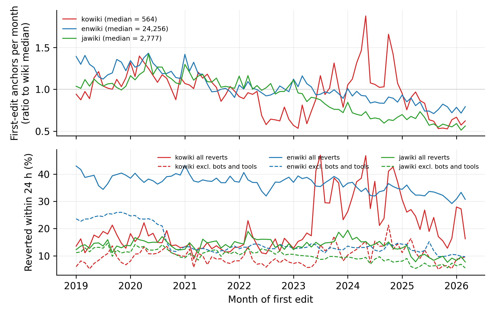

# Supplementary Material

Which reverts count? Reverter populations, attribution rules and observation windows behind a Wikipedia indicator of information quality work

Tables are generated by `03_pipeline/17_supplement_v03.py` from the aggregates in `04_output/` of the public repository. Editions marked * were held out for the registered tests. Dump rule: the history dumps' unbounded identity-revert rule. Radius rule: the same hashes with the 15-revision radius of the mwreverts library.

## Table S1. Structured review of practice: how studies using a revert-based measure operationalise it

One row per study. "Not stated" means that no statement was found in the methods text read. Evidence level: A, establishing sentence re-verified in the full text; B, taken from a first coder's extract; C, metadata or abstract only. The full table with the establishing sentences, URLs and references is `04_output/practice_review.csv`.

| short_cite                 | venue                                         | editions                        | role               | detection                     | radius_or_rule                   | bot_reverts                  | tool_reverts        | self_reverts            | window                             | sensitivity_over_revert_choices             | evidence_level   |
|:---------------------------|:----------------------------------------------|:--------------------------------|:-------------------|:------------------------------|:---------------------------------|:-----------------------------|:--------------------|:------------------------|:-----------------------------------|:--------------------------------------------|:-----------------|
| Kittur et al., 2007        | CHI 2007                                      | en only                         | conflict indicator | identity + summary matching   | none stated                      | not stated                   | not stated          | excluded                | not stated                         | partial                                     | A                |
| Priedhorsky et al., 2007   | GROUP '07                                     | en only                         | descriptive        | identity + summary matching   | 15 revisions                     | counted explicitly           | counted explicitly  | not stated              | revision-bounded: 15 revisions     | partial                                     | B                |
| Halfaker et al., 2009      | WikiSym '09                                   | en only                         | outcome            | identity hash                 | none stated                      | not stated                   | not stated          | excluded                | unbounded stated                   | yes: vandalism reverts removed              | A                |
| Suh et al., 2009           | WikiSym '09                                   | en only                         | descriptive        | summary matching only         | none stated                      | not stated                   | not stated          | not stated              | not stated                         | no                                          | A                |
| Ekstrand & Riedl, 2009     | WikiSym '09                                   | en only                         | descriptive        | identity hash                 | none stated                      | not stated                   | not stated          | not stated              | not stated                         | no                                          | A                |
| West et al., 2010          | EUROSEC '10                                   | en only                         | ML label           | rollback or undo actions only | none stated                      | excluded                     | counted explicitly  | not stated              | not stated                         | partial                                     | A                |
| Halfaker et al., 2011a     | WikiSym '11                                   | en only                         | exposure           | not stated                    | none stated                      | not stated                   | not stated          | excluded                | not stated                         | no                                          | A                |
| Halfaker et al., 2011b     | WikiSym '11                                   | en only                         | exposure           | rollback or undo actions only | none stated                      | not stated                   | not stated          | not stated              | not stated                         | no                                          | A                |
| Lam et al., 2011           | WikiSym '11                                   | en only                         | outcome            | identity + summary matching   | none stated                      | not stated                   | not stated          | not stated              | time-bounded: 7 days               | no                                          | A                |
| Sumi et al., 2011          | IEEE PASSAT/SocialCom 2011                    | multilingual                    | conflict indicator | identity hash                 | none stated                      | not stated                   | not stated          | excluded                | not stated                         | partial                                     | A                |
| Yasseri et al., 2012       | PLoS ONE                                      | en only                         | conflict indicator | identity hash                 | none stated                      | not stated                   | not stated          | excluded                | not stated                         | no                                          | A                |
| Flöck et al., 2012         | HT '12                                        | en only                         | descriptive        | diff-based                    | 20 revisions (also 50, 100)      | not stated                   | not stated          | not stated              | revision-bounded: 20 revisions     | yes: scan range 20/50/100; diff vs identity | A                |
| Halfaker et al., 2013      | American Behavioral Scientist                 | en only                         | exposure           | identity hash                 | none stated                      | modelled separately or focal | modelled separately | excluded (definitional) | not stated                         | no                                          | A                |
| Geiger & Halfaker, 2013    | WikiSym '13                                   | en only                         | outcome            | not stated                    | none stated                      | modelled separately or focal | modelled separately | not stated              | unbounded stated                   | no                                          | A                |
| Yasseri et al., 2014       | Global Wikipedia (edited book)                | multilingual                    | conflict indicator | identity hash                 | none stated                      | not stated                   | not stated          | not stated              | not stated                         | no                                          | A                |
| Tsvetkova et al., 2016     | Scientific Reports                            | multilingual                    | conflict indicator | identity hash                 | none stated                      | excluded                     | not stated          | excluded                | time-bounded: 24 hours             | yes: window 24-240 h                        | A                |
| Tsvetkova et al., 2017     | PLoS ONE                                      | multilingual                    | conflict indicator | identity hash                 | none stated                      | modelled separately or focal | not stated          | excluded                | not stated                         | no                                          | A                |
| Geiger & Halfaker, 2017    | PACM HCI (CSCW)                               | multilingual                    | conflict indicator | identity hash                 | mwreverts default (not reported) | modelled separately or focal | not stated          | not stated              | not stated                         | partial                                     | A                |
| TeBlunthuis et al., 2018   | CHI 2018                                      | Wikia                           | exposure           | not stated                    | none stated                      | modelled separately or focal | not stated          | not stated              | not stated                         | no                                          | A                |
| DeDeo, 2013                | PLoS ONE                                      | en only                         | conflict indicator | identity hash                 | none stated                      | not stated                   | not stated          | excluded                | not stated                         | partial                                     | A                |
| Zhang et al., 2019         | ICWSM 2019                                    | en only                         | exposure           | not stated                    | none stated                      | not stated                   | not stated          | excluded (definitional) | unbounded stated                   | no                                          | A                |
| Tran et al., 2020          | IEEE S&P 2020                                 | en only                         | outcome            | identity hash                 | mwreverts default (not reported) | not stated                   | not stated          | excluded                | not stated                         | no                                          | A                |
| Hill & Shaw, 2021          | Communication Research                        | Wikia                           | outcome            | identity hash                 | mwreverts default (not reported) | not stated                   | not stated          | not stated              | not stated                         | no                                          | A                |
| Chhabra et al., 2020       | OpenSym 2020                                  | en only                         | conflict indicator | identity hash                 | none stated                      | not stated                   | not stated          | counted explicitly      | not stated                         | no                                          | A                |
| TeBlunthuis et al., 2021   | PACM HCI (CSCW)                               | multilingual                    | outcome            | identity hash                 | none stated                      | not stated                   | not stated          | excluded                | time-bounded: 48 hours             | no                                          | A                |
| Ruprechter et al., 2021    | Scientific Reports                            | multilingual                    | descriptive        | dump precomputed field        | none stated                      | counted explicitly           | not stated          | not stated              | not stated                         | no                                          | A                |
| Wikimedia Foundation, 2021 | Meta-Wiki report                              | single non-English edition (pt) | outcome            | not stated                    | none stated                      | not stated                   | not stated          | not stated              | time-bounded: 48 hours             | no                                          | A                |
| Tran et al., 2022          | PACM HCI (CSCW)                               | multilingual                    | outcome            | not stated                    | none stated                      | not stated                   | not stated          | not stated              | unbounded stated                   | no                                          | A                |
| Wang & Zhu, 2022           | FAccT '22                                     | multilingual                    | outcome            | not stated                    | none stated                      | not stated                   | not stated          | excluded (definitional) | not stated                         | no                                          | A                |
| Champion & Hill, 2023      | PACM HCI (CSCW)                               | en only                         | outcome            | not stated                    | 10 contributions forward         | not stated                   | not stated          | not stated              | revision-bounded: 10 contributions | no                                          | A                |
| Warncke-Wang et al., 2023  | PACM HCI (CSCW)                               | multilingual                    | outcome            | not stated                    | none stated                      | not stated                   | not stated          | not stated              | time-bounded: 48 hours             | no                                          | A                |
| Trokhymovych et al., 2023  | KDD '23                                       | multilingual                    | ML label           | dump precomputed field        | none stated                      | not stated                   | not stated          | not stated              | not stated                         | no                                          | A                |
| Franzmeyer et al., 2024    | Findings of ACL 2024                          | en only                         | ML label           | not stated                    | none stated                      | not stated                   | not stated          | excluded (definitional) | not stated                         | no                                          | A                |
| Formisano et al., 2026     | Humanities and Social Sciences Communications | en only                         | outcome            | dump precomputed field        | none stated                      | not stated                   | not stated          | not stated              | not stated                         | no                                          | A                |

**References for Table S1**

Champion, K., & Hill, B. M. (2023). Taboo and collaborative knowledge production: Evidence from Wikipedia. Proceedings of the ACM on Human-Computer Interaction, 7(CSCW2), Article 299, 1-25. https://doi.org/10.1145/3610090

Chhabra, A., Kaur, R., & Iyengar, S. R. S. (2020). Dynamics of edit war sequences in Wikipedia. In Proceedings of the 16th International Symposium on Open Collaboration (OpenSym 2020) (pp. 1-10). ACM. https://doi.org/10.1145/3412569.3412585

DeDeo, S. (2013). Collective phenomena and non-finite state computation in a human social system. PLoS ONE, 8(10), Article e75818. https://doi.org/10.1371/journal.pone.0075818

Ekstrand, M. D., & Riedl, J. T. (2009). rv you're dumb: Identifying discarded work in wiki article history. In Proceedings of the 5th International Symposium on Wikis and Open Collaboration (WikiSym '09) (pp. 1-10). ACM. https://doi.org/10.1145/1641309.1641317

Flock, F., Vrandecic, D., & Simperl, E. (2012). Revisiting reverts: Accurate revert detection in Wikipedia. In Proceedings of the 23rd ACM Conference on Hypertext and Social Media (HT '12) (pp. 3-12). ACM. https://doi.org/10.1145/2309996.2310000

Formisano, G., Hine, E., Juneja, P., Laitila, J., Novelli, C., Chiu, E., Dejanikus, E., Levin, M., Schroder, T., West, A., & Floridi, L. (2026). Editorial governance under pressure: Wikipedia's revert dynamics during the 2024 US election. Humanities and Social Sciences Communications, 13, Article 1459. https://doi.org/10.1057/s41599-026-06810-2

Franzmeyer, T., Shtedritski, A., Albanie, S., Torr, P., Henriques, J. F., & Foerster, J. N. (2024). HelloFresh: LLM evaluations on streams of real-world human editorial actions across X Community Notes and Wikipedia edits. In Findings of the Association for Computational Linguistics: ACL 2024 (pp. 12702-12716). Association for Computational Linguistics. https://doi.org/10.18653/v1/2024.findings-acl.754

Geiger, R. S., & Halfaker, A. (2013). When the levee breaks: Without bots, what happens to Wikipedia's quality control processes? In Proceedings of the 9th International Symposium on Open Collaboration (WikiSym '13) (pp. 1-6). ACM. https://doi.org/10.1145/2491055.2491061

Geiger, R. S., & Halfaker, A. (2017). Operationalizing conflict and cooperation between automated software agents in Wikipedia: A replication and expansion of "Even good bots fight". Proceedings of the ACM on Human-Computer Interaction, 1(CSCW), Article 49, 1-33. https://doi.org/10.1145/3134684

Halfaker, A., Geiger, R. S., Morgan, J. T., & Riedl, J. (2013). The rise and decline of an open collaboration system: How Wikipedia's reaction to popularity is causing its decline. American Behavioral Scientist, 57(5), 664-688. https://doi.org/10.1177/0002764212469365

Halfaker, A., Kittur, A., & Riedl, J. (2011). Don't bite the newbies: How reverts affect the quantity and quality of Wikipedia work. In Proceedings of the 7th International Symposium on Wikis and Open Collaboration (WikiSym '11) (pp. 163-172). ACM. https://doi.org/10.1145/2038558.2038585

Halfaker, A., Kittur, A., Kraut, R., & Riedl, J. (2009). A jury of your peers: Quality, experience and ownership in Wikipedia. In Proceedings of the 5th International Symposium on Wikis and Open Collaboration (WikiSym '09) (pp. 1-10). ACM. https://doi.org/10.1145/1641309.1641332

Halfaker, A., Song, B., Stuart, D. A., Kittur, A., & Riedl, J. (2011). NICE: Social translucence through UI intervention. In Proceedings of the 7th International Symposium on Wikis and Open Collaboration (WikiSym '11) (pp. 101-104). ACM. https://doi.org/10.1145/2038558.2038575

Hill, B. M., & Shaw, A. (2021). The hidden costs of requiring accounts: Quasi-experimental evidence from peer production. Communication Research, 48(6), 771-795. https://doi.org/10.1177/0093650220910345

Kittur, A., Suh, B., Pendleton, B. A., & Chi, E. H. (2007). He says, she says: Conflict and coordination in Wikipedia. In Proceedings of the SIGCHI Conference on Human Factors in Computing Systems (CHI '07) (pp. 453-462). ACM. https://doi.org/10.1145/1240624.1240698

Lam, S. K., Uduwage, A., Dong, Z., Sen, S., Musicant, D. R., Terveen, L., & Riedl, J. (2011). WP:Clubhouse? An exploration of Wikipedia's gender imbalance. In Proceedings of the 7th International Symposium on Wikis and Open Collaboration (WikiSym '11) (pp. 1-10). ACM. https://doi.org/10.1145/2038558.2038560

Priedhorsky, R., Chen, J., Lam, S. K., Panciera, K., Terveen, L., & Riedl, J. (2007). Creating, destroying, and restoring value in Wikipedia. In Proceedings of the 2007 International ACM Conference on Supporting Group Work (GROUP '07) (pp. 259-268). ACM. https://doi.org/10.1145/1316624.1316663

Ruprechter, T., Horta Ribeiro, M., Santos, T., Lemmerich, F., Strohmaier, M., West, R., & Helic, D. (2021). Volunteer contributions to Wikipedia increased during COVID-19 mobility restrictions. Scientific Reports, 11, Article 21505. https://doi.org/10.1038/s41598-021-00789-3

Suh, B., Convertino, G., Chi, E. H., & Pirolli, P. (2009). The singularity is not near: Slowing growth of Wikipedia. In Proceedings of the 5th International Symposium on Wikis and Open Collaboration (WikiSym '09) (pp. 1-10). ACM. https://doi.org/10.1145/1641309.1641322

Sumi, R., Yasseri, T., Rung, A., Kornai, A., & Kertesz, J. (2011). Edit wars in Wikipedia. In 2011 IEEE Third International Conference on Privacy, Security, Risk and Trust and 2011 IEEE Third International Conference on Social Computing (pp. 724-727). IEEE. https://doi.org/10.1109/PASSAT/SocialCom.2011.47

TeBlunthuis, N., Hill, B. M., & Halfaker, A. (2021). Effects of algorithmic flagging on fairness: Quasi-experimental evidence from Wikipedia. Proceedings of the ACM on Human-Computer Interaction, 5(CSCW1), Article 56, 1-27. https://doi.org/10.1145/3449130

TeBlunthuis, N., Shaw, A., & Hill, B. M. (2018). Revisiting "The rise and decline" in a population of peer production projects. In Proceedings of the 2018 CHI Conference on Human Factors in Computing Systems (CHI '18) (Paper 355, pp. 1-7). ACM. https://doi.org/10.1145/3173574.3173929

Tran, C., Champion, K., Forte, A., Hill, B. M., & Greenstadt, R. (2020). Are anonymity-seekers just like everybody else? An analysis of contributions to Wikipedia from Tor. In 2020 IEEE Symposium on Security and Privacy (SP) (pp. 186-202). IEEE. https://doi.org/10.1109/SP40000.2020.00053

Tran, C., Champion, K., Hill, B. M., & Greenstadt, R. (2022). The risks, benefits, and consequences of prepublication moderation: Evidence from 17 Wikipedia language editions. Proceedings of the ACM on Human-Computer Interaction, 6(CSCW2), Article 333, 1-25. https://doi.org/10.1145/3555225

Trokhymovych, M., Aslam, M., Chou, A.-J., Baeza-Yates, R., & Saez-Trumper, D. (2023). Fair multilingual vandalism detection system for Wikipedia. In Proceedings of the 29th ACM SIGKDD Conference on Knowledge Discovery and Data Mining (KDD '23) (pp. 4981-4990). ACM. https://doi.org/10.1145/3580305.3599823

Tsvetkova, M., Garcia-Gavilanes, R., & Yasseri, T. (2016). Dynamics of disagreement: Large-scale temporal network analysis reveals negative interactions in online collaboration. Scientific Reports, 6, Article 36333. https://doi.org/10.1038/srep36333

Tsvetkova, M., Garcia-Gavilanes, R., Floridi, L., & Yasseri, T. (2017). Even good bots fight: The case of Wikipedia. PLoS ONE, 12(2), Article e0171774. https://doi.org/10.1371/journal.pone.0171774

Wang, L., & Zhu, H. (2022). How are ML-based online content moderation systems actually used? Studying community size, local activity, and disparate treatment. In 2022 ACM Conference on Fairness, Accountability, and Transparency (FAccT '22) (pp. 824-838). ACM. https://doi.org/10.1145/3531146.3533147

Warncke-Wang, M., Ho, R., Miller, M., & Johnson, I. (2023). Increasing participation in peer production communities with the Newcomer Homepage. Proceedings of the ACM on Human-Computer Interaction, 7(CSCW2), Article 280, 1-26. https://doi.org/10.1145/3610071

West, A. G., Kannan, S., & Lee, I. (2010). Detecting Wikipedia vandalism via spatio-temporal analysis of revision metadata? In Proceedings of the Third European Workshop on System Security (EUROSEC '10) (pp. 22-28). ACM. https://doi.org/10.1145/1752046.1752050

Wikimedia Foundation Anti-Harassment Tools Team. (2021). IP editing: Privacy enhancement and abuse mitigation/Impact report for login required experiment on Portuguese Wikipedia. Meta-Wiki. https://meta.wikimedia.org/wiki/IP_Editing:_Privacy_Enhancement_and_Abuse_Mitigation/Impact_report_for_Login_Required_Experiment_on_Portuguese_Wikipedia

Yasseri, T., Spoerri, A., Graham, M., & Kertesz, J. (2014). The most controversial topics in Wikipedia: A multilingual and geographical analysis. In P. Fichman & N. Hara (Eds.), Global Wikipedia: International and cross-cultural issues in online collaboration. Rowman & Littlefield.

Yasseri, T., Sumi, R., Rung, A., Kornai, A., & Kertesz, J. (2012). Dynamics of conflicts in Wikipedia. PLoS ONE, 7(6), Article e38869. https://doi.org/10.1371/journal.pone.0038869

Zhang, A. F., Wang, R., Blohm, E., Budak, C., Robert, L. P., Jr., & Romero, D. M. (2019). Participation of new editors after times of shock on Wikipedia. Proceedings of the International AAAI Conference on Web and Social Media, 13(1), 560-571. https://doi.org/10.1609/icwsm.v13i01.3253

## Table S2. Composition of first reverts of newcomer first edits (dump rule, full cohorts)

**First edits 2019 onward, window 24 h.** Shares of first reverts with 95 percent Wilson intervals.

| Edition   |   First edits |   p reverted | Bot                  | One-click tool       | Other registered, manual   | Unregistered         | Self                 |
|:----------|--------------:|-------------:|:---------------------|:---------------------|:---------------------------|:---------------------|:---------------------|
| English   |     2,189,284 |        0.37  | 0.122 [0.122, 0.123] | 0.448 [0.447, 0.449] | 0.364 [0.363, 0.365]       | 0.023 [0.022, 0.023] | 0.044 [0.043, 0.044] |
| Italian*  |       135,400 |        0.342 | 0.000 [0.000, 0.000] | 0.525 [0.520, 0.529] | 0.407 [0.402, 0.411]       | 0.024 [0.023, 0.026] | 0.044 [0.042, 0.046] |
| Korean    |        47,633 |        0.216 | 0.003 [0.002, 0.004] | 0.516 [0.506, 0.525] | 0.289 [0.280, 0.298]       | 0.096 [0.091, 0.102] | 0.096 [0.091, 0.102] |
| German    |       236,903 |        0.256 | 0.001 [0.001, 0.002] | 0.410 [0.406, 0.414] | 0.545 [0.541, 0.549]       | 0.017 [0.016, 0.018] | 0.027 [0.026, 0.028] |
| Polish*   |        67,755 |        0.222 | 0.001 [0.001, 0.002] | 0.315 [0.307, 0.322] | 0.616 [0.608, 0.624]       | 0.030 [0.028, 0.033] | 0.038 [0.035, 0.041] |
| French    |       346,938 |        0.243 | 0.042 [0.041, 0.043] | 0.255 [0.252, 0.258] | 0.643 [0.640, 0.647]       | 0.012 [0.012, 0.013] | 0.047 [0.046, 0.049] |
| Japanese* |       223,045 |        0.14  | 0.001 [0.001, 0.001] | 0.247 [0.242, 0.252] | 0.558 [0.552, 0.563]       | 0.080 [0.077, 0.083] | 0.114 [0.111, 0.118] |

**First edits 2019 onward, window unbounded.** Shares of first reverts with 95 percent Wilson intervals.

| Edition   |   First edits |   p reverted | Bot                  | One-click tool       | Other registered, manual   | Unregistered         | Self                 |
|:----------|--------------:|-------------:|:---------------------|:---------------------|:---------------------------|:---------------------|:---------------------|
| English   |     2,189,284 |        0.412 | 0.111 [0.111, 0.112] | 0.432 [0.431, 0.433] | 0.383 [0.382, 0.384]       | 0.034 [0.033, 0.034] | 0.040 [0.040, 0.041] |
| Italian*  |       135,400 |        0.369 | 0.001 [0.001, 0.001] | 0.503 [0.498, 0.507] | 0.421 [0.417, 0.425]       | 0.034 [0.033, 0.036] | 0.041 [0.040, 0.043] |
| Korean    |        47,633 |        0.279 | 0.006 [0.005, 0.007] | 0.438 [0.429, 0.446] | 0.336 [0.328, 0.344]       | 0.142 [0.137, 0.148] | 0.078 [0.074, 0.083] |
| German    |       236,903 |        0.294 | 0.003 [0.002, 0.003] | 0.369 [0.365, 0.373] | 0.586 [0.582, 0.590]       | 0.017 [0.016, 0.018] | 0.025 [0.024, 0.026] |
| Polish*   |        67,755 |        0.303 | 0.002 [0.001, 0.003] | 0.248 [0.242, 0.254] | 0.690 [0.684, 0.696]       | 0.031 [0.029, 0.034] | 0.029 [0.026, 0.031] |
| French    |       346,938 |        0.27  | 0.039 [0.038, 0.040] | 0.241 [0.238, 0.243] | 0.654 [0.651, 0.657]       | 0.023 [0.022, 0.023] | 0.044 [0.042, 0.045] |
| Japanese* |       223,045 |        0.172 | 0.003 [0.003, 0.004] | 0.209 [0.205, 0.213] | 0.581 [0.576, 0.586]       | 0.109 [0.106, 0.113] | 0.097 [0.094, 0.100] |

**First edits 2021 onward, window 24 h.** Shares of first reverts with 95 percent Wilson intervals.

| Edition   |   First edits |   p reverted | Bot                  | One-click tool       | Other registered, manual   | Unregistered         | Self                 |
|:----------|--------------:|-------------:|:---------------------|:---------------------|:---------------------------|:---------------------|:---------------------|
| English   |     1,453,656 |        0.361 | 0.125 [0.124, 0.126] | 0.524 [0.522, 0.525] | 0.285 [0.284, 0.287]       | 0.022 [0.022, 0.022] | 0.044 [0.043, 0.044] |
| Italian*  |        88,005 |        0.334 | 0.000 [0.000, 0.000] | 0.546 [0.540, 0.551] | 0.390 [0.385, 0.396]       | 0.020 [0.019, 0.022] | 0.044 [0.041, 0.046] |
| Korean    |        32,751 |        0.239 | 0.001 [0.001, 0.002] | 0.554 [0.543, 0.565] | 0.262 [0.252, 0.272]       | 0.094 [0.088, 0.100] | 0.090 [0.084, 0.096] |
| German    |       159,216 |        0.248 | 0.001 [0.001, 0.002] | 0.394 [0.389, 0.398] | 0.560 [0.555, 0.564]       | 0.018 [0.017, 0.019] | 0.028 [0.026, 0.029] |
| Polish*   |        45,382 |        0.227 | 0.002 [0.001, 0.003] | 0.303 [0.294, 0.312] | 0.624 [0.614, 0.633]       | 0.035 [0.031, 0.039] | 0.037 [0.033, 0.040] |
| French    |       229,556 |        0.232 | 0.020 [0.019, 0.022] | 0.261 [0.257, 0.265] | 0.656 [0.652, 0.660]       | 0.011 [0.010, 0.012] | 0.051 [0.049, 0.053] |
| Japanese* |       148,508 |        0.138 | 0.001 [0.001, 0.002] | 0.300 [0.294, 0.306] | 0.519 [0.512, 0.526]       | 0.069 [0.066, 0.073] | 0.110 [0.106, 0.114] |

**First edits 2021 onward, window unbounded.** Shares of first reverts with 95 percent Wilson intervals.

| Edition   |   First edits |   p reverted | Bot                  | One-click tool       | Other registered, manual   | Unregistered         | Self                 |
|:----------|--------------:|-------------:|:---------------------|:---------------------|:---------------------------|:---------------------|:---------------------|
| English   |     1,453,656 |        0.402 | 0.114 [0.113, 0.114] | 0.508 [0.507, 0.510] | 0.305 [0.304, 0.306]       | 0.033 [0.032, 0.033] | 0.040 [0.040, 0.041] |
| Italian*  |        88,005 |        0.361 | 0.001 [0.000, 0.001] | 0.522 [0.517, 0.528] | 0.406 [0.401, 0.412]       | 0.030 [0.028, 0.031] | 0.041 [0.039, 0.043] |
| Korean    |        32,751 |        0.303 | 0.004 [0.003, 0.005] | 0.477 [0.467, 0.487] | 0.310 [0.301, 0.319]       | 0.135 [0.129, 0.142] | 0.074 [0.069, 0.080] |
| German    |       159,216 |        0.287 | 0.003 [0.002, 0.003] | 0.353 [0.349, 0.358] | 0.600 [0.596, 0.605]       | 0.018 [0.017, 0.020] | 0.025 [0.024, 0.027] |
| Polish*   |        45,382 |        0.316 | 0.002 [0.001, 0.003] | 0.234 [0.227, 0.241] | 0.704 [0.697, 0.712]       | 0.033 [0.030, 0.036] | 0.027 [0.025, 0.030] |
| French    |       229,556 |        0.26  | 0.019 [0.018, 0.021] | 0.246 [0.242, 0.249] | 0.667 [0.663, 0.671]       | 0.020 [0.019, 0.022] | 0.047 [0.045, 0.049] |
| Japanese* |       148,508 |        0.17  | 0.004 [0.003, 0.005] | 0.254 [0.249, 0.259] | 0.553 [0.547, 0.559]       | 0.096 [0.093, 0.100] | 0.093 [0.089, 0.097] |

## Table S3. Change in the revert rate when a class of first reverts is recoded as not reverted (percentage points; identity: share times rate)

**First edits 2019 onward, 24-hour window.**

| Edition   |   Bots |   One-click tools |   Self-reverts |   Unregistered reverters |   Undo-button reverts (if counted as a tool) |   Undo share of manual reverts |
|:----------|-------:|------------------:|---------------:|-------------------------:|---------------------------------------------:|-------------------------------:|
| English   |   4.53 |             16.56 |           1.62 |                     0.84 |                                        11.24 |                          0.707 |
| Italian*  |   0.01 |             17.93 |           1.49 |                     0.83 |                                        10.17 |                          0.627 |
| Korean    |   0.07 |             11.13 |           2.07 |                     2.07 |                                         5.87 |                          0.565 |
| German    |   0.04 |             10.5  |           0.69 |                     0.43 |                                         7.31 |                          0.485 |
| Polish*   |   0.03 |              6.99 |           0.83 |                     0.67 |                                         7.54 |                          0.497 |
| French    |   1.02 |              6.2  |           1.15 |                     0.3  |                                        11.69 |                          0.684 |
| Japanese* |   0.01 |              3.45 |           1.6  |                     1.11 |                                         5.69 |                          0.542 |

**First edits 2021 onward, 24-hour window.**

| Edition   |   Bots |   One-click tools |   Self-reverts |   Unregistered reverters |   Undo-button reverts (if counted as a tool) |   Undo share of manual reverts |
|:----------|-------:|------------------:|---------------:|-------------------------:|---------------------------------------------:|-------------------------------:|
| English   |   4.51 |             18.9  |           1.58 |                     0.79 |                                         8.49 |                          0.67  |
| Italian*  |   0    |             18.21 |           1.46 |                     0.67 |                                         9.76 |                          0.645 |
| Korean    |   0.03 |             13.25 |           2.15 |                     2.24 |                                         5.97 |                          0.561 |
| German    |   0.03 |              9.76 |           0.68 |                     0.45 |                                         7.19 |                          0.479 |
| Polish*   |   0.04 |              6.87 |           0.83 |                     0.79 |                                         8.37 |                          0.531 |
| French    |   0.48 |              6.07 |           1.19 |                     0.26 |                                        11.81 |                          0.707 |
| Japanese* |   0.02 |              4.15 |           1.52 |                     0.96 |                                         5.46 |                          0.565 |

## Table S4. Follow-up manual reverts by class of first reverter, and the window ratio R, under two attribution rules (page-history samples)

**Dump rule, window 24 h.** Share of first edits first reverted by the class shown that were later reverted manually by another editor.

| first_class               |   English |   Italian* |   Korean |   German |   Polish* |   French |   Japanese* |
|:--------------------------|----------:|-----------:|---------:|---------:|----------:|---------:|------------:|
| Bot or one-click tool     |     0.100 |      0.114 |    0.122 |    0.089 |     0.111 |    0.120 |       0.145 |
| Manual, by another editor |     0.149 |      0.175 |    0.239 |    0.091 |     0.098 |    0.151 |       0.213 |
| Bot                       |     0.142 |      0.000 |    0.129 |    0.065 |     0.056 |    0.237 |       0.000 |
| One-click tool            |     0.089 |      0.114 |    0.122 |    0.089 |     0.112 |    0.101 |       0.146 |
| Other registered, manual  |     0.146 |      0.171 |    0.241 |    0.090 |     0.095 |    0.151 |       0.206 |
| Unregistered              |     0.204 |      0.239 |    0.233 |    0.135 |     0.162 |    0.175 |       0.263 |
| Self                      |     0.134 |      0.134 |    0.276 |    0.149 |     0.159 |    0.114 |       0.147 |

**Dump rule, window 7 d.** Share of first edits first reverted by the class shown that were later reverted manually by another editor.

| first_class               |   English |   Italian* |   Korean |   German |   Polish* |   French |   Japanese* |
|:--------------------------|----------:|-----------:|---------:|---------:|----------:|---------:|------------:|
| Bot or one-click tool     |     0.147 |      0.174 |    0.210 |    0.117 |     0.154 |    0.168 |       0.180 |
| Manual, by another editor |     0.209 |      0.234 |    0.312 |    0.119 |     0.140 |    0.205 |       0.262 |
| Bot                       |     0.194 |      0.286 |    0.250 |    0.083 |     0.048 |    0.295 |       0.222 |
| One-click tool            |     0.134 |      0.174 |    0.210 |    0.117 |     0.155 |    0.148 |       0.180 |
| Other registered, manual  |     0.207 |      0.231 |    0.312 |    0.118 |     0.137 |    0.204 |       0.256 |
| Unregistered              |     0.236 |      0.279 |    0.313 |    0.159 |     0.202 |    0.223 |       0.299 |
| Self                      |     0.178 |      0.199 |    0.319 |    0.165 |     0.179 |    0.147 |       0.164 |

**Dump rule, window 180 d.** Share of first edits first reverted by the class shown that were later reverted manually by another editor.

| first_class               |   English |   Italian* |   Korean |   German |   Polish* |   French |   Japanese* |
|:--------------------------|----------:|-----------:|---------:|---------:|----------:|---------:|------------:|
| Bot or one-click tool     |     0.211 |      0.267 |    0.356 |    0.186 |     0.256 |    0.264 |       0.251 |
| Manual, by another editor |     0.277 |      0.312 |    0.397 |    0.174 |     0.198 |    0.283 |       0.315 |
| Bot                       |     0.259 |      0.455 |    0.288 |    0.148 |     0.086 |    0.368 |       0.136 |
| One-click tool            |     0.199 |      0.267 |    0.357 |    0.186 |     0.257 |    0.248 |       0.252 |
| Other registered, manual  |     0.277 |      0.310 |    0.388 |    0.173 |     0.195 |    0.284 |       0.313 |
| Unregistered              |     0.270 |      0.325 |    0.420 |    0.209 |     0.284 |    0.263 |       0.326 |
| Self                      |     0.222 |      0.277 |    0.400 |    0.231 |     0.254 |    0.215 |       0.209 |

**Dump rule, window unbounded.** Share of first edits first reverted by the class shown that were later reverted manually by another editor.

| first_class               |   English |   Italian* |   Korean |   German |   Polish* |   French |   Japanese* |
|:--------------------------|----------:|-----------:|---------:|---------:|----------:|---------:|------------:|
| Bot or one-click tool     |     0.217 |      0.279 |    0.385 |    0.198 |     0.280 |    0.279 |       0.258 |
| Manual, by another editor |     0.282 |      0.318 |    0.419 |    0.187 |     0.217 |    0.293 |       0.320 |
| Bot                       |     0.266 |      0.357 |    0.325 |    0.159 |     0.108 |    0.382 |       0.160 |
| One-click tool            |     0.204 |      0.279 |    0.386 |    0.199 |     0.281 |    0.263 |       0.259 |
| Other registered, manual  |     0.283 |      0.317 |    0.408 |    0.186 |     0.213 |    0.294 |       0.318 |
| Unregistered              |     0.274 |      0.326 |    0.447 |    0.230 |     0.286 |    0.279 |       0.332 |
| Self                      |     0.227 |      0.281 |    0.417 |    0.240 |     0.264 |    0.232 |       0.212 |

**Dump rule, unbounded: follow-up after the first edit's content was reinstated** (share of first edits first reverted by the class).

| first_class               |   English |   Italian* |   Korean |   German |   Polish* |   French |   Japanese* |
|:--------------------------|----------:|-----------:|---------:|---------:|----------:|---------:|------------:|
| Bot or one-click tool     |     0.015 |      0.023 |    0.127 |    0.020 |     0.033 |    0.012 |       0.044 |
| Manual, by another editor |     0.023 |      0.031 |    0.092 |    0.024 |     0.020 |    0.022 |       0.060 |

**Dump rule, unbounded: follow-up immediately, restoring a still earlier state** (share of first edits first reverted by the class).

| first_class               |   English |   Italian* |   Korean |   German |   Polish* |   French |   Japanese* |
|:--------------------------|----------:|-----------:|---------:|---------:|----------:|---------:|------------:|
| Bot or one-click tool     |     0.015 |      0.030 |    0.046 |    0.025 |     0.046 |    0.020 |       0.018 |
| Manual, by another editor |     0.020 |      0.024 |    0.044 |    0.007 |     0.012 |    0.017 |       0.023 |

**Dump rule, unbounded: follow-up after other intervening edits** (share of first edits first reverted by the class).

| first_class               |   English |   Italian* |   Korean |   German |   Polish* |   French |   Japanese* |
|:--------------------------|----------:|-----------:|---------:|---------:|----------:|---------:|------------:|
| Bot or one-click tool     |     0.187 |      0.227 |    0.212 |    0.153 |     0.200 |    0.247 |       0.196 |
| Manual, by another editor |     0.239 |      0.263 |    0.283 |    0.156 |     0.185 |    0.253 |       0.238 |

**Radius rule, window 24 h.** Share of first edits first reverted by the class shown that were later reverted manually by another editor.

| first_class               |   English |   Italian* |   Korean |   German |   Polish* |   French |   Japanese* |
|:--------------------------|----------:|-----------:|---------:|---------:|----------:|---------:|------------:|
| Bot or one-click tool     |     0.017 |      0.033 |    0.048 |    0.028 |     0.048 |    0.027 |       0.063 |
| Manual, by another editor |     0.020 |      0.027 |    0.051 |    0.008 |     0.012 |    0.016 |       0.030 |
| Bot                       |     0.022 |      0.000 |    0.069 |    0.032 |     0.056 |    0.059 |       0.000 |
| One-click tool            |     0.016 |      0.033 |    0.048 |    0.028 |     0.048 |    0.021 |       0.063 |
| Other registered, manual  |     0.019 |      0.025 |    0.049 |    0.008 |     0.011 |    0.015 |       0.031 |
| Unregistered              |     0.043 |      0.063 |    0.054 |    0.009 |     0.033 |    0.036 |       0.025 |
| Self                      |     0.036 |      0.046 |    0.118 |    0.067 |     0.081 |    0.035 |       0.071 |

**Radius rule, window 7 d.** Share of first edits first reverted by the class shown that were later reverted manually by another editor.

| first_class               |   English |   Italian* |   Korean |   German |   Polish* |   French |   Japanese* |
|:--------------------------|----------:|-----------:|---------:|---------:|----------:|---------:|------------:|
| Bot or one-click tool     |     0.022 |      0.038 |    0.059 |    0.030 |     0.052 |    0.030 |       0.065 |
| Manual, by another editor |     0.023 |      0.031 |    0.056 |    0.008 |     0.015 |    0.019 |       0.035 |
| Bot                       |     0.028 |      0.000 |    0.067 |    0.028 |     0.048 |    0.063 |       0.000 |
| One-click tool            |     0.021 |      0.038 |    0.059 |    0.030 |     0.052 |    0.025 |       0.066 |
| Other registered, manual  |     0.022 |      0.029 |    0.053 |    0.008 |     0.014 |    0.018 |       0.036 |
| Unregistered              |     0.035 |      0.067 |    0.064 |    0.012 |     0.037 |    0.040 |       0.030 |
| Self                      |     0.045 |      0.059 |    0.127 |    0.068 |     0.081 |    0.046 |       0.072 |

**Radius rule, window 180 d.** Share of first edits first reverted by the class shown that were later reverted manually by another editor.

| first_class               |   English |   Italian* |   Korean |   German |   Polish* |   French |   Japanese* |
|:--------------------------|----------:|-----------:|---------:|---------:|----------:|---------:|------------:|
| Bot or one-click tool     |     0.027 |      0.044 |    0.072 |    0.033 |     0.060 |    0.033 |       0.071 |
| Manual, by another editor |     0.027 |      0.035 |    0.063 |    0.011 |     0.016 |    0.022 |       0.040 |
| Bot                       |     0.033 |      0.000 |    0.057 |    0.049 |     0.029 |    0.065 |       0.000 |
| One-click tool            |     0.025 |      0.044 |    0.073 |    0.033 |     0.060 |    0.028 |       0.071 |
| Other registered, manual  |     0.026 |      0.033 |    0.060 |    0.010 |     0.015 |    0.022 |       0.041 |
| Unregistered              |     0.035 |      0.061 |    0.071 |    0.023 |     0.048 |    0.035 |       0.031 |
| Self                      |     0.051 |      0.067 |    0.137 |    0.073 |     0.085 |    0.049 |       0.075 |

**Radius rule, window unbounded.** Share of first edits first reverted by the class shown that were later reverted manually by another editor.

| first_class               |   English |   Italian* |   Korean |   German |   Polish* |   French |   Japanese* |
|:--------------------------|----------:|-----------:|---------:|---------:|----------:|---------:|------------:|
| Bot or one-click tool     |     0.027 |      0.044 |    0.074 |    0.033 |     0.060 |    0.034 |       0.070 |
| Manual, by another editor |     0.027 |      0.036 |    0.064 |    0.011 |     0.017 |    0.022 |       0.040 |
| Bot                       |     0.034 |      0.000 |    0.079 |    0.048 |     0.027 |    0.066 |       0.000 |
| One-click tool            |     0.025 |      0.044 |    0.074 |    0.033 |     0.061 |    0.029 |       0.071 |
| Other registered, manual  |     0.026 |      0.034 |    0.061 |    0.011 |     0.016 |    0.022 |       0.042 |
| Unregistered              |     0.035 |      0.060 |    0.072 |    0.023 |     0.047 |    0.034 |       0.032 |
| Self                      |     0.051 |      0.067 |    0.136 |    0.075 |     0.087 |    0.049 |       0.075 |

**Radius rule, unbounded: follow-up after the first edit's content was reinstated** (share of first edits first reverted by the class).

| first_class               |   English |   Italian* |   Korean |   German |   Polish* |   French |   Japanese* |
|:--------------------------|----------:|-----------:|---------:|---------:|----------:|---------:|------------:|
| Bot or one-click tool     |     0.001 |      0.002 |    0.010 |    0.002 |     0.004 |    0.001 |       0.004 |
| Manual, by another editor |     0.001 |      0.002 |    0.008 |    0.001 |     0.001 |    0.000 |       0.003 |

**Radius rule, unbounded: follow-up immediately, restoring a still earlier state** (share of first edits first reverted by the class).

| first_class               |   English |   Italian* |   Korean |   German |   Polish* |   French |   Japanese* |
|:--------------------------|----------:|-----------:|---------:|---------:|----------:|---------:|------------:|
| Bot or one-click tool     |     0.015 |      0.029 |    0.040 |    0.025 |     0.045 |    0.020 |       0.018 |
| Manual, by another editor |     0.018 |      0.022 |    0.038 |    0.007 |     0.011 |    0.017 |       0.021 |

**Radius rule, unbounded: follow-up after other intervening edits** (share of first edits first reverted by the class).

| first_class               |   English |   Italian* |   Korean |   German |   Polish* |   French |   Japanese* |
|:--------------------------|----------:|-----------:|---------:|---------:|----------:|---------:|------------:|
| Bot or one-click tool     |     0.011 |      0.014 |    0.025 |    0.007 |     0.011 |    0.013 |       0.049 |
| Manual, by another editor |     0.008 |      0.012 |    0.017 |    0.003 |     0.005 |    0.005 |       0.017 |

**Window ratio R** (replace effect of excluding bots and tools at the longer window divided by the effect within 24 hours; 2,000 bootstrap resamples of editors).

| key                           | English              | Italian*             | Korean               | German               | Polish*              | French               | Japanese*            |
|:------------------------------|:---------------------|:---------------------|:---------------------|:---------------------|:---------------------|:---------------------|:---------------------|
| Dump rule, 180 d / 24 h       | 0.926 [0.919, 0.934] | 0.857 [0.848, 0.865] | 0.809 [0.793, 0.825] | 0.931 [0.921, 0.941] | 0.905 [0.890, 0.920] | 0.875 [0.861, 0.889] | 0.926 [0.906, 0.945] |
| Dump rule, unbounded / 24 h   | 0.922 [0.915, 0.930] | 0.843 [0.834, 0.852] | 0.775 [0.758, 0.792] | 0.917 [0.907, 0.928] | 0.877 [0.860, 0.892] | 0.858 [0.844, 0.871] | 0.919 [0.898, 0.939] |
| Radius rule, 180 d / 24 h     | 1.043 [1.038, 1.048] | 1.024 [1.020, 1.028] | 1.074 [1.064, 1.085] | 1.036 [1.030, 1.042] | 1.067 [1.058, 1.077] | 1.039 [1.032, 1.046] | 1.046 [1.034, 1.058] |
| Radius rule, unbounded / 24 h | 1.045 [1.041, 1.050] | 1.024 [1.020, 1.028] | 1.074 [1.065, 1.085] | 1.036 [1.030, 1.042] | 1.067 [1.057, 1.077] | 1.039 [1.031, 1.046] | 1.048 [1.036, 1.061] |

## Table S5. Retention (an edit on days 2 to 60) by who made the first revert within 24 hours

Cells: share retained; odds ratio against newcomers not reverted within 24 hours with 95 percent Woolf interval (0.5 added to each cell); number of newcomers. Classes with fewer than 30 newcomers are omitted.

| first_revert_class       | English                                  | Italian*                                | Korean                                  | German                                  | Polish*                                 | French                                  | Japanese*                               |
|:-------------------------|:-----------------------------------------|:----------------------------------------|:----------------------------------------|:----------------------------------------|:----------------------------------------|:----------------------------------------|:----------------------------------------|
| Any revert               | 0.097; OR 0.43 [0.43, 0.43]; n = 809,720 | 0.090; OR 0.40 [0.38, 0.41]; n = 46,260 | 0.079; OR 0.32 [0.29, 0.34]; n = 10,279 | 0.107; OR 0.51 [0.50, 0.53]; n = 60,665 | 0.113; OR 0.54 [0.51, 0.57]; n = 15,033 | 0.089; OR 0.47 [0.46, 0.49]; n = 84,351 | 0.116; OR 0.36 [0.35, 0.37]; n = 31,127 |
| Bot                      | 0.069; OR 0.30 [0.29, 0.31]; n = 99,135  | nan                                     | 0.194; OR 0.94 [0.40, 2.22]; n = 31     | 0.081; OR 0.40 [0.19, 0.85]; n = 86     | nan                                     | 0.041; OR 0.21 [0.18, 0.25]; n = 3,552  | nan                                     |
| One-click tool           | 0.086; OR 0.38 [0.37, 0.38]; n = 362,541 | 0.072; OR 0.31 [0.29, 0.33]; n = 24,278 | 0.035; OR 0.13 [0.12, 0.16]; n = 5,301  | 0.062; OR 0.29 [0.27, 0.30]; n = 24,876 | 0.067; OR 0.30 [0.27, 0.34]; n = 4,733  | 0.052; OR 0.27 [0.25, 0.28]; n = 21,513 | 0.037; OR 0.10 [0.09, 0.12]; n = 7,690  |
| Other registered, manual | 0.114; OR 0.52 [0.51, 0.52]; n = 294,376 | 0.108; OR 0.48 [0.46, 0.51]; n = 18,823 | 0.118; OR 0.50 [0.44, 0.56]; n = 2,971  | 0.142; OR 0.71 [0.68, 0.73]; n = 33,055 | 0.135; OR 0.66 [0.62, 0.70]; n = 9,263  | 0.104; OR 0.57 [0.55, 0.58]; n = 54,268 | 0.129; OR 0.41 [0.39, 0.43]; n = 17,362 |
| Unregistered             | 0.106; OR 0.48 [0.45, 0.50]; n = 18,309  | 0.121; OR 0.55 [0.46, 0.66]; n = 1,130  | 0.122; OR 0.52 [0.43, 0.63]; n = 988    | 0.084; OR 0.40 [0.32, 0.50]; n = 1,007  | 0.132; OR 0.65 [0.50, 0.85]; n = 454    | 0.082; OR 0.44 [0.35, 0.55]; n = 1,044  | 0.152; OR 0.49 [0.44, 0.55]; n = 2,485  |
| Self                     | 0.139; OR 0.65 [0.63, 0.67]; n = 35,359  | 0.128; OR 0.59 [0.51, 0.67]; n = 2,017  | 0.153; OR 0.67 [0.56, 0.79]; n = 988    | 0.113; OR 0.55 [0.47, 0.64]; n = 1,641  | 0.124; OR 0.61 [0.47, 0.78]; n = 564    | 0.119; OR 0.66 [0.60, 0.73]; n = 3,974  | 0.199; OR 0.68 [0.63, 0.74]; n = 3,562  |

Share retained among newcomers not reverted within 24 hours:

|   English |   Italian* |   Korean |   German |   Polish* |   French |   Japanese* |
|----------:|-----------:|---------:|---------:|----------:|---------:|------------:|
|     0.199 |      0.201 |    0.213 |    0.189 |     0.191 |    0.171 |       0.266 |

## Table S6. Tag coverage: radius-rule reverts whose reverted first edit carries no `mw-reverted` tag, first edits from October 2020

Patrolling regime: English, Korean, Japanese none; German, Polish FlaggedRevs; Italian, French recent-changes patrolling. Cells: untagged share with 95 percent Wilson interval; number of reverts.

| reverter_class           | English                          | Italian*                         | Korean                          | German                           | Polish*                          | French                           | Japanese*                       |
|:-------------------------|:---------------------------------|:---------------------------------|:--------------------------------|:---------------------------------|:---------------------------------|:---------------------------------|:--------------------------------|
| All reverters            | 0.003 [0.002, 0.004]; n = 16,611 | 0.096 [0.091, 0.101]; n = 14,935 | 0.004 [0.003, 0.005]; n = 9,485 | 0.024 [0.022, 0.027]; n = 12,246 | 0.039 [0.036, 0.043]; n = 13,282 | 0.070 [0.065, 0.075]; n = 10,914 | 0.010 [0.008, 0.013]; n = 7,039 |
| Bot                      | 0.000 [0.000, 0.003]; n = 2,012  | 0.000 [0.000, 0.390]; n = 6      | 0.000 [0.000, 0.071]; n = 50    | 0.043 [0.012, 0.145]; n = 46     | 0.161 [0.071, 0.326]; n = 31     | 0.004 [0.001, 0.024]; n = 231    | 0.048 [0.008, 0.227]; n = 21    |
| One-click tool           | 0.002 [0.001, 0.003]; n = 8,433  | 0.006 [0.005, 0.008]; n = 7,952  | 0.002 [0.001, 0.004]; n = 4,809 | 0.022 [0.018, 0.027]; n = 4,413  | 0.052 [0.045, 0.061]; n = 3,112  | 0.003 [0.002, 0.006]; n = 2,682  | 0.015 [0.010, 0.022]; n = 1,813 |
| Other registered, manual | 0.003 [0.002, 0.005]; n = 4,942  | 0.106 [0.099, 0.114]; n = 5,964  | 0.004 [0.002, 0.007]; n = 2,793 | 0.016 [0.013, 0.019]; n = 7,305  | 0.020 [0.017, 0.023]; n = 9,363  | 0.031 [0.027, 0.035]; n = 7,274  | 0.006 [0.004, 0.009]; n = 3,884 |
| Unregistered             | 0.002 [0.000, 0.010]; n = 551    | 0.786 [0.745, 0.822]; n = 434    | 0.002 [0.000, 0.007]; n = 1,107 | 0.235 [0.179, 0.301]; n = 183    | 0.286 [0.245, 0.332]; n = 412    | 0.715 [0.653, 0.770]; n = 228    | 0.000 [0.000, 0.006]; n = 624   |
| Self                     | 0.022 [0.014, 0.036]; n = 673    | 0.708 [0.670, 0.744]; n = 579    | 0.022 [0.014, 0.035]; n = 726   | 0.127 [0.094, 0.170]; n = 299    | 0.135 [0.103, 0.174]; n = 364    | 0.733 [0.693, 0.770]; n = 499    | 0.027 [0.018, 0.042]; n = 697   |

## Table S7. Registered tests in the held-out editions, as produced by the registered code

Bootstrap replicates in the registered code: 2,000 for H1 and H2, 500 for H4 (the manuscript reports H4 intervals recomputed with 2,000 replicates, below). Holm adjustment across the three tests per edition does not change any decision.

|                         |   Japanese* |   Polish* |   Italian* |
|:------------------------|------------:|----------:|-----------:|
| n                       |   60000.000 | 59997.000 |  59999.000 |
| delta24_pp              |       2.972 |     6.217 |     15.900 |
| deltainf_pp             |       2.730 |     5.450 |     13.409 |
| D_pp                    |       0.242 |     0.767 |      2.492 |
| D_ci90_lo               |       0.188 |     0.680 |      2.362 |
| D_ci95_lo               |       0.180 |     0.660 |      2.338 |
| D_ci95_hi               |       0.307 |     0.872 |      2.650 |
| R                       |       0.919 |     0.877 |      0.843 |
| R_ci_lo                 |       0.898 |     0.861 |      0.834 |
| R_ci_hi                 |       0.939 |     0.892 |      0.852 |
| h2_n                    |   60000.000 | 59997.000 |  59999.000 |
| h2_delta_strict_pp      |       3.477 |     6.995 |     17.955 |
| h2_delta_replace_pp     |       2.972 |     6.217 |     15.900 |
| h2_S                    |       0.145 |     0.111 |      0.114 |
| h2_S_ci95_hi_onesided   |       0.157 |     0.119 |      0.119 |
| h2_S_ci_lo              |       0.131 |     0.102 |      0.109 |
| h2_S_ci_hi              |       0.160 |     0.120 |      0.121 |
| h3_n                    |   44211.000 | 44041.000 |  43006.000 |
| h3_agree_d2_d3r15       |       0.986 |     0.979 |      0.954 |
| h3_agree_d1_d2          |       0.981 |     0.977 |      0.951 |
| h3_n_d1only             |     538.000 |   876.000 |   1997.000 |
| h3_d1only_beyond_radius |       0.424 |     0.094 |      0.073 |
| h4_or_ratio             |       1.836 |     1.425 |      1.783 |
| h4_or_ratio_ci_lo       |       1.791 |     1.375 |      1.720 |
| h4_or_ratio_ci_hi       |       1.878 |     1.494 |      1.841 |
| h4_boot                 |     500.000 |   500.000 |    500.000 |

**H4 recomputed with 2,000 paired bootstrap replicates (all editions).**

| Edition   |   max/min odds ratio | 95% interval   |   one-sided 95% lower bound |
|:----------|---------------------:|:---------------|----------------------------:|
| English   |                1.785 | [1.768, 1.801] |                       1.771 |
| Italian*  |                1.783 | [1.722, 1.846] |                       1.732 |
| Korean    |                3.008 | [2.801, 3.221] |                       2.84  |
| German    |                1.629 | [1.592, 1.665] |                       1.599 |
| Polish*   |                1.425 | [1.368, 1.491] |                       1.378 |
| French    |                1.512 | [1.485, 1.538] |                       1.489 |
| Japanese* |                1.836 | [1.791, 1.887] |                       1.798 |

## Table S8. Change tags on reverting revisions by edition and year (all namespaces)

**mw-rollback**

|           |    2018 |   2019 |   2020 |   2021 |   2022 |   2023 |   2024 |   2025 |   2026 |
|:----------|--------:|-------:|-------:|-------:|-------:|-------:|-------:|-------:|-------:|
| English   | 1122426 | 895626 | 932095 | 883106 | 750250 | 774662 | 589221 | 606866 | 445436 |
| Italian*  |  119804 | 124817 | 147566 | 159560 | 156810 | 127405 | 103429 |  90733 |  44813 |
| Korean    |   20961 |  14881 |  28911 |  22528 |  31437 |  27802 |  29237 |  28939 |  11935 |
| German    |  193873 | 189579 | 154538 | 142501 | 117173 | 120366 |  97322 |  69006 |  44425 |
| Polish*   |   33863 |  33984 |  42665 |  37281 |  36801 |  33087 |  34604 |  22962 |  12179 |
| French    |   82033 |  86959 |  68743 |  76641 |  67687 |  60521 |  59402 |  47767 |  33146 |
| Japanese* |    9121 |  11759 |  18030 |  27752 |  24273 |  26174 |  19051 |  14461 |   8951 |

**huggle**

|           |   2018 |   2019 |   2020 |   2021 |   2022 |   2023 |   2024 |   2025 |   2026 |
|:----------|-------:|-------:|-------:|-------:|-------:|-------:|-------:|-------:|-------:|
| English   | 345176 | 262033 | 162423 |   1631 |   2409 | 151939 | 132999 | 104257 |  47488 |
| Italian*  |      0 |      0 |      0 |      0 |      0 |      0 |      0 |      0 |      0 |
| Korean    |      0 |      0 |      0 |      0 |      0 |      0 |      0 |      0 |      0 |
| German    |      0 |      0 |      0 |      0 |      0 |      0 |      0 |      0 |      0 |
| Polish*   |      0 |      0 |      0 |      0 |      0 |      0 |      0 |      0 |      0 |
| French    |   5016 |   4433 |    836 |   1111 |   1774 |   4027 |   1868 |   1510 |    280 |
| Japanese* |      0 |      0 |      0 |      0 |      0 |      0 |      0 |      0 |      0 |

**twinkle**

|           |   2018 |   2019 |   2020 |   2021 |   2022 |   2023 |   2024 |   2025 |   2026 |
|:----------|-------:|-------:|-------:|-------:|-------:|-------:|-------:|-------:|-------:|
| English   |      0 |      0 | 207362 | 602187 | 543831 | 514898 | 541969 | 538128 | 322779 |
| Italian*  |      0 |      0 |      0 |      0 |      0 |      0 |      0 |      0 |      0 |
| Korean    |      0 |      0 |      0 |      0 |      0 |      0 |      0 |      0 |      0 |
| German    |      0 |      0 |      0 |      0 |      0 |      0 |      0 |      0 |      0 |
| Polish*   |      0 |      0 |      0 |      0 |      0 |      0 |      0 |      0 |      0 |
| French    |      0 |      0 |      0 |      0 |      0 |      0 |      0 |      0 |      0 |
| Japanese* |      0 |      0 |      0 |      0 |      0 |      0 |      0 |      0 |      0 |

**mw-undo**

|           |    2018 |    2019 |    2020 |    2021 |    2022 |    2023 |    2024 |    2025 |   2026 |
|:----------|--------:|--------:|--------:|--------:|--------:|--------:|--------:|--------:|-------:|
| English   | 1494822 | 1529089 | 1540633 | 1552495 | 1435631 | 1340784 | 1362885 | 1285981 | 803483 |
| Italian*  |   95578 |  117098 |  116429 |  114948 |   97846 |   89979 |   84370 |   73064 |  45823 |
| Korean    |   30946 |   29764 |   57931 |   45761 |   26982 |   21147 |   28007 |   21249 |  11311 |
| German    |  109547 |   96185 |   98655 |   97514 |   81234 |   79920 |   75943 |   69172 |  44466 |
| Polish*   |   24450 |   26055 |   33152 |   46991 |   49128 |   31284 |   32403 |   22045 |  13004 |
| French    |  161866 |  154328 |  168055 |  151144 |  134478 |  137671 |  119977 |  118490 |  84144 |
| Japanese* |   74816 |   95772 |   95019 |   93695 |   94968 |   67232 |   50025 |   44876 |  31462 |

## Table S9. Cohort variants: bot-or-tool share of first reverts within 24 hours

| cohort                                                  |   English |   Italian* |   Korean |   German |   Polish* |   French |   Japanese* |
|:--------------------------------------------------------|----------:|-----------:|---------:|---------:|----------:|---------:|------------:|
| all registered first edits 2019+                        |     0.565 |      0.523 |    0.511 |    0.398 |     0.317 |    0.292 |       0.259 |
| self-created first edits 2019+ (primary)                |     0.570 |      0.525 |    0.519 |    0.411 |     0.316 |    0.297 |       0.248 |
| self-created, anchors 2021+ (all tags available)        |     0.649 |      0.546 |    0.555 |    0.395 |     0.305 |    0.282 |       0.301 |
| self-created, secondary anchors (edits 2-5 within 91 d) |     0.564 |      0.517 |    0.512 |    0.409 |     0.335 |    0.315 |       0.280 |

## Figure S1. Odds ratio of retention in the nine registered cells, by edition

Reverted versus non-reverted first edits under three reverter filters (all reverts; without bots; without bots and one-click tools, strict recoding) and three windows. The movement across cells is compositional (see main text).

## Figure S2. Monthly newcomer first edits and 24-hour revert rates in Korean, English and Japanese, 2019 to March 2026

Upper panel: first edits per month relative to the edition's median. Lower panel: share reverted within 24 hours, all reverts (solid) and without bots and one-click tools (dashed). The drop of the dashed English line in September 2020 marks the start of Twinkle tagging.
